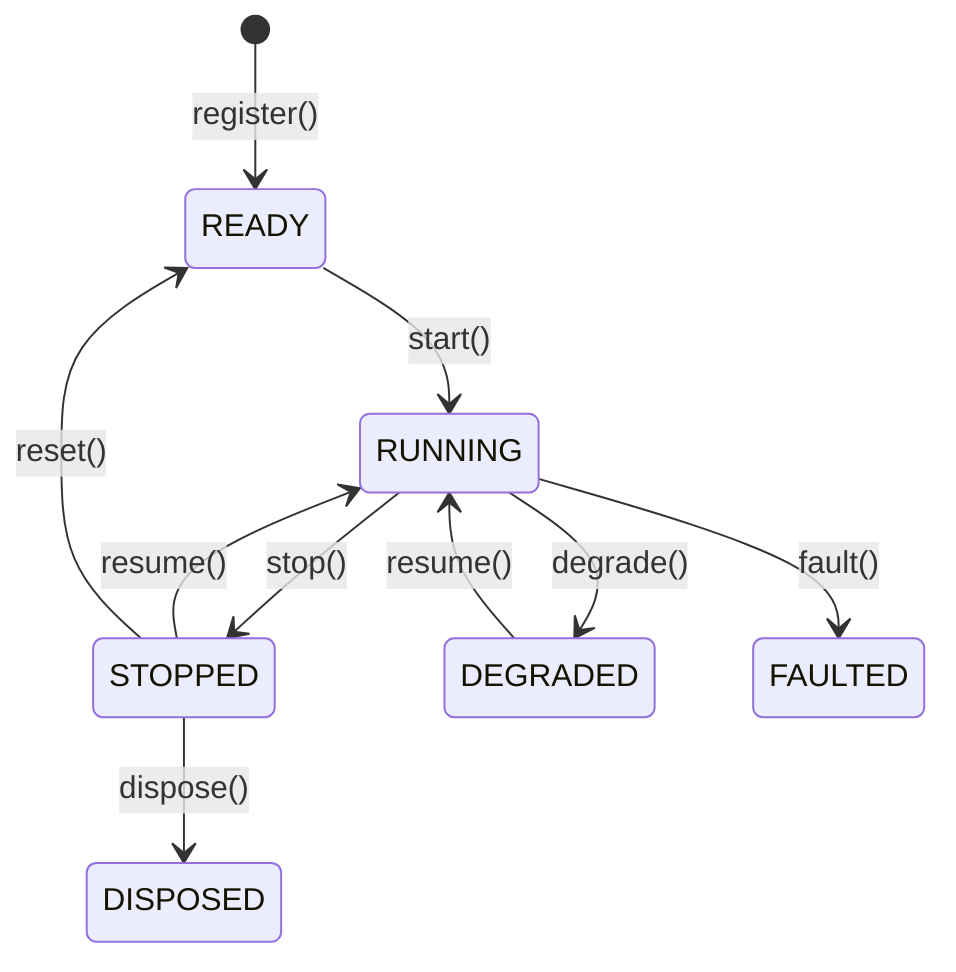

# Actors

A **data actor** receives requested and subscribed data, handles system events, and manages component state.
In Python, extend the `DataActor` class. In Rust, implement the `DataActor` trait. A strategy adds
order-management capabilities.

**Capabilities**:

- Market and custom data subscriptions and requests.
- Custom data and signal publishing.
- Event, timer, and alert handling.
- Cache access.
- Structured logging.

## Basic Python example

Actors support configuration through a pattern similar to strategies. Declare custom fields as keyword-only
arguments and accept `**_kwargs` so the base fields (`actor_id` and the log settings) pass through to
`DataActorConfig.__new__`, which reads them from the same call.

A positional argument would be matched against `actor_id` instead, raising a `TypeError`.

```python
from nautilus_trader.common import DataActor
from nautilus_trader.config import DataActorConfig
from nautilus_trader.model import Bar
from nautilus_trader.model import BarType


class MyActorConfig(DataActorConfig):
    def __init__(self, *, bar_type: BarType, **_kwargs) -> None:
        super().__init__()
        self.bar_type = bar_type


class MyActor(DataActor):
    def __init__(self, config: MyActorConfig) -> None:
        super().__init__(config)

        # Keep runtime state on the actor
        self.count_of_processed_bars: int = 0

    def on_start(self) -> None:
        # Subscribe to bars matching the configured bar type
        self.subscribe_bars(self.config.bar_type)

    def on_bar(self, bar: Bar) -> None:
        self.count_of_processed_bars += 1
```

## Actor configuration and IDs

Data actors can receive a `DataActorConfig` subclass. The base config accepts an optional `actor_id`. If you
supply an ID, the actor registers with that ID. Without an ID, a Python actor registers under its class name.

Give each instance an explicit `actor_id` when running more than one instance of the same actor, because a
duplicate ID is rejected at registration (a `RuntimeError` in Python).

Treat configuration as construction data for the actor. Read user-supplied settings through
`self.config`, and keep runtime state on the actor itself.

:::info Rust implementation
Rust actors store runtime identity and state in `DataActorCore`. Read the runtime ID through
`actor_id()` rather than expecting a generated ID to be written back into `DataActorConfig`.
A Rust actor without a configured `actor_id` registers as `DataActor` whatever its type, so give
each Rust actor an explicit `actor_id`.

Rust authors implement `DataActor` and use the facade methods on `self`.
`DataActorNative` is native-only access for runtime wiring and borrowed
core state. Import it only for same-binary performance paths or internal runtime wiring.
:::

## Lifecycle

Actors move through the main stable states shown below:



Main flow only: transitional states and less common valid edges are omitted. For actions with a
lifecycle handler, the actor reaches the destination state only after that handler succeeds.

Override these methods to hook into lifecycle events:

| Method         | When called                                                                                                            |
| -------------- | ---------------------------------------------------------------------------------------------------------------------- |
| `on_start()`   | Actor executes its start transition. Subscribe to data here.                                                           |
| `on_stop()`    | Actor executes its stop transition. Clean up actor-owned resources here.                                               |
| `on_resume()`  | Actor is resuming after it stopped or degraded.                                                                        |
| `on_reset()`   | Actor resets, including between backtest runs. The actor releases retained data subscriptions after the hook succeeds. |
| `on_degrade()` | Actor is entering a degraded state and may provide only partial functionality.                                         |
| `on_fault()`   | Actor is entering the faulted state after it encounters a fault.                                                       |
| `on_dispose()` | Actor is being disposed and must release its remaining resources.                                                      |

## Timers and alerts

Actors have access to a clock for scheduling:

```python
from datetime import timedelta

from nautilus_trader.common import TimeEvent


def on_start(self) -> None:
    self._schedule_clock_events()


def on_resume(self) -> None:
    self._schedule_clock_events()


def on_stop(self) -> None:
    self._cancel_clock_events()


def on_degrade(self) -> None:
    self._cancel_clock_events()


def _cancel_clock_events(self) -> None:
    self.clock.cancel_timer("my_actor.timer")
    self.clock.cancel_timer("my_actor.alert")


def _schedule_clock_events(self) -> None:
    # Set a recurring timer with a callback that fires every 5 seconds
    self.clock.set_timer(
        "my_actor.timer",
        timedelta(seconds=5),
        callback=self._on_timer,
    )

    # Set a one-time alert with a callback
    self.clock.set_time_alert(
        "my_actor.alert",
        self.clock.utc_now() + timedelta(minutes=1),
        callback=self._on_alert,
    )


def _on_timer(self, event: TimeEvent) -> None:
    self.log.info("Timer fired!")


def _on_alert(self, event: TimeEvent) -> None:
    self.log.info("Alert triggered!")
```

Pass a `callback` to direct `TimeEvent` objects to your own method. Without one, the actor runtime
connects the clock's registered default handler to `on_time_event()`.

Use `set_timer_zoned()` to schedule a recurring local time, such as 09:30 in New York across DST changes.
See the [calendar timer example](strategies.md#calendar-timers) for setup and delivery behavior.

When components share a clock:

- Use **explicit callbacks** to route events to the intended component.
- Use **unique timer names** within the clock's namespace. Registering the same name replaces the
  existing timer.

## System access

Actors have access to core system components:

| API                                         | Description                                          |
| ------------------------------------------- | ---------------------------------------------------- |
| `self.cache`                                | Shared state for instruments, orders, and positions. |
| `self.clock`                                | Current time and timer or alert scheduling.          |
| `self.log`                                  | Structured logging.                                  |
| `publish_data()` / `subscribe_data()`       | Structured custom data messaging.                    |
| `publish_signal()` / `subscribe_signal()`   | Lightweight alerts and notifications.                |
| `publish_message()`                         | Publish a Python object on an application topic.     |
| `subscribe_topic()` / `unsubscribe_topic()` | Manage Python object callbacks.                      |
| `subscribe_queue_state()`                   | Live runner queue pressure state changes.            |
| `subscribe_socket_state()`                  | Live socket transport state changes.                 |
| `reconnect_socket()`                        | Request recovery of one live socket endpoint.        |
| `unsubscribe_queue_state()`                 | Stop receiving runner queue pressure state changes.  |
| `unsubscribe_socket_state()`                | Stop receiving socket transport state changes.       |
| `on_queue_state()`                          | Handle a runner queue pressure state change.         |
| `on_socket_state()`                         | Handle a socket transport state change.              |

The Python `DataActor` and `Strategy` APIs do not expose `self.msgbus`. Use custom data for
structured payloads, signals for lightweight values, or
[topic messaging](message_bus.md#python-topic-messaging) for arbitrary in-process Python objects.

### Queue pressure state

Actors can subscribe to runner queue pressure state changes:

```rust tab="Rust"
use nautilus_common::{
    actor::DataActor,
    messages::system::QueueStateChanged,
};

impl DataActor for MyActor {
    fn on_start(&mut self) -> anyhow::Result<()> {
        self.subscribe_queue_state(None, Some(50));
        Ok(())
    }

    fn on_stop(&mut self) -> anyhow::Result<()> {
        self.unsubscribe_queue_state(None);
        Ok(())
    }

    fn on_queue_state(&mut self, event: &QueueStateChanged) -> anyhow::Result<()> {
        log::warn!(
            "Queue {:?} changed {:?} to {:?} at depth {}",
            event.channel,
            event.condition,
            event.state,
            event.queue_depth,
        );
        Ok(())
    }
}
```

```python tab="Python"
from nautilus_trader.common import QueueStateChanged


def on_start(self) -> None:
    self.subscribe_queue_state(priority=50)


def on_stop(self) -> None:
    self.unsubscribe_queue_state()


def on_queue_state(self, event: QueueStateChanged) -> None:
    self.log.warning(
        f"Queue {event.channel} changed {event.condition} to {event.state} "
        f"at depth {event.queue_depth}",
    )
```

#### Filters and delivery

The optional priority controls delivery order among matching subscribers. **Higher values run first.** A
second subscription does not change an existing priority. To change the priority, unsubscribe first, then
subscribe with the new priority.

Pass `channel` to select one runner channel, for example
`self.subscribe_queue_state(channel=SystemChannel.DATA_EVENTS)` in Python. Import `SystemChannel`
from `nautilus_trader.common`.

- Omitting `channel` subscribes to all monitored channels.
- To remove a subscription, pass the **same channel** to `unsubscribe_queue_state`. Omitting it
  removes only the unfiltered subscription.
- Overlapping subscriptions each invoke the callback for a matching event.

Runner queues are shared across clients, so they have no client filter.

#### Queue event contents

`QueueStateChanged` includes the trader ID, runner channel, queue condition, condition state, queue
depth, mean dispatch time, event ID, and timestamps. Delivery uses the typed in-process message bus
and has no external wire representation. See
[Queue pressure monitoring](live.md#queue-pressure-monitoring) for the trigger and clear semantics.

### Socket transport state

Actors can subscribe to socket state changes from live adapters that report them:

```rust tab="Rust"
use nautilus_common::{
    actor::DataActor,
    messages::system::SocketStateChanged,
};

impl DataActor for MyActor {
    fn on_start(&mut self) -> anyhow::Result<()> {
        self.subscribe_socket_state(None, None, Some(50));
        Ok(())
    }

    fn on_stop(&mut self) -> anyhow::Result<()> {
        self.unsubscribe_socket_state(None, None);
        Ok(())
    }

    fn on_socket_state(&mut self, event: &SocketStateChanged) -> anyhow::Result<()> {
        log::info!(
            "Socket {} for {} changed to {:?}",
            event.endpoint,
            event.client_id,
            event.state,
        );
        Ok(())
    }
}
```

```python tab="Python"
from nautilus_trader.common import SocketStateChanged


def on_start(self) -> None:
    self.subscribe_socket_state(priority=50)


def on_stop(self) -> None:
    self.unsubscribe_socket_state()


def on_socket_state(self, event: SocketStateChanged) -> None:
    self.log.info(
        f"Socket {event.endpoint} for {event.client_id} changed to {event.state}",
    )
```

#### Filters and delivery

The optional priority controls delivery order among matching subscribers. **Higher values run first.** A
second subscription does not change an existing priority. To change the priority, unsubscribe first, then
subscribe with the new priority.

Pass `client_id`, `endpoint`, or both to filter socket events. In Python,
`self.subscribe_socket_state(client_id=ClientId("BINANCE"), endpoint="binance-futures-market-streams")`
selects one transport. Import `ClientId` from `nautilus_trader.model`.

- Each omitted filter matches all values of that field.
- Supplied values match literally, including dots and wildcard characters.
- Pass the **same filters** to `unsubscribe_socket_state` to remove that subscription. Omitting both
  removes only the unfiltered subscription.
- Overlapping subscriptions each invoke the callback for a matching event.

#### Socket event contents

`SocketStateChanged` includes the trader ID, client ID, optional venue, stable endpoint label,
transport state, event ID, and timestamps. The endpoint is a non-secret logical label, not a raw
connection URL. `SocketState.DISCONNECTED` reports the loss of an active transport.

:::note
`SocketState.CONNECTED` reports **transport availability**, not authentication, subscription replay,
or adapter readiness.
:::

Delivery uses the typed in-process message bus and has no external wire representation. See
[Socket transport state](live.md#socket-transport-state) for supported adapters and the precise
connection edge semantics.

### Reconnect a socket endpoint

Live actors and strategies can request recovery of one endpoint without restarting its data or
execution client. Pass the `client_id` and the endpoint label reported by `SocketStateChanged`:

```rust tab="Rust"
use nautilus_common::actor::DataActor;
use nautilus_model::identifiers::ClientId;

impl MyActor {
    fn recover_market_socket(&self) -> anyhow::Result<()> {
        self.reconnect_socket(
            ClientId::from("POLYMARKET"),
            "polymarket-market-streams",
        )?;
        Ok(())
    }
}
```

```python tab="Python"
from nautilus_trader.model import ClientId


def recover_market_socket(self) -> None:
    self.reconnect_socket(
        client_id=ClientId("POLYMARKET"),
        endpoint="polymarket-market-streams",
    )
```

#### Observe recovery

:::note
This API is **fire-and-observe**. A successful return means the command passed local validation and
was queued. It does not acknowledge that the kernel accepted the request or that recovery completed.
:::

Subscribe with `subscribe_socket_state` using the same `client_id` and `endpoint` filters, then
inspect the `SocketStateChanged` events. An accepted request reports:

1. `SocketState.DISCONNECTED` as the transport enters reconnect mode.
1. `SocketState.CONNECTED` after transport recovery.

#### Request failures

- **Synchronous failures**: Invalid endpoint labels and unavailable or closed runner channels fail
  synchronously. Endpoint labels accept only ASCII letters, digits, `.`, `-`, and `_`. Pass a logical label
  rather than a raw URL.
- **Kernel rejections**: The kernel logs unknown clients, unsupported clients, unknown or ambiguous
  endpoints, duplicate requests, disconnecting transports, and closed transports. These rejections
  do not emit a socket state change or affect another endpoint.

## Data handling and callbacks

The system dispatches request responses separately from subscribed updates. The operation determines
which callback handles the data.

### Request responses and subscriptions

The system distinguishes between two data flows:

1. **Request responses**:
   - Received through methods like `request_bars()`, `request_quotes()`, etc.
   - Processed through type-specific batch handlers such as `on_historical_bars()` and
     `on_historical_quotes()`.
   - Custom data uses `on_historical_data()` once per response. A scalar `CustomData` arrives as
     that object, while a batch arrives as one list, including an empty list.
   - Used for initial data loading and historical analysis.

2. **Subscribed data**:
   - Received through methods like `subscribe_bars()`, `subscribe_quotes()`, etc.
   - Processed through specific handlers like `on_bar()`, `on_quote()`, etc.
   - Used for ongoing event processing.

### Historical request lists

Each historical request selects one data type. These methods accept a scalar or a non-empty list:

| Data                   | Request methods                                                      | Python argument |
| ---------------------- | -------------------------------------------------------------------- | --------------- |
| Instrument definitions | `request_instrument`                                                 | `instrument_id` |
| Quotes and trades      | `request_quotes`, `request_trades`                                   | `instrument_id` |
| Order books            | `request_book_snapshot`, `request_book_deltas`, `request_book_depth` | `instrument_id` |
| Funding rates          | `request_funding_rates`                                              | `instrument_id` |
| Bars                   | `request_bars`                                                       | `bar_type`      |

Rust accepts vectors, arrays, and slices as well as scalar values. Python keeps the singular keyword
for sequence inputs. Duplicate members are removed in first-occurrence order.

- IDs must share a venue unless `client_id` is explicit.
- Quote and trade requests with multiple IDs reject a record limit before dispatch.
- Multiple-member support depends on the adapter. Book, funding-rate, and bar requests require one member.

Databento supports lists for instrument definitions, quotes, and trades. Other adapter paths reject
unsupported lists with a clear error. Custom data, venue-wide instrument requests, option-chain
requests, and DeFi requests keep their existing inputs.

Invalid routing and multi-ID record limits fail in the request call (`ValueError` in Python,
`Err` in Rust). Unsupported lists reach `on_data_response` as a completed envelope with
`failure_reason` set. Catalog hits can still supply partial data.

### Historical completion

`on_data_response(response)` runs after the typed payload hook for each envelope. The envelope keeps
the root correlation ID, and `completed` marks the final envelope for that request.
When present, `sub_correlation_id` identifies the child request.

Requests with `params["time_range_generator"]` deliver each window's payload through the typed hook
and `on_data_response`, with `completed=False`. On success, the final envelope has an empty payload.
Its `params["data_count"]` reports the total count when nonzero.

Check `failure_reason` at completion. Operational failures preserve data from successful work. A
terminal envelope can have `data=None`; it then has no payload metadata and invokes no typed payload hook.

Submit a request for another data type from the completion hook. Each call has its own correlation ID.
For an actor with `instrument_ids` configured:

```python
def on_start(self):
    self.quotes_request_id = self.request_quotes(instrument_id=self.config.instrument_ids)


def on_data_response(self, response):
    if response.correlation_id != self.quotes_request_id or not response.completed:
        return
    if response.failure_reason is not None:
        self.log.error(response.failure_reason)
        return
    self.request_trades(instrument_id=self.config.instrument_ids)
```

#### Python callbacks and joins

Python actors and strategies accept an optional `callback` on historical request methods.
The callable receives the request ID as a string, matching the method's return value. It runs once
on terminal success or failure, after the typed payload hook and `on_data_response`, with that
request no longer pending. Intermediate envelopes do not invoke it. Callback exceptions retain their
tracebacks in the log and do not prevent other completions.

The callback does not receive the outcome; inspect or record `failure_reason` in `on_data_response`,
which runs first. A failed request's partial data still reaches the typed payload hooks.
Callbacks can submit follow-up requests. A successful reset or disposal, or a call to `fault()`,
discards unfinished callbacks and joins. If one happens during a response hook, that response's
callback is also discarded.

Use `request_join(request_ids, callback=None, request_id=None)` to wait for historical requests
already issued by the same actor or strategy:

```python
def on_start(self):
    quotes_id = self.request_quotes(instrument_id=self.config.instrument_ids)
    trades_id = self.request_trades(instrument_id=self.config.instrument_ids)
    self.request_join([quotes_id, trades_id], callback=self._on_history_complete)


def _on_history_complete(self, request_id):
    self.log.info(f"Historical requests completed: {request_id}")
```

A join follows the completion-group rules below and returns its own string ID. It coordinates
completion while each child retains its payload delivery; it does not merge or replay the data.
`request_join` and `is_pending_request` accept string IDs or `UUID4` objects. A join of completed
children can invoke its callback before `request_join` returns. Use the callback argument to identify
it, or supply a previously stored `request_id` to recognize it in `on_data_response`.

Inspect historical requests on the actor or strategy:

- `is_pending_request(request_id)` checks an individual request or join.
- `has_pending_requests()` checks whether any historical request or join is pending.
- `pending_requests()` returns a snapshot set of their string IDs, including callback-free requests.

#### Completion groups

In Rust, use `request_group(request_ids, request_id)` to receive one completion event after several requests finish.
Pass a non-empty list of distinct request IDs issued by the same actor. Completed requests and other
groups are valid children. Empty, duplicate, or unknown child IDs return an error without creating a
group. The supplied group ID must not match an existing request or group ID in the actor.

Each child keeps its own typed payload delivery. The group emits a terminal `on_data_response` envelope
with its own correlation ID and no payload. It waits for every child, including after a failure.
Its `failure_reason` identifies the first failed child in the supplied order, or is absent on success.

Groups notify after the active response hook returns. Groups made ready by the same child notify in
registration order. A group whose children have already completed can notify before `request_group`
returns. Store and supply a group UUID before the call if the hook needs to recognize that event:

```rust
use nautilus_core::UUID4;

let group_id = UUID4::new();
self.history_group = Some(group_id);
self.request_group(vec![quotes_id, trades_id], Some(group_id))?;
```

The runner queues follow-up requests submitted from completion hooks. Hook errors are
logged and do not prevent group completion. Request IDs and failure metadata remain available for
grouping until actor request cleanup; payload batches are not retained for grouping. Successful reset
or disposal, fault, and `release_subscriptions` clear this state and discard unfinished groups without
completion events. Python `request_join` uses the same lifecycle.

### Subscription lists

Actor and Strategy subscriptions accept one identifier or a non-empty collection. The matching
unsubscribe methods accept the same inputs.

| Data                   | Subscribe methods                                                             | Python argument |
| ---------------------- | ----------------------------------------------------------------------------- | --------------- |
| Instrument definitions | `subscribe_instrument`                                                        | `instrument_id` |
| Order books            | `subscribe_book_deltas`, `subscribe_book_depth`, `subscribe_book_at_interval` | `instrument_id` |
| Quotes and trades      | `subscribe_quotes`, `subscribe_trades`                                        | `instrument_id` |
| Mark and index prices  | `subscribe_mark_prices`, `subscribe_index_prices`                             | `instrument_id` |
| Funding rates          | `subscribe_funding_rates`                                                     | `instrument_id` |
| Instrument events      | `subscribe_instrument_status`, `subscribe_instrument_close`                   | `instrument_id` |
| Option Greeks          | `subscribe_option_greeks`                                                     | `instrument_id` |
| Bars                   | `subscribe_bars`                                                              | `bar_type`      |

Rust accepts scalar values, vectors, arrays, and slices. Python keeps the scalar keyword for both
scalar and sequence inputs. Duplicate IDs or full bar types are removed in first-occurrence order.
Different bar specifications for one instrument stay distinct.

```rust tab="Rust"
self.subscribe_quotes(instrument_id, None, None);
self.subscribe_quotes([first_id, second_id], None, None);
self.unsubscribe_quotes([first_id, second_id], None, None);
self.subscribe_trades([first_id, second_id], None, None);
```

```python tab="Python"
self.subscribe_quotes(instrument_id=instrument_id)
self.subscribe_quotes(instrument_id=[first_id, second_id])
self.unsubscribe_quotes(instrument_id=[first_id, second_id])
self.subscribe_trades(instrument_id=[first_id, second_id])
```

These subscription list rules do not change custom data, venue-wide `subscribe_instruments(Venue)`,
option-chain, or DeFi inputs.

#### Routing and validation

- **Venues**: IDs must share a venue unless `client_id` is explicit. This applies to subscribe and unsubscribe.
- **Book settings**: Settings apply to every ID. Unsubscribe with the original `is_parent` parameter and snapshot interval.
- **Trades**: The actor groups synthetic IDs separately from other IDs, even with an explicit client.

For non-external data clients, the actor also checks these subscription routes:

- Quote lists must share one route: client, synthetic, or aggregated spread. Spread routing requires
  `aggregate_spread_quotes=true` and a cached spread instrument.
- Instrument definitions, books, status, closes, and option Greeks reject any list with multiple IDs
  and a synthetic member.

External data clients handle those quote and synthetic route mixtures themselves.

Empty or missing-client mixed-venue lists fail before any subscription changes, including releases.
Unsupported subscription routes fail before ownership is retained or handlers are registered:

| API             | Validation failure |
| --------------- | ------------------ |
| Rust actor      | Panic              |
| `DataActorCore` | `Err`              |
| Python          | `ValueError`       |

Invalid Python elements raise `TypeError` before any subscription changes, including releases.

#### Bar ownership

The actor acquires one subscription per standard output bar type. The first full requested type
supplies the source; later source variants for that output do not acquire another owner.

Unsubscribe with the original full type or its `standard()` alias. Both release the original full type.

```rust tab="Rust"
self.subscribe_bars([first_bar_type, second_bar_type], None, None);
self.unsubscribe_bars([first_bar_type, second_bar_type], None, None);
```

```python tab="Python"
self.subscribe_bars(bar_type=[first_bar_type, second_bar_type])
self.unsubscribe_bars(bar_type=[first_bar_type, second_bar_type])
```

#### Ownership and releases

- The actor retains ownership per instrument and dispatches only newly acquired IDs. A shared feed
  stays active until its last owner releases it.
- Releases use the original route and parameters. Members acquired in separate calls remain in
  separate release commands; a scalar acquisition therefore has a scalar release.
- The client adapter keeps failed non-book final release commands for explicit retries. Actors do not
  retry failed releases automatically.

:::warning
Non-book releases remove one anonymous ownership claim per member. Balance subscribe and unsubscribe
calls. Repeating a whole release list after partial success is not guaranteed to have no further effects.
:::

#### Adapter delivery and failures

Compatible direct members reach native and Python hooks as one ordered list, with their parent command
ID and metadata. This applies to subscribe and unsubscribe; external MessageBus clients also receive lists.

Hooks reject unsupported lists before effects. Supported lists process independent members best effort
without rolling back accepted work. The engine logs preparation failures and forwards successfully
prepared members. Adapters can batch venue requests or iterate locally.

Internal and composite bars, book snapshots, spreads, and continuous futures acquire separate source
subscriptions. These derived commands keep their own ownership and can contain one member even when
the parent contains several.

Native hooks report synchronous acceptance:

| Hook result         | Accepted members                                        |
| ------------------- | ------------------------------------------------------- |
| `Ok(())`            | Every dispatched member                                 |
| `SubscriptionError` | Exact `instrument_ids_accepted` or `bar_types_accepted` |
| Other error         | None                                                    |

Bar outcomes use full bar types. Unsubscribe acceptance means successful release. Failure logs identify
unaccepted or unreleased members.

The Python bridge accepts the whole command when the runtime admits it to the client queue. Later async
hook failures are logged without per-member outcomes to the engine. Venue acknowledgements remain separate.

#### Catalog start times

With `streaming`, the engine infers catalog `start_ns` only when `params` does not supply it:

| Subscription       | Catalog start inference |
| ------------------ | ----------------------- |
| Single quote/trade | Per instrument          |
| Quote/trade list   | None                    |
| External bars      | Per full bar type       |

Pass explicit `start_ns` for one shared batch start. External bar types with equal effective parameters
stay in one list; different starts produce ordered subsets with the same command ID.

Releases can regroup those subsets using their original parameters, routes, and acquisition boundaries.
Scalar derived sources keep their own catalog inference.

#### Custom Rust integrations

- Override instrument methods with `impl IntoInstrumentIds` and bar methods with `impl IntoBarTypes`.
  Pass explicit `InstrumentId` or `BarType` values where `.into()` relied on scalar inference.
- Migrated `DataActorCore` list methods return `Result<()>`. Remove `topic` or `pattern` from migrated
  subscribe calls; the core derives topics from each member.
- Read `instrument_ids` or `bar_types` in commands. The serialized fields also carry lists, so upgrade
  producers and consumers together. Python command properties are read-only and return list copies.
- Hooks limited to one member can reject lists before effects with `single_instrument_id()` or
  `single_bar_type()`. Construct partial errors with `SubscriptionError::instruments` or `SubscriptionError::bars`.

### Callback handlers

Common data operations map to these handlers:

| Operation                       | Category     | Handler                         | Purpose                                    |
| ------------------------------- | ------------ | ------------------------------- | ------------------------------------------ |
| `subscribe_data()`              | Subscription | `on_data()`                     | Custom data updates.                       |
| `subscribe_signal()`            | Subscription | `on_signal()`                   | Signal updates.                            |
| `subscribe_instrument()`        | Subscription | `on_instrument()`               | Instrument definition updates.             |
| `subscribe_instruments()`       | Subscription | `on_instrument()`               | Instrument definition updates for a venue. |
| `subscribe_book_deltas()`       | Subscription | `on_book_deltas()`              | Order book deltas.                         |
| `subscribe_book_depth()`        | Subscription | `on_book_depth()`               | Order book depth snapshots.                |
| `subscribe_book_at_interval()`  | Subscription | `on_book()`                     | Order book snapshots at intervals.         |
| `subscribe_quotes()`            | Subscription | `on_quote()`                    | Quote updates.                             |
| `subscribe_trades()`            | Subscription | `on_trade()`                    | Trade updates.                             |
| `subscribe_mark_prices()`       | Subscription | `on_mark_price()`               | Mark price updates.                        |
| `subscribe_index_prices()`      | Subscription | `on_index_price()`              | Index price updates.                       |
| `subscribe_bars()`              | Subscription | `on_bar()`                      | Bar updates.                               |
| `subscribe_funding_rates()`     | Subscription | `on_funding_rate()`             | Funding rate updates.                      |
| `subscribe_instrument_status()` | Subscription | `on_instrument_status()`        | Instrument status updates.                 |
| `subscribe_instrument_close()`  | Subscription | `on_instrument_close()`         | Instrument close updates.                  |
| `subscribe_option_greeks()`     | Subscription | `on_option_greeks()`            | Option Greek updates.                      |
| `subscribe_option_chain()`      | Subscription | `on_option_chain()`             | Option chain slice snapshots.              |
| `request_data()`                | Request      | `on_historical_data()`          | Historical custom data.                    |
| `request_book_deltas()`         | Request      | `on_historical_book_deltas()`   | Historical order book deltas.              |
| `request_book_depth()`          | Request      | `on_historical_book_depth()`    | Historical order book depth.               |
| `request_book_snapshot()`       | Request      | `on_book()`                     | Order book snapshot.                       |
| `request_instrument()`          | Request      | `on_instrument()`               | Instrument definition.                     |
| `request_instruments()`         | Request      | `on_instrument()`               | Instrument definitions.                    |
| `request_quotes()`              | Request      | `on_historical_quotes()`        | Historical quotes.                         |
| `request_trades()`              | Request      | `on_historical_trades()`        | Historical trades.                         |
| `request_bars()`                | Request      | `on_historical_bars()`          | Historical bars.                           |
| `request_funding_rates()`       | Request      | `on_historical_funding_rates()` | Historical funding rates.                  |

### Request and subscription example

This example shows both request and subscription handling:

```python
from collections.abc import Sequence

from nautilus_trader.common import DataActor
from nautilus_trader.config import DataActorConfig
from nautilus_trader.model import Bar
from nautilus_trader.model import BarType


class MyActorConfig(DataActorConfig):
    def __init__(self, *, bar_type: BarType, **_kwargs) -> None:
        super().__init__()
        self.bar_type = bar_type


class MyActor(DataActor):
    def __init__(self, config: MyActorConfig) -> None:
        super().__init__(config)

    def on_start(self) -> None:
        # Limit the historical response, which is handled by on_historical_bars()
        self.request_bars(
            bar_type=self.config.bar_type,
            limit=100,
        )

        # Deliver subscribed updates to on_bar()
        self.subscribe_bars(self.config.bar_type)

    def on_historical_bars(self, bars: Sequence[Bar]) -> None:
        for bar in bars:
            self.log.info(f"Received historical bar: {bar}")

    def on_bar(self, bar: Bar) -> None:
        self.log.info(f"Received subscribed bar: {bar}")
```

Separate request and subscription handlers let an actor distinguish bootstrap data from ongoing updates. Use
historical bars to initialize indicators or baseline state. Apply different validation or logging to response
batches and individual subscribed updates.

:::tip
When debugging data flow, check the handler for your data source. If bars appear in the logs but not in
`on_bar()`, check `on_historical_bars()`. They might come from a request rather than a subscription.
:::

## Order event handling

Data actors do not manage orders or define order event callbacks. Handle order events in a `Strategy`
through its specific order callbacks or `on_order_event()`. Use custom data or signals to pass
derived values to a data actor when another component needs them. See
[Strategies: order management](strategies.md#order-management) for the callback list.

## Related guides

- [Strategies](strategies.md): Strategies extend actors with order-management capabilities.
- [Data](data/): Data types and subscriptions available to actors.
- [Message Bus](message_bus.md): The messaging system actors use for communication.
