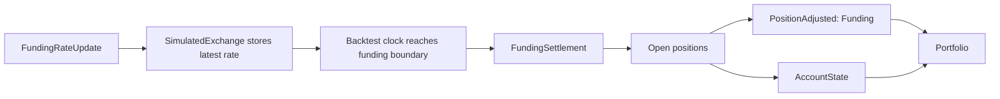

# Backtest Accounts and Margin

Backtest venues use simulated accounts for balances, margin, and funding settlement. For the full
account model and margin formulas, see [Accounting](../accounting.md).

## Funding

Backtests settle perpetual funding from `FundingRateUpdate` data at funding boundaries:

- With `next_funding_ns`, the simulated exchange stores the latest rate, and the backtest clock
  emits one `FundingSettlement` at that timestamp.
- Without `next_funding_ns`, the exchange settles only when `ts_event` lands on the `interval` boundary.
- Updates without a boundary stay strategy data and do not create funding payments.



The settlement adjusts the open position and the matching account balance before the portfolio
observes the new state.

`PositionAdjusted` stays the position accounting event. A **positive funding rate** debits long positions and
credits short positions. The adjustment changes realized PnL, and the matching account balance update records
the cash movement.

For a single-currency account whose base currency differs from the settlement currency, the balance update is
converted to the base currency at the cached mid exchange rate, while `PositionAdjusted` keeps the settlement
currency. A settlement without an exchange rate is handled like one without a settlement price.

## Accounts

Each backtest venue uses one of three `account_type` values: `CASH`, `MARGIN`, or `BETTING`. The low-level API
accepts model types directly:

```python
from decimal import Decimal

from nautilus_trader.backtest import BacktestEngine
from nautilus_trader.config import BacktestEngineConfig
from nautilus_trader.execution import MakerTakerFeeModel
from nautilus_trader.model import AccountType
from nautilus_trader.model import Money
from nautilus_trader.model import OmsType
from nautilus_trader.model import Venue

engine = BacktestEngine(BacktestEngineConfig())
engine.add_venue(
    venue=Venue("BINANCE"),
    oms_type=OmsType.NETTING,
    account_type=AccountType.CASH,
    starting_balances=[Money.from_str("10_000 USDT")],
    fee_model=MakerTakerFeeModel(
        maker_rate=Decimal("0.001"),
        taker_rate=Decimal("0.001"),
    ),
)
```

The high-level API accepts the same enum values but represents starting balances as strings:

```python
from decimal import Decimal

from nautilus_trader.config import BacktestVenueConfig
from nautilus_trader.execution import MakerTakerFeeModel
from nautilus_trader.model import AccountType
from nautilus_trader.model import BookType
from nautilus_trader.model import OmsType

venue = BacktestVenueConfig(
    name="SIM",
    oms_type=OmsType.NETTING,
    account_type=AccountType.CASH,
    book_type=BookType.L1_MBP,
    starting_balances=["10_000 USDT"],
    fee_model=MakerTakerFeeModel(
        maker_rate=Decimal("0"),
        taker_rate=Decimal("0"),
    ),
)
```

## Account history retention

Backtests retain every account state event by default. To limit this history, configure the execution
engine through `BacktestEngineConfig.exec_engine`:

```python
from nautilus_trader.config import BacktestEngineConfig
from nautilus_trader.config import ExecutionEngineConfig

config = BacktestEngineConfig(
    exec_engine=ExecutionEngineConfig(
        purge_account_events_interval_mins=60,
        purge_account_events_lookback_mins=1440,
    ),
)
```

At each purge, the account retains events newer than the lookback cutoff. Events exactly at the cutoff
are removed. The account always retains at least its latest event. The purge interval controls when
cleanup runs, so history can exceed the lookback between purges.

:::warning
Scheduled purge timers are [settlement points](execution-flow.md#latency-delayed-commands) that can release
latency-delayed commands during gaps in market data. This can change fill times, fill prices, and subsequent
financial results.
:::

- **Account state and Rust statistics**: Removing retained events leaves existing balances, stored
  starting balances, commissions, and position PnL intact. Rust portfolio statistics use separate daily equity
  snapshots, including flat days. See [return sources](../portfolio.md#returns-position-vs-portfolio)
  for snapshot requirements and the position-return fallback.
- **Account reports**: `generate_account_report` includes only retained account state events. Purging
  truncates the report without reconstructing removed rows from equity snapshots. Leave purging
  disabled when you need a full account balance report.
- **Python tearsheets**: Starting-balance displays use the first retained report row. When tearsheets
  fall back to account reports for returns, their series also depends on retained history. Keep full
  account history when you need these views to cover the entire run.
- **Memory**: Account-event purging does not remove orders, positions, loaded market data, or portfolio
  snapshots. It limits one source of retained memory, not total backtest memory.

See the [retention measurements](../../../crates/backtest/benches/BENCHMARKS.md#account-history-retention)
for the workload, memory comparison, and reproduction commands.

## Margin models

Margin accounts use `LeveragedMarginModel` by default. To reserve the instrument's fixed initial and
maintenance margin percentages without account leverage reductions, pass `StandardMarginModel`.

```python
from decimal import Decimal

from nautilus_trader.config import BacktestVenueConfig
from nautilus_trader.execution import MakerTakerFeeModel
from nautilus_trader.model import AccountType
from nautilus_trader.model import BookType
from nautilus_trader.model import OmsType
from nautilus_trader.model import StandardMarginModel

venue = BacktestVenueConfig(
    name="SIM",
    oms_type=OmsType.NETTING,
    account_type=AccountType.MARGIN,
    book_type=BookType.L1_MBP,
    starting_balances=["1_000_000 USD"],
    fee_model=MakerTakerFeeModel(
        maker_rate=Decimal("0"),
        taker_rate=Decimal("0"),
    ),
    margin_model=StandardMarginModel(),
)
```

`BacktestVenueConfig` accepts built-in and custom Python margin model objects directly. See
[Python model selection](../accounting.md#python-model-selection) for the callback contract.
The high-level configuration does not load custom margin models from class-path strings.
