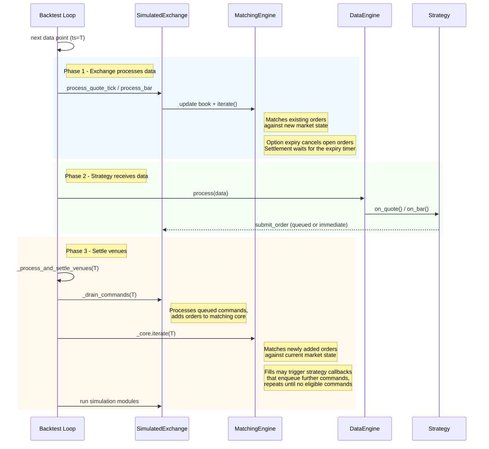

# Backtest Execution Flow

The backtest loop processes market state before strategy callbacks, then settles commands generated
at the same timestamp.

## Data and message sequencing

The main backtest loop processes new market data for order execution before the data engine
dispatches it to actors and strategies.

### Main loop flow

For each data point the engine runs three phases:

1. **Exchange processing**: The simulated exchange updates its order book from incoming market data and
   iterates the matching engine. This fills existing orders that match the new market state.
1. **Strategy callbacks**: The data engine dispatches the data point to actors and strategies through
   callbacks (for example, `on_quote`, `on_bar`). Strategies may submit, cancel, or modify orders during these
   callbacks.
1. **Venue settling**: The engine drains all queued venue commands, then iterates matching engines to fill
   newly submitted orders. It repeats until no command is eligible, so cascading orders (for example, a hedge
   submitted from `on_order_filled`) settle within the same timestamp. Earlier latency-delayed commands follow
   the instrument-scoped rules under [command settling](#command-settling).



The three phases ensure resting orders see the incoming market before newly submitted orders do.

Timer events use the same settle mechanism, batched by timestamp. All callbacks at timestamp T execute first.
Then venues settle for T before the clock advances to T+1. A timestamp containing only portfolio snapshot
timers does not release older latency-deferred commands.

For timers used by internally aggregated bars, see
[internal bar aggregation timing](bar-execution.md#internal-bar-aggregation-timing).

### Deferred option settlement

At an option's expiration timestamp, automatic expiry checks close its market, cancel open orders,
and reject new orders. Position settlement waits until all market data at that timestamp has been
processed, so settlement sees the latest underlying price available for that timestamp.

An explicit `InstrumentClose` with `InstrumentCloseType::ContractExpired` attempts settlement immediately.
Streaming batches must keep **all data for a timestamp together**. `BacktestNode` does this automatically.

`SimulatedVenueConfig.defer_option_settlement` defaults to `true`. The backtest engine schedules
settlement after all market data at the expiry timestamp, without waiting for the next timestamp.
When driving `SimulatedExchange` directly, schedule expiry processing after that timestamp's data,
or explicitly set `defer_option_settlement` to `false` for immediate settlement. Immediate settlement
can use an **older underlying price** if an update with the same timestamp has yet to be processed.

### Command settling

#### Same-cycle commands

An order fill can trigger a strategy callback that submits another order, such as a stop-loss from
`on_order_filled`. The engine drains venue command queues and processes commands generated by their events
until no command is eligible for the current cycle. Commands created at that timestamp and already due settle
within the same cycle, including zero-latency and same-tick commands for another instrument.

Simulation modules run once, after the command loop completes.

#### Latency-delayed commands

A [`LatencyModel`](../behavioral_models.md#custom-python-latency-models) places each command in the venue's
inflight queue with an arrival timestamp. Once a command is due, the settlement point determines whether
the engine releases it:

| Settlement point               | Due commands released                                                      |
| ------------------------------ | -------------------------------------------------------------------------- |
| Market data                    | Same-timestamp commands and older commands for the data's instrument.      |
| Portfolio snapshot timers only | Same-timestamp commands.                                                   |
| Other timer                    | All commands due at the timer timestamp.                                   |
| Funding-rate settlement        | All commands due at the funding settlement timestamp.                      |
| Shutdown drain                 | All commands due as the clock advances through the final inflight arrival. |

Market data for another instrument does not activate an older command against stale market state. Commands
with a future arrival timestamp stay in the inflight queue.

### Sandbox inbound latency

`SandboxExecutionClientConfig.latency_model` accepts a `StaticLatencyModel` or a
[Python `LatencyModel` subclass](../behavioral_models.md#custom-python-latency-models), following the
`fee_model` configuration pattern. It delays submits, modifies, and cancels by the
model's insert, update, and delete legs, respectively, before they reach the matching engine.

Venue-generated events (accepts, fills, cancels, expirations) are not delayed, so the model covers
only the **inbound leg**. Without a latency model, client behavior is unchanged.

```python
from decimal import Decimal

from nautilus_trader.adapters.sandbox import SandboxExecutionClientConfig
from nautilus_trader.execution import MakerTakerFeeModel
from nautilus_trader.execution import StaticLatencyModel
from nautilus_trader.model import Money
from nautilus_trader.model import Venue

config = SandboxExecutionClientConfig(
    venue=Venue("BINANCE"),
    starting_balances=[Money.from_str("10_000 USDT")],
    fee_model=MakerTakerFeeModel(
        maker_rate=Decimal("0.001"),
        taker_rate=Decimal("0.001"),
    ),
    latency_model=StaticLatencyModel(base_latency_nanos=1_000_000_000),
)
```

#### Event and command timing

Each client event uses the runner's execution channel in emission order, with or without a latency model:

- An order's `OrderSubmitted` precedes its venue events.
- A fill from market data precedes the response to any command released after it.

**Command timing**:

- A command applies before any market data processed after its due time. The client drains its queue before
  each tick. Its clock alert releases queued commands when no data flows.
- A command with a zero latency leg applies on arrival unless another command is already due and
  unreleased. In that case, it joins the queue behind that command.
- A cancel-all cancels only orders the venue has received. An order whose submit is still in transit stays
  untouched until the venue processes its submit.

#### Contingent orders

In both backtest and sandbox, contingent actions respect venue receipt:

- Fills, updates, expirations, and cancellations cannot activate, amend, or cancel a linked order
  the venue has not yet received.
- Each submit list arrives as a unit.
- An OTO child already received by the venue can still activate when its parent fills.
- A late submit is checked against its linked orders' current state and may be rejected if a linked
  order has already closed.
- Contingent quantity changes skipped before receipt are not replayed when the submit arrives. The order keeps
  its submitted quantity unless another applicable rule changes it.

#### Stopping with commands in flight

Stopping the client discards anything still in flight:

- A discarded submit, modify, or targeted cancel is rejected (`OrderRejected`, `OrderModifyRejected`,
  `OrderCancelRejected`) so its order does not stay `SUBMITTED` or pending forever. The sandbox
  generates no order status reports, so nothing else would resolve it.
- A discarded `CancelAllOrders` is dropped. The strategy marks no order `PENDING_CANCEL` for it,
  so no pending state needs releasing.

### Shutdown semantics

`BacktestEngine::end()` is separate from the `shutdown_on_error` configuration in
[backtest APIs and repeated runs](apis-and-runs.md#shutdown-on-error). It invokes each strategy's `on_stop`
handler, drains and settles any commands it emits (for example, `close_all_positions`, `cancel_all_orders`),
then stops the engines.

- `on_stop` commands use normal venue queuing and latency. They do not get priority over earlier
  inflight commands.
- If a pre-stop order reaches the venue before an `on_stop` cancel, it may still fill. A later
  reduce-only close can then reject if the fill changed net exposure.
- Strategies that need deterministic flattening should enter an exit-only state before stopping and
  avoid new opening orders while cancel and close commands are in-flight.
- Strategy event handlers do not fire for the resulting events because the strategy is already `Stopped`.
  `OrderFilled` and similar events log but bypass `on_order_filled` and related handlers. Logic that reacts to
  fills must run before `on_stop` returns.
- Simulation modules do not re-run at shutdown. `SimulationModule::process` runs once per timestamp. A second
  call would double-apply side effects like FX rollover interest.
- A `LatencyModel` adds its delay to trailing commands (those emitted on the final
  data tick or in `on_stop`). The shutdown path advances the engine clock to the latest inflight
  arrival timestamp so those commands still settle before the engines stop.

## Timer-only backtests

The backtest engine supports runs with timers but no market data. This is useful for scheduled
operations or testing timer-based logic. Timers fire in chronological order.

## Deterministic trade IDs

The simulated exchange (used by both backtest and sandbox execution) emits a deterministic `TradeId` for each
generated fill. The ID has the format `T-{hash:016x}-{count:03d}`. The 16-character hex is an FNV-1a hash of
`(venue, raw_id, ts_init)`. The trailing counter distinguishes multiple fills at the same `ts_init` (for
example, several legs of a bar-driven fill).

Deterministic trade IDs have these properties:

- **Deterministic across runs**: The same replayed data produces the same `TradeId` each time, keeping
  downstream dedup and golden-output comparisons stable.
- **Collision-safe across resets**: `ts_init` is pinned in backtest data and monotonic in live/sandbox. Thus,
  a `BacktestEngine.reset()` cannot mint a `TradeId` that collides with one already in the cache. The same
  guarantee applies to an in-memory `IdsGenerator` reset in a sandbox with persisted orders.
- **Bounded length**: The hash keeps the identifier under the 36-character `TradeId` cap regardless
  of venue name length.

The `use_random_ids` venue flag still governs `VenueOrderId` and `PositionId` generation, but
`TradeId` is always deterministic and is not affected by the flag.
