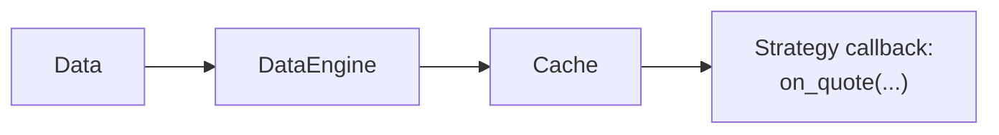

# Cache

The `Cache` is the central in-memory store for trading state and recent market data. Actors and
strategies use it to read data maintained by the data and execution engines or to share raw bytes
under application-defined keys.

The cache:

- Stores current order books and bounded histories of quotes, trades, bars, and other market data.
- Tracks orders, positions, accounts, instruments, and currencies until they are purged or reset.
- Shares caller-serialized data between components and persists it when a backing database is
  configured.

## How caching works

The engines add built-in data to the `Cache` as events flow through the system. Live adapters feed
events to the engine asynchronously, so the cache changes **when the engine processes an event**, not
when the adapter first receives it.

For quotes, trades, and bars, the `DataEngine` attempts to write to the `Cache` before publishing to
subscribers. After a successful write, the latest value is available by the time the strategy handler runs.
Order book deltas and depth snapshots are published directly. `BookUpdater` subscriptions maintain current
book state separately:



For the full step-by-step trace, see
[Data flow: life of a quote tick](architecture.md#data-flow-life-of-a-quote-tick).

### Basic example

Within a strategy, access the shared `Cache` through `self.cache`:

```python
def on_bar(self, bar: Bar) -> None:

    # Read recent bars; index 0 is the same bar after a successful cache write
    last_bar = self.cache.bar(self.bar_type, index=0)
    previous_bar = self.cache.bar(self.bar_type, index=1)
    third_last_bar = self.cache.bar(self.bar_type, index=2)

    # Read current position state
    if self.last_position_opened_id is not None:
        position = self.cache.position(self.last_position_opened_id)
        if position is not None and position.is_open:
            open_quantity = position.quantity

    # Read open orders for the instrument
    open_orders = self.cache.orders_open(instrument_id=self.instrument_id)
```

## Configuration

Use the `CacheConfig` class to configure the `Cache` behavior and capacity.
Pass it to a `BacktestEngine` or `LiveNode`, depending on the
[environment context](architecture.md#environment-contexts).

The same capacity settings apply in both environments:

```python
from nautilus_trader.config import BacktestEngineConfig
from nautilus_trader.config import CacheConfig
from nautilus_trader.config import LiveNodeConfig

# For backtesting
engine_config = BacktestEngineConfig(
    cache=CacheConfig(
        # Retain up to 10,000 entries per history per instrument
        tick_capacity=10_000,
        # Store last 5,000 bars per bar type
        bar_capacity=5_000,
    ),
)

# For live trading
node_config = LiveNodeConfig(
    cache=CacheConfig(
        tick_capacity=10_000,
        bar_capacity=5_000,
    ),
)
```

:::tip
By default, the `Cache` keeps up to 10,000 values in each per-instrument tick sequence and 10,000
bars for each bar type. These are separate limits, not combined totals. Set each capacity to a value
in `[1, 1_000_000]`. Increase them when a strategy needs a longer in-memory lookback and the
additional memory use is acceptable.
:::

### Configuration options

The `CacheConfig` type supports these parameters:

```rust
use nautilus_common::{cache::CacheConfig, enums::SerializationEncoding};

let config = CacheConfig {
    encoding: SerializationEncoding::MsgPack,
    timestamps_as_iso8601: false,
    buffer_interval_ms: None,
    bulk_read_batch_size: None,
    use_trader_prefix: true,
    use_instance_id: false,
    flush_on_start: false,
    drop_instruments_on_reset: true,
    tick_capacity: 10_000,
    bar_capacity: 10_000,
    persist_account_events: true,
    save_market_data: false,
};
```

:::note
Each bar type maintains its own capacity. For example, if you use both 1-minute and 5-minute bars,
each stores up to `bar_capacity` bars.
When `bar_capacity` is reached, the `Cache` automatically removes the oldest data.
:::

### Database configuration

Configure a database backing to recover successfully persisted, supported cache records after a
restart. Restorable records include general data, currencies, instruments, instrument closes,
accounts, orders, and positions. Startup does not restore bounded market-data histories or the
running process.

Instrument closes persist whenever a backing database is configured. `save_market_data` does not
gate them because they are recovery snapshots rather than bounded market-data history.

`CacheConfig` controls cache behavior. Connection settings belong to the concrete backing config,
such as `RedisCacheConfig` or `PostgresCacheConfig`.

A backing is a recovery mechanism, not a complete event archive or a synchronized distributed cache. Each node
owns its in-memory cache. Pointing multiple nodes at the same database namespace does not keep those caches
coherent.

Rust-native callers build a concrete database config and use the `CacheDatabaseFactory` trait to
construct the adapter passed into the system builder:

```rust
use nautilus_common::{
    cache::{CacheConfig, database::CacheDatabaseFactory},
    enums::SerializationEncoding,
};
use nautilus_infrastructure::redis::cache::RedisCacheConfig;

let config = CacheConfig {
    encoding: SerializationEncoding::MsgPack,
    timestamps_as_iso8601: true,
    buffer_interval_ms: Some(100),
    ..Default::default()
};

let database = RedisCacheConfig {
    host: Some("localhost".to_string()),
    port: Some(6379),
    connection_timeout: 2,
    response_timeout: 2,
    ..Default::default()
};

let cache_database = database
    .create(trader_id, instance_id, config.clone())
    .await?;
```

For a Rust-native live node, attach the adapter before startup:

```rust
let node_config = LiveNodeConfig {
    trader_id,
    ..Default::default()
};
let mut node = LiveNode::build("LiveNode".to_string(), Some(node_config))?;
node.set_cache_database(cache_database)?;
node.run().await?;
```

:::warning
With the default `LiveExecutionEngineConfig.load_cache = true`, the node restores persisted cache state
and rebuilds derived indexes before connecting clients or reconciling execution state. Setting
`CacheConfig.flush_on_start = true` clears the backing instead. A Postgres backing clears only the
node's trader rows (see below).
:::

Python passes the same database config to `LiveNodeBuilder.with_cache_database_factory`. The node
constructs and owns the adapter when it starts, so the connection opens only when the node runs:

```python
from nautilus_trader.common import Environment
from nautilus_trader.infrastructure import RedisCacheConfig
from nautilus_trader.live import LiveNode
from nautilus_trader.model import TraderId

node = (
    LiveNode.builder("LiveNode", TraderId("TRADER-001"), Environment.LIVE)
    .with_cache_database_factory(RedisCacheConfig(host="localhost", port=6379))
    .build()
)

try:
    node.run()
finally:
    node.dispose()
```

Pass `PostgresCacheConfig` instead to back cache data with Postgres. Postgres does not support actor
or strategy state persistence, so do not combine it with `load_state` or `save_state`. Both configs
come from `nautilus_trader.infrastructure`.

A Postgres backing is scoped to the node's trader ID, so several nodes can share one database:

- The node loads and writes only its own orders, positions, snapshots, and accounts, keyed by trader. Thus,
  two traders can reuse the same client order or position IDs.
- `flush_on_start` deletes only that trader's rows.
- Currencies, instruments, instrument closes, market data, and general data stay shared across traders.

:::warning
Upgrading an existing database is a required migration step. Account events persisted before trader scoping
have no trader, and nothing establishes which trader owns them, so connecting fails while any exist. This
blocks each node using that database. The error lists the affected accounts. Run `nautilus database init`,
then assign each account to its trader:

```bash
nautilus database assign-account --account-id <ACCOUNT_ID> --trader-id <TRADER_ID>
```

:::

:::warning
Always dispose the node. `dispose()` closes the backing, which flushes writes still held in the
buffer when `CacheConfig.buffer_interval_ms` is set. Returning straight from `run()` can drop them.
:::

## Using the cache

### Accessing market data

The `Cache` provides access to order books, quotes, trades, bars, and other market data. Cached
market-data histories use **reverse indexing**: index 0 is the latest entry, and index 1 is the previous
entry. The list accessors use the same order as the single-entry accessors.

| Data type           | History                              | Latest entry                       |
| ------------------- | ------------------------------------ | ---------------------------------- |
| Quotes              | `quotes(instrument_id)`              | `quote(instrument_id)`             |
| Trades              | `trades(instrument_id)`              | `trade(instrument_id)`             |
| Bars                | `bars(bar_type)`                     | `bar(bar_type)`                    |
| Mark prices         | `mark_prices(instrument_id)`         | `mark_price(instrument_id)`        |
| Index prices        | `index_prices(instrument_id)`        | `index_price(instrument_id)`       |
| Funding rates       | `funding_rates(instrument_id)`       | `funding_rate(instrument_id)`      |
| Instrument statuses | `instrument_statuses(instrument_id)` | `instrument_status(instrument_id)` |

Bars are ordered by `ts_event`, newest first. The other histories use reverse insertion order: the
most recently added entry comes first, even if it has an older timestamp. These histories are not
sorted by `ts_event` or `ts_init`.

Each history accessor returns a list, or `None` when no entries are cached for the key. For a nonempty
list, `[0]` is the latest entry. `[-1]` selects the oldest retained bar or the least recently inserted
entry in the other histories. Only `quote()`, `trade()`, and `bar()` accept an `index` argument.
They return `None` for a missing entry at a valid non-negative index. A negative index, or an integer
too large for the platform's unsigned index type, raises `OverflowError`. Negative indexing works on
the returned Python lists.

`CacheConfig.bar_capacity` limits the history for each bar type. `CacheConfig.tick_capacity` limits
each of the other histories per instrument. When a history reaches its capacity, a new insertion
removes the last entry.

#### Order book

The cache holds the current order book state for each instrument, rather than a history of book
updates. Instrument closes also keep one value per instrument: `instrument_close(instrument_id)`
returns the last inserted close, or `None` if absent.

```python
# Get the current order book. Returns OrderBook or None
book = self.cache.order_book(instrument_id)

# Check whether an order book exists
has_book = self.cache.has_order_book(instrument_id)

# Get the number of applied book updates
update_count = self.cache.book_update_count(instrument_id)
```

#### Quote ticks

```python
# Get quotes. Returns list[QuoteTick] or None
quotes = self.cache.quotes(instrument_id)

# Returns QuoteTick or None
latest_quote = self.cache.quote(instrument_id)

# Returns QuoteTick or None
second_last_quote = self.cache.quote(instrument_id, index=1)

# Check quote availability
quote_count = self.cache.quote_count(instrument_id)
has_quotes = self.cache.has_quote_ticks(instrument_id)
```

#### Trade ticks

```python
# Get trades. Returns list[TradeTick] or None
trades = self.cache.trades(instrument_id)

# Returns TradeTick or None
latest_trade = self.cache.trade(instrument_id)

# Returns TradeTick or None
second_last_trade = self.cache.trade(instrument_id, index=1)

# Check trade availability
trade_count = self.cache.trade_count(instrument_id)
has_trades = self.cache.has_trade_ticks(instrument_id)
```

Quotes and trades accumulate all ticks, including those sharing a timestamp.

#### Bar access

```python
# Get all cached bars for a bar type. Returns list[Bar] or None
bars = self.cache.bars(bar_type)

# Get the most recent bar. Returns Bar or None
latest_bar = self.cache.bar(bar_type)

# Get a historical bar by index (0 = most recent). Returns Bar or None
second_last_bar = self.cache.bar(bar_type, index=1)

# Check whether bars exist and get the count
bar_count = self.cache.bar_count(bar_type)
has_bars = self.cache.has_bars(bar_type)
```

To process bars from oldest to newest, reverse the returned list:

```python
bars_chronological = list(reversed(self.cache.bars(bar_type) or []))
```

Bars are kept **newest-first per bar type**. A newer bar is added. An older bar is skipped but is still
delivered in the response.

- **Time bars**: a bar with the same `ts_event` replaces the cached one (the later data wins), so duplicates
  from overlapping historical requests do not accumulate.
- **Non-time bars**: Renko bricks or volume bars emitted from a single update can legitimately share a
  `ts_event`. All bars at the same timestamp are kept, including any re-delivered by an overlapping request.
- **Internal request aggregation**: the cache inserts request-generated bars at their ordered position instead
  of skipping them. The cache is their only delivery path.

#### Price access

```python
from nautilus_trader.model import PriceType

# Get the current price by type. Returns Price or None
price = self.cache.price(
    instrument_id=instrument_id,
    # Options: BID, ASK, MID, LAST, MARK
    price_type=PriceType.MID,
)
```

#### Bar types

```python
from nautilus_trader.model import AggregationSource, PriceType

# Get all available bar types for an instrument. Returns list[BarType]
bar_types = self.cache.bar_types(
    instrument_id=instrument_id,
    # Options: BID, ASK, MID, LAST, MARK
    price_type=PriceType.LAST,
    aggregation_source=AggregationSource.EXTERNAL,
)
```

#### Simple example

```python
from nautilus_trader.model import Bar, BarType
from nautilus_trader.trading import Strategy


class MarketDataStrategy(Strategy):
    def on_start(self) -> None:

        # Subscribe to 1-minute bars
        self.bar_type = BarType.from_str(f"{self.instrument_id}-1-MINUTE-LAST-EXTERNAL")
        self.subscribe_bars(self.bar_type)

    def on_bar(self, bar: Bar) -> None:
        bars = (self.cache.bars(self.bar_type) or [])[:3]
        if len(bars) < 3:
            return

        # Access the latest three bars for analysis
        current_bar = bars[0]
        prev_bar = bars[1]
        prev_prev_bar = bars[2]

        # Read the latest quote and trade
        latest_quote = self.cache.quote(self.instrument_id)
        latest_trade = self.cache.trade(self.instrument_id)

        if latest_quote is not None:
            current_spread = latest_quote.ask_price - latest_quote.bid_price
            self.log.info(f"Current spread: {current_spread}")
```

### Trading objects

The `Cache` provides access to trading objects such as:

- Orders
- Positions
- Accounts
- Instruments

#### Orders

Query orders by venue, strategy, instrument, account, or order side.

##### Basic order access

```python
# Get a specific order by its client order ID
order = self.cache.order(ClientOrderId("O-123"))

# Get all orders in the system
orders = self.cache.orders()

# All orders for a specific venue
orders_for_venue = self.cache.orders(venue=venue)

# All orders for a specific strategy
orders_for_strategy = self.cache.orders(strategy_id=strategy_id)

# All orders for an instrument
orders_for_instrument = self.cache.orders(instrument_id=instrument_id)
```

##### Order state queries

```python
# Orders currently active at the venue
open_orders = self.cache.orders_open()

# Orders that have completed their lifecycle
closed_orders = self.cache.orders_closed()

# Orders being simulated locally by the system
emulated_orders = self.cache.orders_emulated()

# Orders submitted (or modified) to venue, but not yet confirmed
inflight_orders = self.cache.orders_inflight()

# Orders still managed locally (initialized, emulated, or released)
local_active_orders = [order for order in self.cache.orders() if order.is_active_local]

# Checks if an order with the given ID exists in the cache
exists = self.cache.order_exists(client_order_id)

# Checks if an order is currently open
is_open = self.cache.is_order_open(client_order_id)

# Checks if an order is closed
is_closed = self.cache.is_order_closed(client_order_id)

# Checks if an order is being simulated locally
is_emulated = self.cache.is_order_emulated(client_order_id)

# Checks if an order is submitted or modified, but not yet confirmed
is_inflight = self.cache.is_order_inflight(client_order_id)

# Checks if an order is still managed locally
order = self.cache.order(client_order_id)
is_active_local = order is not None and order.is_active_local
```

##### Order statistics

```python
# Number of open orders
open_count = self.cache.orders_open_count()

# Number of closed orders
closed_count = self.cache.orders_closed_count()

# Number of emulated orders
emulated_count = self.cache.orders_emulated_count()

# Number of inflight orders
inflight_count = self.cache.orders_inflight_count()

# Number of locally active orders (initialized, emulated, or released)
local_active_count = sum(order.is_active_local for order in self.cache.orders())

# Total number of orders in the system
total_count = self.cache.orders_total_count()

# Number of currently open BUY orders
buy_orders_count = self.cache.orders_open_count(side=OrderSide.BUY)

# Total number of orders for a given venue
venue_orders_count = self.cache.orders_total_count(venue=venue)
```

#### Positions

The `Cache` keeps positions until they are purged or reset and provides several ways to query them.

##### Position access

```python
# Get a specific position by its ID
position = self.cache.position(PositionId("P-123"))

# All positions in the system
all_positions = self.cache.positions()

# All currently open positions
open_positions = self.cache.positions_open()

# All closed positions
closed_positions = self.cache.positions_closed()

# Positions for a specific venue
venue_positions = self.cache.positions(venue=venue)

# Positions for a specific instrument
instrument_positions = self.cache.positions(instrument_id=instrument_id)

# Positions for a specific strategy
strategy_positions = self.cache.positions(strategy_id=strategy_id)

# All long positions
long_positions = self.cache.positions(side=PositionSide.LONG)
```

##### Position state queries

```python
# Checks if a position with the given ID exists
exists = self.cache.position_exists(position_id)

# Checks if a position is open
is_open = self.cache.is_position_open(position_id)

# Checks if a position is closed
is_closed = self.cache.is_position_closed(position_id)

# All orders related to a specific position
orders = self.cache.orders_for_position(position_id)

# Find the position associated with a specific order
position = self.cache.position_for_order(client_order_id)
```

##### Position statistics

```python
# Number of currently open positions
open_count = self.cache.positions_open_count()

# Number of closed positions
closed_count = self.cache.positions_closed_count()

# Total number of positions in the system
total_count = self.cache.positions_total_count()

# Number of open long positions
long_positions_count = self.cache.positions_open_count(side=PositionSide.LONG)

# Number of positions for a given instrument
instrument_positions_count = self.cache.positions_total_count(instrument_id=instrument_id)
```

#### Accounts

```python
# Retrieve account by ID
account = self.cache.account(account_id)

# Retrieve account for a specific venue
account = self.cache.account_for_venue(venue)

# Retrieve account ID for a venue
account_id = self.cache.account_id(venue)
```

A venue lookup resolves only when exactly one account is issued under the venue (the account ID prefix, such
as `BINANCE` in `BINANCE-001`). When several accounts share a venue, `account_for_venue` and `account_id`
return `None`. Get those accounts by ID.

#### Instruments

```python
# Retrieve a specific instrument by its ID
instrument = self.cache.instrument(instrument_id)

# Retrieve all instruments in the cache
all_instruments = self.cache.instruments()

# Instruments for a specific venue
venue_instruments = self.cache.instruments(venue=venue)

# Get all instrument IDs
instrument_ids = self.cache.instrument_ids()

# Get instrument IDs for a specific venue
venue_instrument_ids = self.cache.instrument_ids(venue=venue)
```

### Purging cached data

Long-running sessions accumulate closed orders, closed positions, account events, and
unused instruments. The cache exposes targeted and bulk purge methods so strategies and
the live trading engine can keep memory bounded without restarting the system.

#### Targeted purges

Use these to drop a single entity. Each refuses to purge while the entity is still active.

- `cache.purge_order(client_order_id)`: removes the order and each order-keyed index entry. Skips open orders.
- `cache.purge_position(position_id)`: removes the position, its snapshots, and position-keyed
  index entries. Skips open positions.
- `cache.purge_instrument(instrument_id)`: removes the instrument and its transient per-instrument
  maps (order book, quotes, trades, mark/index/funding prices, instrument status and close, greeks,
  and bars referencing the instrument). Skips while any associated order is non-terminal (anything
  that has not reached a closed state, including initialized, submitted, accepted, emulated,
  released, and inflight orders) or any associated position is non-closed. Cached orders and
  positions remain indexed until purged separately, preserving historical queries and realized PnL.

:::warning
`purge_instrument` is intended for actors and strategies with their own lifecycle logic
for deciding when an instrument is no longer needed. Purging an instrument that another
component still relies on causes missing instrument lookups and loses market-data
history. Active subscriptions belong to the data engine, so unsubscribe before purging
if you no longer want updates.
:::

#### Bulk purges

Use these to sweep older entries by age. They take the current timestamp and a buffer or
lookback window in seconds.

- `cache.purge_closed_orders(ts_now, buffer_secs)`: closed orders whose close timestamp is
  older than `buffer_secs`.
- `cache.purge_closed_positions(ts_now, buffer_secs)`: closed positions whose close timestamp
  is older than `buffer_secs`.
- `cache.purge_account_events(ts_now, lookback_secs)`: account state events older than
  `lookback_secs`. A value of `0` purges all events.

:::warning
Keep the closed source position of a virtual `HEDGING` flip while its order can still receive fills.
Purging it removes the history needed to route later fills and can cause the engine to reject them.
:::

#### Automatic purging in live trading

`LiveExecutionEngineConfig` schedules the bulk purges on a timer. All purge intervals default to `None`, which
disables the corresponding loop. Set an interval to enable a loop and set its buffer or lookback to control
how recent entries stay protected. This example uses the recommended starting values from the live-trading
configuration guide:

```python
from nautilus_trader.config import LiveExecutionEngineConfig

exec_engine = LiveExecutionEngineConfig(
    purge_closed_orders_interval_mins=15,
    purge_closed_orders_buffer_mins=60,
    purge_closed_positions_interval_mins=15,
    purge_closed_positions_buffer_mins=60,
    purge_account_events_interval_mins=15,
    purge_account_events_lookback_mins=60,
)
```

A shorter interval runs a purge more often, while a shorter buffer or lookback removes newer data.
Choose each value separately based on memory limits and the recent execution context needed for
reconciliation or analysis. See
[Configure live trading: memory management](../how_to/configure_live_trading.md) for the
full parameter reference.

:::note
The instrument purge has no automatic loop because the right time to drop an instrument
depends on strategy state, not age. Call `cache.purge_instrument` from the actor or
strategy that owns the instrument's lifecycle.
:::

### Custom data

The `Cache` stores raw bytes under application-defined string keys. Serialize values before adding
them and deserialize them after retrieval. Actors and strategies can use these entries to share
small amounts of application data.

#### Basic storage and retrieval

```python
# Store serialized data
self.cache.add(key="my_key", value=b"some binary data")

# Retrieve serialized data. Returns bytes or None
stored_data = self.cache.get("my_key")
```

:::warning
The `Cache` is not a general database. Use a dedicated store for large datasets or complex queries.
:::

## Best practices and common questions

### Cache vs. portfolio usage

The `Cache` and `Portfolio` serve different purposes:

**Cache**:

- Keeps execution objects, selected object histories, and bounded recent market data until purge or reset.
- Applies local state changes immediately, such as initializing an order before submission.
- Applies external events when the engine processes them, such as when an order fills.

**Portfolio**:

- Aggregates position, exposure, and account information.
- Computes current portfolio values from cached state and market prices.

```python
from nautilus_trader.model import PositionChanged
from nautilus_trader.trading import Strategy


class MyStrategy(Strategy):
    def on_position_changed(self, event: PositionChanged) -> None:

        # Read the fills retained by the cached position
        position = self.cache.position(event.position_id)
        fills = position.events() if position is not None else []

        # Read current aggregate exposure from the portfolio
        current_exposure = self.portfolio.net_exposure(event.instrument_id)
```

### Cache vs. strategy variables

Use cache entries for shared, serialized data and strategy variables for local working state.

**Cache storage**:

- Available to actors and strategies that share the system cache.
- Can persist general byte entries when a backing database is configured and writes complete.
- Stays available when an individual strategy resets, but a cache or execution-engine reset clears the
  in-memory entries.

**Strategy variables**:

- Keep typed, strategy-specific calculations and intermediate values encapsulated.
- Do not expose values to other components or persist them automatically.

Actor and strategy state persistence across process restarts uses separate `on_save` and `on_load`
hooks with a supported backing. See the
[cache database configuration](../how_to/configure_live_trading.md#cache-database-configuration)
section of the live-trading guide.

Serialize shared data before adding it to the cache:

```python
import json

from nautilus_trader.trading import Strategy


class MyStrategy(Strategy):
    def on_start(self) -> None:
        shared_data = {
            "last_reset": self.clock.timestamp_ns(),
            "trading_enabled": True,
        }
        self.cache.add("shared_strategy_info", json.dumps(shared_data).encode())
```

Another strategy can retrieve the cached data as follows:

```python
import json

from nautilus_trader.trading import Strategy


class AnotherStrategy(Strategy):
    def on_start(self) -> None:
        data_bytes = self.cache.get("shared_strategy_info")
        if data_bytes is not None:
            shared_data = json.loads(data_bytes)
            self.log.info(f"Shared data retrieved: {shared_data}")
```

## Related guides

- [Data](data/): Data types stored in the cache.
- [Strategies](strategies.md): Strategies access cache for market data and state.
- [Reports](reports.md): Generate reports from cached data.
