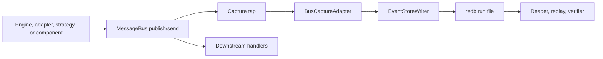
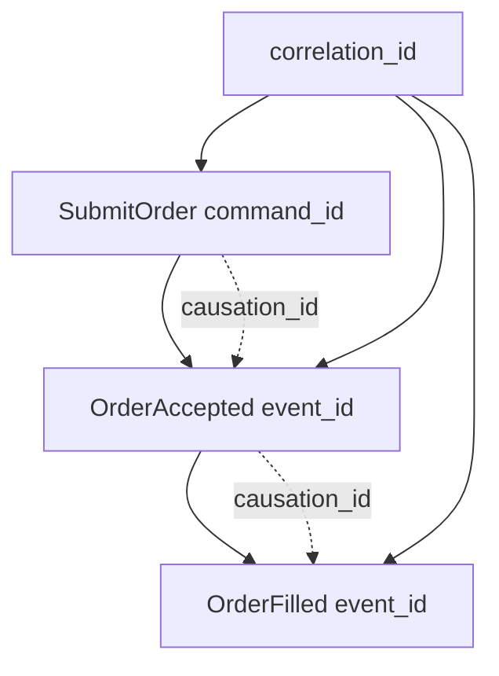
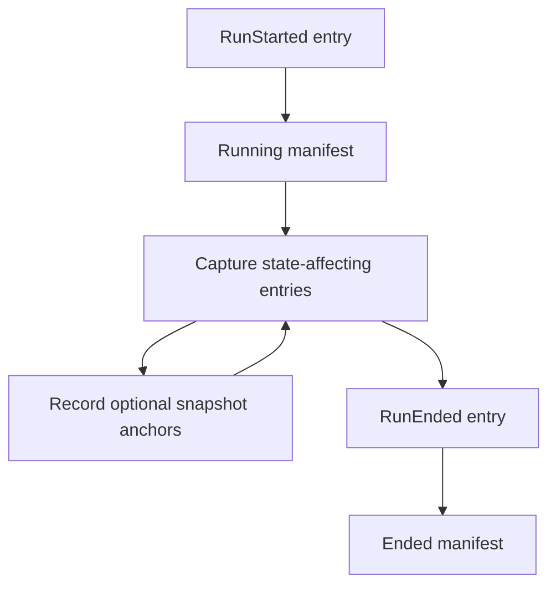
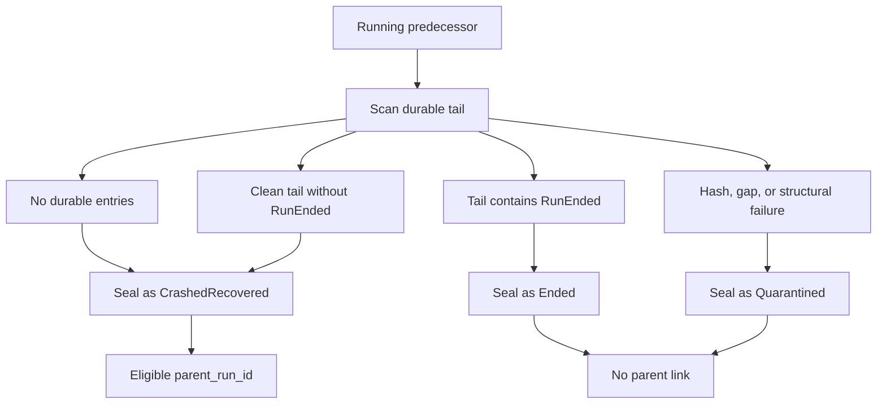
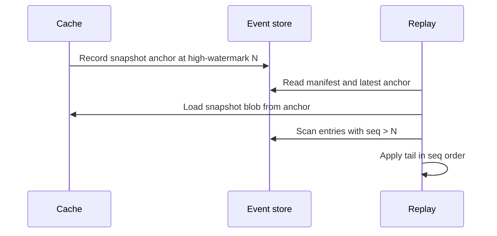

# Event Sourcing

Event sourcing gives NautilusTrader a durable, ordered record of the messages that change engine state. The
event store records those messages at the system boundary. Readers, replay tools, and verifiers then use the
same log to reconstruct what happened and to rebuild state.

**Core principles**:

- The event store is the durable authority for state-affecting history.
- The cache is a write-through projection, not the source of truth.
- Cache replay rebuilds state by applying captured history to cache-owned state.
- Market data stays in the data catalog. The event store records the messages that affect state.
- External I/O becomes replayable only when Nautilus captures it as commands, raw reports, or
  other state-affecting inputs.

:::note
Event-store capture, replay, verification, recovery, and retention planning have targeted test
coverage, but the API surface is still evolving. Treat this page as the design contract, and the
[`nautilus-event-store` README](https://github.com/nautechsystems/nautilus_trader/blob/develop/crates/event_store/README.md)
plus [docs.rs](https://docs.rs/nautilus-event-store) as the API reference.
:::

## Why event sourcing

The cache answers "what is true now". The event store answers "how did Nautilus get here". It gives readers,
replay tools, and verifiers a run-scoped history. That history explains past state without strategy logic,
venue queries, or the live cache.

The event store provides a durable basis to:

- Prove whether a sealed run is clean before replay or archive.
- Inspect the exact command, report, and event sequence behind an order or component intent.
- Rebuild cache state from captured history, including a snapshot anchor plus the run tail.
- Trace an intent through the engine-side messages that followed from it.
- Seal stale run files before the next run starts after a process exit or writer halt.

## Terms

- **Run**: one kernel session for one instance, binary, and config.
- **Entry**: one captured message plus replay metadata.
- `seq`: the per-run sequence assigned by the writer and used as replay order.
- **High-watermark**: the largest `seq` durably acknowledged by the backend.
- **Snapshot anchor**: the high-watermark recorded with a cache snapshot.
- **Headers**: correlation and causation metadata propagated with captured messages.

## What the store records

The event store records state-affecting message bus traffic for one trading instance and one run.
A run starts when the kernel starts and ends when the process stops cleanly or crashes.

**Captured entries include**:

- Execution commands such as submit, modify, and cancel.
- Data subscription commands that define the actor or strategy observation window.
- Fired time events and generated order, position, and account events.
- Raw venue execution reports before reconciliation synthesizes derived events.
- Reconciliation outputs produced from those raw reports.
- Request and response messages, or their audit-relevant metadata, that cross the bus and affect
  state.
- Run lifecycle entries such as `RunStarted` and `RunEnded`.

Streamed market-data observations stay in the data catalog. The event store records the command
stream, raw reports, generated events, and metadata needed to replay how the engine reacted to that
world.

Two capture rules distinguish data responses and instrument closes from streamed observations:

- **Data responses**: each response to an engine request is captured, including book, option-chain reference
  price, and custom-data responses. Only those listed under [Cache replay](#cache-replay) have rules that
  apply them back to cache state. The rest are inspection records.
- **Instrument closes**: each published `InstrumentClose` is captured because contract expiration settles
  positions.

## Boundaries

The event store is intentionally narrow:

- It does not replace the data catalog.
- It does not provide analytics or OLAP queries.
- It does not aggregate multiple trader instances into a consensus log.
- It does not yet define redaction, encryption-at-rest, or tamper evidence.

## Capture flow

Capture happens at the message bus dispatch boundary, so the tap sees each state-affecting message before
downstream handlers observe it.



Capture branches off the same dispatch that feeds downstream handlers, and readers only ever reach
the durable backend.

Capture is **asynchronous**, not an acceptance gate on dispatch. A successful capture enqueues the
entry to the writer. The writer thread then assigns the next `seq`, commits a batch, and advances
the high-watermark once the backend acknowledges durability.

Readers scan sealed or running backends through an interface with no append operations.

The writer takes entries over a bounded channel, with two distinct failure paths:

- **Backpressure**: a submit that stalls past the configured `halt_threshold` fires the halt
  signal. Backpressure never silently drops an accepted entry.
- **Backend commit failure**: the writer fires the halt signal, discards the pending batch, and
  ends its loop. Those entries never become durable.

:::warning
**Fail-stop does not interrupt the run**. The tap logs the failure, and the message still reaches
its handlers. Once halted, the tap stops recording, so the rest of that session runs uncaptured.

No runtime component polls the halt signal to stop the trader. The recovery sweep on the next boot
seals the run, using `CrashedRecovered` when its tail is clean.
:::

Some messages are expected to cross more than one tap-visible boundary:

- The execution engine sends an order event to the portfolio endpoint and publishes the same event
  on its strategy topic.
- Trading commands hop from strategy to risk to execution.

Duplicate dispatches of one message land within a single engine cycle. Thus, the capture adapter deduplicates
against a bounded window of recently captured message identities (event id, command id). Each logical message
becomes one entry, and replay does not apply the same event twice.

## Lifecycle options

`EventStoreConfig` is the serializable run policy. Process-local construction policy lives in
`EventStoreLifecycleOptions`, which advanced callers pass through
`EventStoreLifecycle::boot_with_options(...)`.

By default the lifecycle opens `RedbBackend` and installs the default encoder and data-marker
extractor registries. Lifecycle options replace any of the three:

- An encoder registry, or a factory that builds one per run, applied before the bus tap starts
  capture.
- A backend opener that returns any `EventStore` implementation for the new run.
- A data-marker extractor registry factory for the configured marker classes.

The backend opener is the simulation-safe path for memory capture. A DST harness or focused test can open
`MemoryBackend` through the normal lifecycle with the same bus tap and writer semantics. It can then read the
captured entries in-process after seal. With a `MemoryBackend` opener, capture needs no `redb` run file.

Under `cfg(madsim)`, the writer commits each submit synchronously, so the captured `seq` order is
deterministic.

## Entry model

Each event-store entry is one captured message plus metadata:

- `seq`: the per-run replay-order authority.
- `ts_init`: the domain timestamp on the captured message.
- `ts_publish`: the bus-accepted or writer-receive timestamp.
- `topic`: the bus topic or logical endpoint.
- `payload_type`: the encoded message type.
- `payload`: the encoded message bytes.
- `headers`: correlation and causation metadata.
- `entry_hash`: the canonical hash over the entry content.

`seq` orders replay. Timestamps help explain the run, but they do not override `seq`.

Secondary indices cover lookup by `client_order_id` and `venue_order_id`. A `correlation_id` index can be
added when a concrete inspection caller needs that lookup pattern. Until then, correlation scans can walk the
captured stream.

## Correlation model

The target model uses three identity levels to distinguish scope, lineage, and message identity:

- `correlation_id`: the logical workflow or chain.
- `causation_id`: the direct parent message that caused this message.
- `command_id`, `event_id`, or `report_id`: the identity of this specific message.



One `correlation_id` spans the whole workflow, while `causation_id` links each message to its direct
parent.

:::warning
**Header propagation is incomplete**, so most captured entries carry empty headers. Treat the
diagram above as the design contract, not as a description of what a captured run contains.

The default encoder registry registers extractors for trading commands, data commands, and data
responses. Those extractors forward whatever the message carries. In practice:

- **Data messages**: only data requests and data responses yield populated headers. A request contributes its
  `request_id`. A response carries a required `correlation_id`.
- **Trading commands**: in-tree producers leave `correlation_id` and `causation_id` unset.
- **Events and reports**: order, position, and account events, execution reports, and time events
  have no extractor.

:::

Where headers are populated, this lets operators ask two common questions:

- "Show everything in this workflow": filter or scan by `correlation_id`.
- "Show why this event happened": walk `causation_id` back to the direct parent.

## Run files and manifests

The default backend is `redb`. It stores one file per run under:

```text
<base>/<instance_id>/<run_id>.redb
```

Each run file contains:

- Entries keyed by `seq`.
- Secondary indices for order identifiers.
- A manifest written at run start and sealed at run end.
- An optional snapshot anchor for cache restore.

The manifest records the run identity and reproducibility inputs:

- Run identity:
  - `run_id`
  - `parent_run_id`
  - `instance_id`

- Build identity:
  - `binary_hash`
  - `schema_version`
  - `crate_versions`
  - `feature_flags`
  - `adapter_versions`

- Configuration identity:
  - `config_hash`
  - `registered_components`
  - `seed`

- Lifecycle state:
  - `start_ts_init`
  - `end_ts_init`
  - `high_watermark`
  - `status`

Run status is one of `Running`, `Ended`, `CrashedRecovered`, or `Quarantined`.

## Run lifecycle



A run opens with `RunStarted` and closes with `RunEnded`. Snapshot anchors are optional points recorded while
the manifest stays `Running`.

- `RunStarted` is the first entry of a fresh run. A repeated `open()` in the same process seals
  the current session before it starts a new run.
- While the manifest is `Running`, the bus tap records state-affecting entries and cache snapshots
  can record anchors against the durable high-watermark.
- A clean shutdown, kernel drop, or reset/rerun seal appends `RunEnded` and seals the manifest as
  `Ended`.
- A fail-stopped (halted) session skips the in-process seal. The recovery sweep on the next boot owns it. The
  halt signal is scoped to the run that fired it. A later `open()` re-arms a fresh signal, so one halt does
  not poison subsequent runs in the same process.

## Recovery sealing

A predecessor is an older run file for the same instance whose manifest still says `Running`. This
means the previous process did not finish the normal lifecycle, or the writer halted before the
manifest seal completed.



Boot recovery scans each `Running` predecessor and chooses a final manifest status from the durable
tail:

| Durable tail                              | Sealed status      | Eligible parent |
| ----------------------------------------- | ------------------ | --------------- |
| No entries                                | `CrashedRecovered` | Yes             |
| Clean, without `RunEnded`                 | `CrashedRecovered` | Yes             |
| Clean, ending in `RunEnded`               | `Ended`            | No              |
| Hash mismatch, gap, or structural failure | `Quarantined`      | No              |

The sweep never leaves the trader unbootable because one run file is damaged:

- **Repair**: after a hard kill (SIGKILL, OOM kill, or power loss), redb refuses to open the run
  file read-only. The listing falls back to a writable open, which performs redb's repair pass
  before recovery proceeds.
- **Skip and retry**: if a file still cannot be opened or lacks a manifest, recovery skips it and logs an
  error. Recovery retries that file on the next boot. Recovery and retention continue over the healthy runs.

Only `CrashedRecovered` predecessors become `parent_run_id`. A configured `replay_from_run_id`
overrides a recovered parent after validation.

The read-only verifier separately inspects sealed runs without mutating them and reports
`quarantine=not-performed`.

## Replay inputs

Replay follows one ordering rule: apply event-store entries in `seq` order. `ts_init` and
`ts_publish` explain when messages happened, but `seq` is the durable replay order.

The Rust replay-input API keeps planning separate from execution:

- Event-store-only replay inputs return entries only.
- Catalog-joined replay inputs add caller-selected catalog slices for context analysis.

Catalog planners take explicit `CatalogSliceSelector` values and a read-only `ReplayCatalog`:

- **Planning**: resolves catalog time bounds from the event-store scan unless the selector supplies explicit
  bounds. It reports missing catalog slices and preserves `seq` as the entry ordering authority.
- **Loading**: returns `ReplayInputs` with event-store entries in `seq` order and catalog records
  grouped under their selected slice.

Rust callers can enable the off-by-default `persistence` feature and wrap a `ParquetDataCatalog`
with `nautilus_event_store::ParquetReplayCatalog` to plan selected catalog files and
filename-derived intervals. The bridge loads `quotes`, `trades`, and `bars` into typed
`CatalogReplayRecord` values.

:::note
The persistence bridge is read-only: it uses catalog discovery and query APIs but **does not write
to the catalog**. Unsupported catalog classes fail loading until replay adds a typed payload
contract for that class.
:::

These APIs **do not**:

- Open live venue clients
- Run strategies or actors
- Re-run reconciliation
- Delete files
- Replay the clock registration/cancel lifecycle

## Cache replay

Kernel-managed replay uses `EventStoreConfig::replay_from_run_id`. When set, the kernel restores cache state
from the sealed run and records that run as the parent of the fresh child run. It skips live engines, clients,
startup, and venue reconciliation.

**Replay requirements**:

- Quarantined runs are rejected.
- Replay requires `load_state=true`. With it disabled, the kernel logs an error and returns without
  restoring the cache or opening a child run.

The cache replay loader is **state-only**. It restores the cache-owned snapshot, scans the event-store
tail in `seq` order, decodes supported cache-affecting payloads, and applies them directly to
`Cache`. Supported payloads include:

- Synthesized account, order, and position events
- Captured order lists
- Complete data responses for instruments, quotes, trades, funding rates, and bars
- Instrument closes, which settle binary-option positions as live execution does. A replayed fill
  or fill void after that settlement updates its order but not the settled position

The loader **does not**:

- Publish replayed entries to the live message bus
- Run strategy or actor code
- Query venues
- Run reconciliation
- Derive identifiers again
- Re-arm clocks

Fired `TimeEvent`s and raw venue reports are inspection records on this path. Replay applies the synthesized
order, position, and account events captured later in the run.

## Data marker sidecar

:::note
The marker sidecar is opt-in through `EventStoreConfig.data_markers` and stays off by default.
:::

Exact data delivery order is not inferred from catalog timestamps. The marker sidecar records data observed at
the message-bus dispatch boundary in `<base>/<instance_id>/<run_id>.markers.redb`, beside the event-store run.
It does not write full market-data payloads into `EventStoreEntry` rows.

The sidecar supports one audit claim. When marker capture is enabled, Nautilus observed data delivery in
`marker_seq` order at the bus boundary for that run. Each marker carries enough identity to join back to
candidate catalog rows. It cannot:

- Prove that catalog timestamps alone define bus order.
- Reconstruct a data point when the catalog row is absent or changed.
- Prove venue send order before Nautilus observed the message.
- Say anything about runs where marker capture was disabled.
- Guarantee that each observed data message produced a marker.

The sidecar trades completeness for isolation from the trading path, so it does not inherit the
entry writer's backpressure contract. A marker submit that finds the bounded channel full drops the
marker rather than stalling the caller or halting the run. Its sequence becomes part of a gap record:

- `Overflow`: a later submit flushes the dropped range.
- `WriterClosed`: the writer closes while the dropped range is still pending.

### Ordering and identity

Markers do not consume event-store `seq` values and do not create gaps in the entry table. Each marker has its
own monotonically increasing `marker_seq` plus `event_seq_before`, the largest event-store `seq` assigned
before the marker was observed. Event-store `seq` stays the replay-order authority for state-affecting
entries.

For sealed-run analysis:

- Derive the next event-store entry after a marker from `event_seq_before + 1`.
- Order markers that share the same `event_seq_before` by `marker_seq`.

The sidecar has two marker kinds:

- **Cursor snapshots**: `DataCursorSnapshot` is the default capture mode. Each snapshot records
  `marker_seq`, `event_seq_before`, `ts_init`, and the `StreamCursor` entries that advanced since
  the previous snapshot. A `StreamCursor` carries the stream `slot`, the highest `ts_init` seen
  in that slot (`ts_init_hi`), and the record `count`. A `StreamDictEntry` maps each `slot` to its
  `data_cls` (`BookDeltas`, `BookDepth`, `Quote`, `Trade`, `Bar`) and instrument `identifier`.
- **High-fidelity markers**: `HiFiMarker` is opt-in per instrument through `DataMarkerConfig.high_fidelity`.
  Each records `marker_seq`, `event_seq_before`, `slot`, `ts_event`, `ts_init`, `same_ts_ordinal`, and a
  32-byte `record_fingerprint` over the canonical typed row fields.

`same_ts_ordinal` and `record_fingerprint` disambiguate duplicate same-timestamp data without storing prices,
quantities, sizes, or MessagePack payloads. Two catalog rows can be byte-identical for the same key and
timestamp. In this case, the sidecar can prove that Nautilus observed two deliveries in a specific marker
order. It cannot name a unique physical catalog row after catalog compaction rewrites row order.

### Verification and replay boundaries

Marker verification proves that the `marker_seq` sequence is fully accounted for, counting recorded
gaps as coverage. **Read the gap records** to find what was dropped.

The stable contract is the marker schema, opt-in capture and reader primitives, marker sequence
verification, and catalog join rules. Analysis tools can build on that contract to select windows,
interpret venue-specific data, rank or cluster markers, present reports, and package run bundles.

With marker capture disabled, no data marker writer is installed. Cache replay and live restart do not read
this sidecar. Snapshot-tail replay still applies event-store entries in `seq` order. Live restart still boots
from cache-owned state plus the event-store parent link.

## Snapshot-anchored recovery

Cache snapshots are owned by the cache. The event store stores only the snapshot anchor. This contains the
high-watermark at snapshot time, an opaque cache-owned `blob_ref` naming the snapshot, and the cache-owned
`content_hash` for that blob.



Recovery loads the snapshot the anchor names, then applies only the entries after the anchor's
high-watermark.

Recovery cases are ordered by how far the message progressed:

| Failure point                        | Recovery behavior                                                |
| ------------------------------------ | ---------------------------------------------------------------- |
| Before enqueue                       | Message never reached writer, so producer retry policy applies.  |
| After enqueue, before commit         | In-flight batch not durable, so high-watermark does not advance. |
| After commit, before snapshot anchor | Load prior snapshot and replay tail.                             |
| After snapshot anchor                | Load latest snapshot and replay entries after anchor.            |

:::info
Live restart still uses snapshot-plus-reconcile. Event-store recovery becomes the live restart path only after
capture coverage and replay rules cover each state-affecting path.
:::

Replay correctness depends on four checks:

- Entries are addressed by immutable `seq` values.
- Writes reject out-of-order commits.
- Readers detect gaps inside the high-watermark.
- Snapshot replay plans reject anchors that point past the durable high-watermark.

## Retention planning

Retention uses whole run files as the reclaim unit. The event store exposes a non-destructive planner. It
lists sealed run manifests, inspects their latest snapshot-anchor status, and returns candidate run files. A
supervisor or operator process can reclaim those files later.

The planner supports three modes:

- `Full`: keep each sealed run and return no reclaim candidates.
- `Bounded { keep_last }`: keep the newest sealed runs and also keep at least one known-good
  restore point.
- `SnapshotAnchored`: reclaim only sealed runs older than the newest known-good restore point.

A known-good restore point is a sealed, non-`Quarantined` run with a valid snapshot anchor whose
high-watermark does not exceed the run's durable high-watermark. The planner compares against the
last entry on disk rather than the manifest's recorded value, so a tail-trimmed run cannot qualify
as a restore point.

**Retention safeguards**:

- `Running` runs are never listed as sealed runs or selected as reclaim candidates.
- Missing, corrupt, or invalid snapshot anchors do not count as restore points. The planner returns no
  candidates when it cannot prove that at least one structurally valid restore point stays.

**Validation limit**: the planner never loads the snapshot blob. Its check stops at the anchor, so
it cannot rule out a restore failure caused by a missing or altered blob.

## Integrity and verification

Each entry carries a canonical hash over its full content. Readers and verifiers recompute the hash and report
mismatches. The verifier also checks manifest/high-watermark status and validates secondary indices against
the entry table. It reports snapshot anchors that fail to decode or point past the durable high-watermark.

:::warning
A `clean` verdict proves structural integrity, not restorability or capture completeness:

- The verifier checks the snapshot anchor but never loads or hashes the blob it names. Thus, a run whose blob
  is missing or altered verifies clean and fails at restore. The retention planner picks restore points on the
  same anchor-only evidence.
- Marker verification counts recorded gaps as coverage, so a run that dropped markers under
  backpressure verifies clean.
- A run that fail-stopped mid-session verifies clean over what it did capture, and says nothing
  about the messages that followed the halt.

:::

Run verification is process-isolated. This matters because some corrupted `redb` files can panic
on open or first read, and release builds use `panic = "abort"`. The verifier runs the scan in a
worker subprocess so a bad file aborts the worker, not the caller.

Verify a sealed run file:

```bash
cargo run -p nautilus-event-store --bin verify -- ./event_store/trader-001/1700000000-cafe0001.redb
```

Clean output looks like:

```text
clean run_id=1700000000-cafe0001 status=Ended high_watermark=3 entries_scanned=3 markers=absent
```

Corrupt output includes `quarantine=not-performed`:

```text
corrupt run_id=1700000000-cafe0001 status=Ended high_watermark=3 entries_scanned=3 findings=1 marker_findings=0 markers=absent quarantine=not-performed
- hash mismatch at seq 2
```

The `markers=` field reports the sidecar scan:

| Value                | Meaning                                                                                             |
| -------------------- | --------------------------------------------------------------------------------------------------- |
| `absent`             | No `<run_id>.markers.redb` beside the run file.                                                     |
| `clean` or `corrupt` | Sidecar read with counts of scanned snapshots, high-fidelity markers, gaps, and dictionary entries. |
| `error`              | Sidecar present but could not be opened or scanned.                                                 |

Exit codes:

- `0`: the run is clean.
- `1`: the run has corrupt findings, or the worker aborted or timed out.
- `2`: the verifier could not open or run against the requested file.

Increase the worker timeout for a large sealed run:

```bash
env NAUTILUS_EVENT_STORE_VERIFY_TIMEOUT_SECS=120 \
    cargo run -p nautilus-event-store --bin verify -- ./event_store/trader-001/1700000000-cafe0001.redb
```

Read a sealed run from Rust:

```rust
use nautilus_event_store::{EventStoreReader, RedbBackend, ScanDirection};

fn inspect_run() -> Result<(), Box<dyn std::error::Error>> {
    let backend =
        RedbBackend::open_sealed_file("./event_store/trader-001/1700000000-cafe0001.redb")?;
    let reader = EventStoreReader::new(backend);
    let high_watermark = reader.high_watermark()?;

    for entry in reader.scan_range(1, high_watermark, ScanDirection::Forward) {
        let entry = entry?;
        println!("{} {}", entry.seq, entry.topic);
    }

    Ok(())
}
```

:::note
The verifier reports corruption but does not mutate run files. Quarantine is an operator or
supervisor policy.
:::

## Verification coverage

The event-store test suite pins these core correctness guarantees for the alpha surface:

- The default encoder registry covers the audited state-affecting capture surface.
- Fired `TimeEvent`s hit the installed event-store tap through `TimeEventHandler::run`.
- The writer halts under bounded backpressure instead of dropping accepted entries.
- Entry hash verification detects byte-level payload corruption.
- Process-isolated verification reports truncated or zero-tailed run files as corrupt.
- Cache replay reconstructs the same observed account, order, and position state as a live cache
  for generated captured event streams.
- The same order event dispatched across multiple bus boundaries is captured once.
- Snapshot anchors that fail to decode or point past the durable high-watermark surface as
  verifier findings instead of verifying clean.
- Catalog-joined replay input planning covers selected slices, missing slices, time bounds, and
  event-store `seq` ordering.
- Crash recovery seals `Running` predecessors as `Ended`, `CrashedRecovered`, or `Quarantined`
  based on the durable tail, and only `CrashedRecovered` runs become parents.
- Boot recovery repairs hard-crashed run files and skips unreadable ones instead of failing the
  sweep.

## Relationship to DST

The event store and [deterministic simulation testing](dst.md) (DST) solve different parts of
replay.

- The event store supplies the captured input history.
- DST controls scheduling, time, seeded randomness, and other in-scope nondeterminism.

Together they let a run reproduce engine behavior inside the deterministic simulation scope. The
manifest records the inputs that identify such a run alongside the captured log itself: `seed`,
`binary_hash`, `config_hash`, and `schema_version`.

Under `cfg(madsim)`, the writer commits synchronously instead of spawning its writer thread. When a simulation
harness supplies a `MemoryBackend` opener through lifecycle options, capture stays in-process and does not
require `redb` files. Redb stays the default durable backend outside that advanced options path.

Adapter network I/O stays outside bit-identical replay unless Nautilus captures the relevant raw inputs and
routes them through deterministic interfaces.
