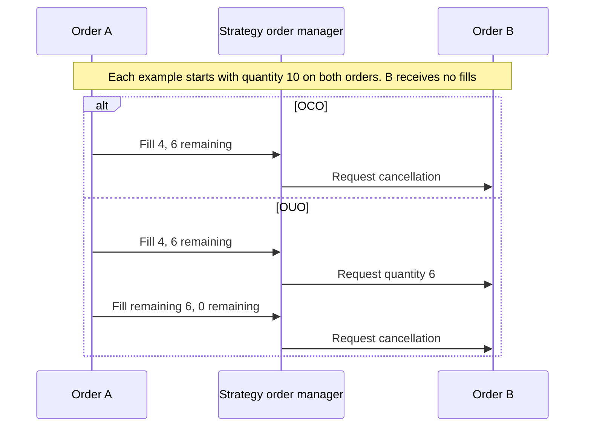
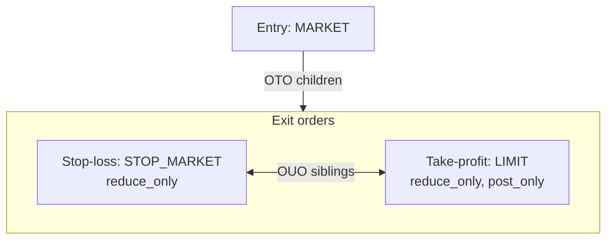

# Advanced orders

Order lists group related orders, while contingency metadata describes how fills, cancellations, or
updates should affect linked orders. The component that handles the list determines the behavior:
the backtest matching engine, local order emulator, live adapter and venue, or strategy code.

:::warning
An `OrderList` or `ContingencyType` does not guarantee that all live adapters or venues implement the
relationship. Check the target integration before relying on native contingency behavior.
:::

## Order lists

An order list groups contingent orders or a larger batch under one `order_list_id`. Orders in the list do not
need a contingency relationship. Their own metadata defines any relationship.

Production constructors require each order in a list to use the same venue. Orders may target different
instruments at that venue, such as pairs, calendar spreads, or multi-leg strategies.

The list takes its representative `instrument_id` from the first order. Consumers that need the
actual instrument must resolve each order individually.

**Validation failure**: if a member fails per-order risk validation, the risk engine stops submission
of the list and sends `OrderDenied` events for its [eligible members](../execution/policies.md#command-outcomes).
The failing member receives its validation-specific reason; other eligible members receive `ORDER_LIST_DENIED`.
Orders already dispatched by an earlier submission keep their lifecycle.

`DENIED` is terminal. To retry denied orders, create new orders with new client order IDs.

**Mixed-instrument caveats**:

- **Pre-trade checks**: Price precision, quantity precision, and GTD expiry use each order's own
  instrument.
- **Cumulative risk check**: Free balance, notional bounds, position-reducing exposure, and market
  data use the list's representative instrument. For a mixed list, this produces a single-instrument
  bound rather than per-instrument accuracy.
- **Cache lookups**: `cache.order_lists(instrument_id=...)` filters against the representative
  `instrument_id`. Lists containing other instruments will not match queries for those other instruments.
- **Position IDs**: The execution engine denies mixed-instrument lists when a `position_id` is
  supplied (a position belongs to a single instrument, regardless of OMS).
- **Adapter batching**: `submit_order_list` implementations vary. Some iterate orders per leg and resolve each
  order's own `instrument_id` against the venue API. Others still build the batch request around the list's
  representative `instrument_id` and will misroute non-first orders. Treat mixed-instrument lists as
  adapter-specific. Verify the target adapter's behavior before relying on it. Backtesting and
  strategy-managed routing avoid relying on an adapter's mixed-instrument batch behavior.

## Contingency types

- **OTO (One-Triggers-Other)**: A parent order releases one or more child orders after a configured
  fill condition.
- **OCO (One-Cancels-Other)**: A fill in one linked order requests cancellation of the others.
- **OUO (One-Updates-Other)**: A fill in one linked order requests a quantity update for the others.

:::info
These types correspond to FIX
[`ContingencyType <1385>`](https://www.onixs.biz/fix-dictionary/5.0.sp2/tagnum_1385.html).
:::

### Strategy-managed contingencies

Enable `StrategyConfig.manage_contingent_orders` to manage open OTO, OCO, and OUO relationships for
orders that are not active local. The strategy sends the resulting cancel and quantity-update
commands through the normal execution path before it calls the specific and aggregate user
order-event handlers.

The `OrderEmulator` always owns active-local orders. Enabling strategy management thus does not make the
strategy and emulator manage the same order.

The option manages non-active-local orders that are already open. It does not add native venue
support or submit a non-active-local OTO child.



For strategy-managed open orders, OCO requests cancellation on a partial fill; OUO first requests a
quantity update and requests cancellation when no quantity remains.

### One-Triggers-Other (OTO)

**OTO sequence**: an OTO relationship has two parts.

1. The parent order enters its execution path.
1. One or more child orders reference the parent and wait for the configured release condition.

The handler determines where the children wait. The backtest engine can hold them locally. A live adapter may
send native venue instructions, submit all legs, reject the list, or require the strategy to manage the
relationship.

#### Child sizing

Before the parent's first fill, strategy management propagates parent quantity updates to open,
non-active-local OTO children.

After filling starts, each parent event starts the child target at the parent's cumulative filled quantity.
For an execution spawn, this quantity includes fills from each order in the spawn.

**Position-linked sizing**: for a parent linked to a position, the manager then adjusts the target
in order.

1. For a non-spread parent with a reduce-only child, cap the total target at the child's filled
   quantity plus the current [commission-adjusted](../positions.md#base-currency-commissions)
   position quantity. This keeps the child's remaining quantity within the open position.
1. Round the total target down to a multiple of the child instrument's size increment.
1. When configured, treat a rounded target below the child instrument's minimum quantity as zero.

**Uncovered remainder**: the calculation does not round position or account state. A remaining
position too small to meet the child instrument's size increment and optional minimum quantity
stays open without reduce-only child coverage.

Spread parents skip the position cap because the execution engine does not create positions for
them. Non-reduce-only children also skip the cap. Both still use the child instrument's size rules.

#### Required sizing state

**Sizing prerequisites**: when a fill event, cached parent, or filled execution-spawn sibling
identifies a position, sizing requires the following.

- The parent and child instruments in the cache.
- A positive size increment for the child instrument.
- The linked position in the cache for a non-spread parent with a reduce-only child.
- Matching fill-event and cached position IDs when both are present.

A fill-event position ID that conflicts with cached ownership stops processing for that parent
event. Other missing sizing state leaves the affected child unchanged, and processing continues
with the remaining linked children.

#### Child lifecycle

**Target application**: parent events apply the validated target according to the child and parent state.

| Condition                                                 | Action                                                     |
| --------------------------------------------------------- | ---------------------------------------------------------- |
| Managed child has a different positive target             | Update its total quantity.                                 |
| Target is zero and parent or execution spawn stays active | Keep the child unchanged and wait for executable quantity. |
| Target is zero and parent or execution spawn closes       | Cancel the child.                                          |
| Child fills meet or exceed the positive target            | Cancel any remaining quantity.                             |
| Active-local child reaches an executable positive target  | The active-local emulator submits it once.                 |

A child fill or update does not recalculate the target immediately. The next parent event refreshes
it.

#### Trigger models

| Trigger model | Backtest release condition                                                |
| ------------- | ------------------------------------------------------------------------- |
| **Partial**   | Release children after the parent's first partial fill.                   |
| **Full**      | Release children after the parent's cumulative fill reaches its quantity. |

:::info
The default `BacktestVenueConfig` mode is `OtoTriggerMode.PARTIAL`. Set `oto_trigger_mode` to
`OtoTriggerMode.FULL` to wait for a complete fill. This setting controls release timing. It does not promise
pro rata child sizing. Verify child quantities when the parent fills partially.
:::

With `support_contingent_orders` enabled, the backtest venue sizes each child as if it covers the parent's
whole quantity. When the parent is modified or closes, each child's remaining quantity covers what the parent
can still hold. This excludes what the children have filled between them.

**Parent capacity**:

- Its quantity while it works.
- Its filled quantity once it is canceled, expires, or is reduced to its filled quantity.

**Child lifecycle**: under the same enabled setting, a modify grows children only when it raises
the parent's quantity, and closing the parent only shrinks them.

- Released children keep working for the parent's filled quantity. A child with nothing left to
  cover is canceled.
- Reducing the parent to its filled quantity completes it. Thus, `OtoTriggerMode.FULL` releases held children
  at that quantity. A child that fills on release leaves the others only what it did not fill.
- Canceling or expiring the parent cancels held children, so a partially filled parent that closes
  this way under `OtoTriggerMode.FULL` leaves its fills without children.

**Quantity units**: the venue compares quantities in the parent's units.

- Under a parent whose quantity is in base, a child that still holds a quote quantity is compared as base
  quantity. Conversion uses its price, then its trigger price if absent. If neither exists, it uses the best
  bid for a sell or the best ask for a buy in the parent's book. It holds that base quantity once the venue
  resizes it, and whenever the parent closes as above. Thus, a later conversion cannot take it past the
  parent's fills. Without such a price it is not resized.
- A parent that still holds a quote quantity, such as a stop that converts when it fills, resizes
  only the children that hold one too.
- Inverse instruments have no quote conversion, so their quantities compare as they are.
- A child on another instrument covers the parent's quantity one to one. Once its own instrument's engine
  matches it, the quantity it still needs to cover is rounded down to that instrument's size precision. At
  that point, a quote quantity converts by that instrument, at its own price or trigger price only.

Reduce-only children also track the position between these events, as described in
[Backtest reduce-only resizing](#backtest-reduce-only-resizing).

Reduce-only OTO children resize when a parent fill releases them, and again on later parent fills.
Fills awaiting cache delivery count toward the available position quantity. A released exit can fill
in the same bar when a later step in the [OHLC price simulation](../backtesting/bar-execution.md#ohlc-price-simulation)
reaches its matching price.

#### Enforcing a full-fill trigger in strategy code

**Full-fill fallback**: if the execution context does not provide the required full-fill behavior,
follow these steps.

1. Submit the parent order without contingent children.
1. Handle `OrderFilled` events for the parent.
1. Confirm the parent has reached `FILLED` status.
1. Submit the stop-loss, take-profit, or other child orders.

:::warning
Full-fill release leaves a partially filled position without its contingent exits until the parent
finishes. Partial release reduces that delay. In backtests, reduce-only children with enforcement
enabled track the available position quantity, subject to parent caps. Other children do not
automatically track each partial fill. Check quantities and adapter behavior before treating a child
as complete protection.
:::

### One-Cancels-Other (OCO)

**Cancellation ownership**: OCO cancellation depends on the component handling the relationship.

- **Backtest local matching**: a full or partial fill in one OCO order causes a best-effort request
  to cancel its open siblings.
- **Local order manager**: applies this behavior only while a sibling stays active local.
- **Strategy management enabled**: the strategy requests cancellation for open, non-active-local
  siblings. Otherwise, the adapter or venue determines cancellation behavior.

Another sibling can fill before cancellation completes.

### One-Updates-Other (OUO)

#### Updates after a sibling fill

**Sibling target**: in backtest local matching, a fill in one OUO order uses that order's remaining
quantity as the target for each open sibling.

- If the target is zero or the sibling's filled quantity already meets the target, cancel the sibling.
- Otherwise, update the sibling's quantity when needed.

This behavior suits equal-sized peers and does not preserve a ratio between unequal starting
quantities. With strategy management enabled, the strategy applies the same update or cancellation
behavior to open, non-active-local siblings. Otherwise, live behavior depends on adapter and venue
support.

#### Backtest reduce-only resizing

With reduce-only enforcement enabled, a fill can resize resting reduce-only orders to the available
position quantity, subject to parent caps.

**Eligible siblings**: when contingent-order support is also enabled, a resized OUO order propagates
its remaining quantity to siblings that meet both conditions.

- Open and not active local.
- Passive orders resting on the same instrument's book.

**Sibling quantities**: siblings do not need to be `reduce_only`. Each sibling's quantity update
follows these rules.

- Add the sibling's prior fills to the propagated remaining quantity to get its total quantity.
- Apply the sibling's own cached parent's filled-quantity cap, when available.
- Never reduce the total below the sibling's prior fills.

The order already being filled keeps its active fill loop's quantity rules. This propagation does not trigger
matching itself.

Resized quantities are in base. An order that still holds a quote quantity (such as an untriggered stop) takes
its resized quantity in base. Thus, its trigger does not convert it again. Inverse instruments have no quote
conversion, so the order keeps its quantity denomination.

#### Backtest cancellation at zero capacity

**Zero capacity**: with reduce-only enforcement and contingent-order support enabled, apply these rules.

- When the reduce-only order has no remaining capacity, cancel it and its eligible siblings without
  resizing the siblings. This also covers siblings whose acceptance event is still awaiting delivery.
- When a sibling exhausts only its own parent allowance, resize it to its filled quantity, then cancel it.

## Constructing contingent orders

Use `OrderFactory.bracket` to construct a bracket's contingency metadata.

**Grouping existing orders**:

- **Rust**: `self.order().create_list(...)` assigns a fresh `order_list_id` to the group.
- **Python**: pass a plain list to `self.submit_order_list(...)`, which creates an `OrderList` when
  needed.

**Validation limits**: these grouping paths do not create parent or linked-order relationships.
The model enforces only part of the remaining consistency.

- A contingent order must have at least one `linked_order_id`.
- A child identifies its parent through `parent_order_id`.
- Rust `create_list` requires a non-empty list whose orders use one venue.
- `OrderList.validate` checks for non-empty, unique client order IDs when a strategy submits the
  list.
- `OrderList.validate` does not verify shared `order_list_id` values, parent references, or other
  cross-field relationships.

Modification, cancellation, and rejection behavior depends on the component managing the contingency. Do not
assume a parent update or cancellation cascades in all live integrations.

:::warning
Handle `OrderDenied` and `OrderRejected` events for each leg. Adapter or venue failures can affect legs
independently and leave a position without its intended protection.
:::

## Bracket orders

Bracket orders combine an entry with take-profit and stop-loss children. By default,
`OrderFactory.bracket` creates a `MARKET` entry, a `LIMIT` take-profit, and a `STOP_MARKET`
stop-loss. It marks the entry with an `OTO` contingency, marks both exits `reduce_only`, and links
the exits with an `OUO` contingency. The default `LIMIT` take-profit is also `post_only`.

The factory creates the orders and their relationship metadata. The execution context determines
whether children wait locally, use a native venue instruction, enter the venue with the parent, or
require manual strategy handling.



Default bracket metadata connects the entry to both exits with OTO and links the exits to each other
with OUO.

Create brackets with
[`OrderFactory`](/docs/python-api-latest/common.html#nautilus_trader.common.OrderFactory), which
also supports different entry and exit types, trigger settings, and execution instructions.

**Example**: bracket a *Market* entry to BUY 10 ETHUSDT-PERP contracts. Use a take-profit *Limit* at 3,300
USDT and a stop-loss *Stop-Market* with a trigger at 2,800 USDT.

```rust tab="Rust"
use nautilus_model::{
    enums::OrderSide,
    identifiers::InstrumentId,
    types::{Price, Quantity},
};

// `bracket()` returns a `bon` builder; finalize with `.call()`.
// The result is a `Vec<OrderAny>` ordered as [entry, stop-loss, take-profit].
let orders = self
    .order()
    .bracket()
    .instrument_id(InstrumentId::from("ETHUSDT-PERP.BINANCE"))
    .order_side(OrderSide::Buy)
    .quantity(Quantity::from(10))
    .tp_price(Price::from("3300.00"))         // take-profit LIMIT (default)
    .sl_trigger_price(Price::from("2800.00")) // stop-loss STOP_MARKET (default)
    .call();
```

```python tab="Python"
from nautilus_trader.model import InstrumentId
from nautilus_trader.model import OrderSide
from nautilus_trader.model import Price
from nautilus_trader.model import Quantity

orders = self.order_factory.bracket(
    instrument_id=InstrumentId.from_str("ETHUSDT-PERP.BINANCE"),
    order_side=OrderSide.BUY,
    quantity=Quantity.from_int(10),
    tp_price=Price.from_str("3300.00"),  # <-- take-profit LIMIT (default)
    sl_trigger_price=Price.from_str("2800.00"),  # <-- stop-loss STOP_MARKET (default)
)
```

:::warning
Some venues reserve margin for bracket legs. Check the venue's margin rules and handle a child
rejection after the entry fills.
:::

## Related guides

- [Orders](index.md) - Order concepts, execution instructions, and the order factory.
- [Emulated orders](emulated.md) - Emulating order types on venues without native support.
- [Execution](../execution/) - Order execution and fill handling.
