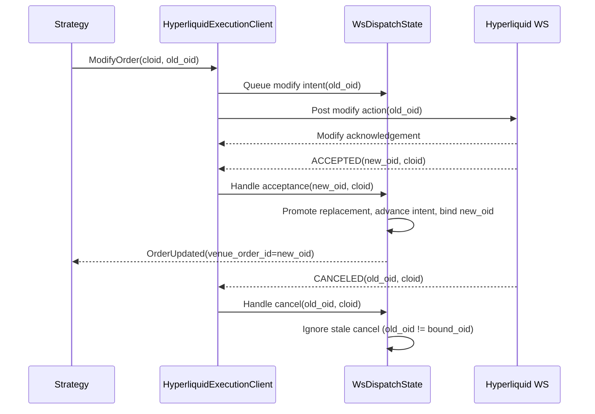

# Hyperliquid

[Hyperliquid](https://hyperliquid.gitbook.io/hyperliquid-docs) is a decentralized perpetual futures
and spot exchange on Hyperliquid L1, a blockchain built for trading. Its HyperCore order book and
matching engine run fully on-chain. This adapter provides live market data and order execution.

## Overview

The Rust adapter exposes Python bindings and connects directly to Hyperliquid's REST and WebSocket
APIs, with no external client libraries:

- `HyperliquidHttpClient`: HTTP API connectivity, instrument loading and parsing, and reconciliation reports.
- `HyperliquidWebSocketClient`: WebSocket API connectivity for Rust callers.
- `HyperliquidDataClient`: Market data feed manager.
- `HyperliquidExecutionClient`: Account management and trade execution gateway.
- `HyperliquidDataClientFactory`: Factory for Hyperliquid data clients (used by the live node builder).
- `HyperliquidExecutionClientFactory`: Factory for Hyperliquid execution clients (used by the live node builder).

:::note
Configure a [live trading node](#live-node-configuration) to use these components together.
Direct client access is available for lower-level API calls.
:::

## Examples

- [Python examples](https://github.com/nautechsystems/nautilus_trader/tree/develop/examples/live/hyperliquid/)
- [Rust examples](https://github.com/nautechsystems/nautilus_trader/tree/develop/crates/adapters/hyperliquid/examples/)

## Builder code attribution

Mainnet orders carry the NautilusTrader builder code at a **zero fee rate**. Attribution adds no
trading cost and helps us measure usage and prioritize maintenance. Users who attribute order flow
at scale may qualify for direct support through the [Institutional](https://nautilustrader.io/institutional/) tier.

You may opt out of attribution with `include_builder_attribution: false` in serialized config,
or `include_builder_attribution=False` in Python.

Orders omit the builder address in these cases:

- **Testnet**: Orders never include the builder. Testnet rejects unapproved builder addresses,
  and faucet-funded wallets typically have no approval.
- **Vault trading** (`vault_address` configured): Vaults cannot approve builder fees, so including
  the address would cause rejection.
- **Attribution disabled** (`include_builder_attribution=False`).

```python
from nautilus_trader.adapters.hyperliquid import HyperliquidExecutionClientConfig

config = HyperliquidExecutionClientConfig(
    include_builder_attribution=False,
)
```

### Builder fee approval

Orders require a one-time `ApproveBuilderFee` approval to carry the builder address:

- Without prior approval, orders are rejected with `Builder fee has not been approved`.
  Any prior approval, including 0%, satisfies the check.
- Approval requires the master wallet's private key, which agent (API) wallet setups do not give
  the adapter. Run the approval script once; execution-client startup does not run it.
- A 0% maximum permits attribution without charging builder fees. Raising it requires a new approval you sign.

Run the approval script once per wallet (reads `HYPERLIQUID_PK`, or `HYPERLIQUID_TESTNET_PK`
with `HYPERLIQUID_TESTNET=true`):

```bash
cargo run -p nautilus-hyperliquid --bin hyperliquid-builder-fee-approve
```

Or from Python:

```python
from nautilus_trader.adapters.hyperliquid import builder_fee_approve

builder_fee_approve()
```

### Revoking the approval

Revocation caps a previously approved builder fee at 0%, including approvals from versions that charged fees.
It keeps the approval record, so attribution continues unless you disable `include_builder_attribution`.

```bash
cargo run -p nautilus-hyperliquid --bin hyperliquid-builder-fee-revoke
```

Or from Python:

```python
from nautilus_trader.adapters.hyperliquid import builder_fee_revoke

builder_fee_revoke()
```

The approval and revocation scripts and Python functions accept `HYPERLIQUID_TESTNET=true` or `1`
for testnet, or `false` or `0` for mainnet (the default when unset). Boolean words are case-insensitive.
They reject other values, including empty strings, before signing a request.

The Rust scripts show an action summary and wait for Enter before signing. Abort with `Ctrl+C` if the
summary is wrong, or append `-- --yes` to `cargo run` to skip the prompt. Python calls do not prompt;
review the active environment variables before calling them.

## Testnet setup

Test strategies with mock funds on Hyperliquid testnet.

:::info
**Mainnet deposit required.** The testnet faucet only serves wallet addresses that have deposited on mainnet.
:::

### Getting testnet funds

Use the same wallet address for both environments:

1. Visit the [Hyperliquid mainnet portal](https://app.hyperliquid.xyz/) and make a deposit with your wallet.
2. Visit the [testnet faucet](https://app.hyperliquid-testnet.xyz/drip) using the same wallet.
3. Claim 1,000 mock USDC from the faucet.

:::note
**Email wallet users**: Email login generates different addresses for mainnet vs testnet.
To use the faucet, export your email wallet from mainnet, import it into MetaMask or Rabby,
then connect the extension to testnet.
:::

### Creating a testnet account

1. Visit the [Hyperliquid testnet portal](https://app.hyperliquid-testnet.xyz/).
2. Connect your wallet (MetaMask, WalletConnect, or email).
3. The testnet automatically creates an account for your wallet address.

### Exporting your private key

Export your testnet wallet's private key for NautilusTrader:

**MetaMask**:

1. Click the three dots menu next to your account.
2. Select "Account details".
3. Click "Show private key".
4. Enter your password and copy the private key.

:::warning
**Never share your private keys.** Store private keys securely using environment variables. Never commit them
to version control.
:::

### Setting environment variables

Set your testnet credentials as environment variables:

```bash
export HYPERLIQUID_TESTNET_PK="your_private_key_here"
# Optional: for vault trading
export HYPERLIQUID_TESTNET_VAULT="vault_address_here"
```

The adapter loads these variables when `environment=HyperliquidEnvironment.TESTNET`.

:::warning
For an [agent (API) wallet](#agent-wallets), including API wallets created in the Hyperliquid UI,
set `HYPERLIQUID_ACCOUNT_ADDRESS` to the master account address. Otherwise `OrderStatusReport`
requests and WebSocket user feeds return empty results even when orders are live.
See [GH-4010](https://github.com/nautechsystems/nautilus_trader/issues/4010).
:::

## Product support

Hyperliquid offers linear perpetual futures, HIP-3 builder-deployed perpetuals, native
spot markets, and HIP-4 binary outcome markets.

| Product Type      | Data Feed | Trading | Readiness    | Notes                                            |
| ----------------- | --------- | ------- | ------------ | ------------------------------------------------ |
| Spot              | ✓         | ✓       | Stable       | Native spot markets.                             |
| Perpetual Futures | ✓         | ✓       | Stable       | USDC-settled linear perps (validator-operated).  |
| HIP-3 Perpetuals  | ✓         | ✓       | Stable       | Builder-deployed perps with per-dex collateral.  |
| HIP-4 Outcomes    | ✓         | ✓       | Experimental | Fully-collateralized binary outcome side tokens. |

Checkmarks identify implemented data and execution paths with automated test coverage.
Production readiness requires validation of the order types and account configuration your strategy uses.

HIP-4 live validation covers read-only testnet HTTP and WebSocket fills, winning and losing settlement
fills, and position reports. It does not cover a fresh order lifecycle or live synthetic settlement polling.
HIP-4 remains experimental; keep [synthetic settlement polling disabled](#settlement-dispatch).

All four product types load automatically at connect when their metadata is available.
No per-product opt-in is required.

:::note
Standard Hyperliquid perpetuals are settled in USDC. HIP-3 dexes may settle in
their own collateral token, such as USDH, USDE, or USDT0, while keeping Nautilus
symbols quoted as `USD`. Spot markets are standard currency pairs. See
[HIP-3 builder-deployed perpetuals](#hip-3-builder-deployed-perpetuals) and
[HIP-4 outcome markets](#hip-4-outcome-markets) for the details of each.
:::

## Symbology

Instrument symbols identify the product and, for HIP-3 perpetuals, the builder dex.

### Spot markets

Format: `{Base}-{Quote}-SPOT`

Examples:

- `PURR-USDC-SPOT` - PURR/USDC spot pair
- `HYPE-USDC-SPOT` - HYPE/USDC spot pair

To subscribe in your strategy:

```python
InstrumentId.from_str("PURR-USDC-SPOT.HYPERLIQUID")
```

Spot instruments loaded from `spotMeta` preserve venue metadata in `CurrencyPair.info`:

| Field         | Value                                           |
| ------------- | ----------------------------------------------- |
| `name`        | Raw venue pair label                            |
| `tokens`      | Base and quote indexes into `spotMeta.tokens`   |
| `index`       | Pair index before the `10000` spot asset offset |
| `isCanonical` | Venue canonical classification                  |

Read `info.get("isCanonical")` in Python or `Params.get_bool("isCanonical")` in Rust to inspect
the venue's canonical classification.

:::note
Spot instruments may include vault tokens (prefixed with `vntls:`). Hyperliquid does not list
these in `spotMeta`, so the HTTP client synthesizes a `{coin}-USDC-SPOT` instrument on first
sight to keep balances and fills resolvable. These synthetic instruments carry no venue metadata:
`info` is `None` in Rust and an empty dict in Python.
:::

### Perpetual futures

Format: `{Base}-USD-PERP`

Examples:

- `BTC-USD-PERP` - Bitcoin perpetual futures
- `ETH-USD-PERP` - Ethereum perpetual futures
- `SOL-USD-PERP` - Solana perpetual futures

To subscribe in your strategy:

```python
InstrumentId.from_str("BTC-USD-PERP.HYPERLIQUID")
InstrumentId.from_str("ETH-USD-PERP.HYPERLIQUID")
```

### HIP-3 perpetuals

Format: `{dex}:{Asset}-USD-PERP`

[HIP-3](https://hyperliquid.gitbook.io/hyperliquid-docs/hyperliquid-improvement-proposals-hips/hip-3-builder-deployed-perpetuals)
markets use a dex prefix separated by a colon. The dex name identifies which
builder-deployed perp dex the market belongs to.

Examples:

- `xyz:TSLA-USD-PERP` - Tesla perp on trade.xyz
- `xyz:GOLD-USD-PERP` - Gold perp on trade.xyz
- `flx:NVDA-USD-PERP` - Nvidia perp on Felix
- `vntl:SPACEX-USD-PERP` - SpaceX perp on Ventuals

To subscribe in your strategy:

```python
InstrumentId.from_str("xyz:TSLA-USD-PERP.HYPERLIQUID")
```

### HIP-4 outcome side tokens

Format: `{outcome_index}-{YES|NO}-OUTCOME.HYPERLIQUID`, where `outcome_index`
is the `outcome` field from `outcomeMeta` and `YES|NO` identifies the side.
The product suffix follows the same pattern as `-PERP` and `-SPOT`.

[HIP-4](https://hyperliquid.gitbook.io/hyperliquid-docs/hyperliquid-improvement-proposals-hips/hip-4-outcome-markets)
side tokens are binary contracts that settle in the market's quote token at `0` (loser) or `1` (winner). The
Nautilus symbol uses the human-readable form above. The wire `raw_symbol` uses the venue coin form
`#{encoding}` (where `encoding = 10 * outcome_index + side`, `side` is `0` for Yes / `1` for No), which is
what `l2Book` and `allMids` accept.

Examples (outcome 25):

- `25-YES-OUTCOME.HYPERLIQUID`: Yes side. Encoding `250`, wire coin `#250`,
  token name `+250`, action asset id `100_000_250`.
- `25-NO-OUTCOME.HYPERLIQUID`: No side. Encoding `251`, wire coin `#251`,
  token name `+251`, action asset id `100_000_251`.

To subscribe in your strategy:

```python
InstrumentId.from_str("25-YES-OUTCOME.HYPERLIQUID")
```

:::note
Settlement removes resolved outcomes from `outcomeMeta`; the next listing advances the index.
Reconciliation reconstructs settled instruments from their `#{encoding}` coin to resolve fills and
historical orders. These instruments lack the market name, description, expiry, and quote token supplied
by `outcomeMeta`. See [Settlement currency](#settlement-currency) for the currency fallback.
Inspect the live universe with:

```bash
curl -s -X POST https://api.hyperliquid.xyz/info \
    -H 'Content-Type: application/json' \
    -d '{"type":"outcomeMeta"}'
```

:::

See [HIP-4 outcome markets](#hip-4-outcome-markets) for the trading flow,
settlement, and current limitations.

## HIP-3 builder-deployed perpetuals

[HIP-3](https://hyperliquid.gitbook.io/hyperliquid-docs/hyperliquid-improvement-proposals-hips/hip-3-builder-deployed-perpetuals)
allows qualified deployers to launch permissionless perp dexes on Hyperliquid. These markets
include equities (TSLA, NVDA, AAPL), commodities (gold, crude oil), indices (S&P 500), and
pre-IPO tokens (SpaceX, OpenAI).

At `LiveNode` connect, `allPerpMetas` loads standard perpetuals and every HIP-3 dex without extra
configuration. The data client has no per-dex filter; strategies select markets by `instrument_id`.

Direct `HyperliquidHttpClient` calls exclude HIP-3 dexes unless you opt in:

```python
from nautilus_trader.adapters.hyperliquid import HyperliquidEnvironment
from nautilus_trader.adapters.hyperliquid import HyperliquidHttpClient

client = HyperliquidHttpClient.from_env(HyperliquidEnvironment.MAINNET)
instruments = await client.load_instrument_definitions(
    include_spot=True,
    include_perps=True,
    include_perps_hip3=True,
    include_outcomes=False,
)
```

### Open-order and position reconciliation

#### Startup mass status

At `LiveNode` startup, unfiltered open-order and position reconciliation queries the default perp dex
and each unique HIP-3 dex named by the wallet's recent historical orders or fills:

- Cached dexes without wallet activity do not generate startup requests.
- If either history response reaches its 2,000-record limit, reconciliation instead queries every
  dex returned by the venue's current perp dex list so bounded history cannot hide older open
  orders or positions.
- Position reconciliation also includes spot holdings.

The returned mass status records its coverage under the
[mass-status history contract](../concepts/execution/reconciliation.md#mass-status-history-contract). With a
configured lookback, `lookback_start` carries its lower bound. Complete snapshots without one remain unbounded.
If either history response reaches its record limit, an unbounded request instead declares the oldest
raw fill timestamp as its lower bound when raw fills are available. This declaration preserves all valid
fills and does not claim complete coverage. Without raw fills, no lower bound is declared.
Unusable rows without a capped response do not add a time bound.
`reports_complete` is `false` for either of these conditions:

- A history response reached its record limit and may be truncated.
- A required venue row could not be decoded, resolved to an instrument, or converted into a report.

Valid rows remain in the report set. Responses that decode cleanly within the record limits form an
authoritative snapshot, including when empty.

For a declared window, fills without an explicit position report update orders only. This prevents
truncated history from creating positions, but can leave a cached position open after an offline close
when flat positions are omitted from the reports. See
[bounded history safety](../concepts/execution/reconciliation.md#bounded-history-safety).

#### Reduce-only fill quantity

Hyperliquid can report a reduce-only order as `filled` with nothing remaining once it closes a position
smaller than the order. During startup mass status or a single-order lookup by venue order ID, the adapter
clamps such an order to its total fills. Thus, it closes `Filled` at a quantity smaller than the submitted
size. The clamp applies only when the `userFills` history is complete and under its 2,000-record limit.
Otherwise the adapter keeps the venue's quantity, and reconciliation can infer the missing fill.

For this clamp, a single-order lookup fetches `userFills` only for a reduce-only order reported `Filled`.
`QueryOrder` also reads fill history for [eligible ordinary filled orders](#order-fill-recovery).

#### Command and direct requests

Outside startup mass status, unfiltered `LiveNode` open-order and position report commands and direct
`HyperliquidHttpClient` requests query the default perp dex and each builder dex represented by the
cached perpetual instruments:

- A request filtered to a HIP-3 instrument derives the builder dex from the symbol's dex prefix and
  queries only that dex.
- A standard perpetual filter queries only the default dex.
- Spot and outcome position filters keep their existing spot-only routing.
- If a required request fails, the request returns an error instead of a partial snapshot. The same applies if
  a venue row cannot be decoded, resolved to an instrument, or converted into a report. Fill and
  historical-order report requests fail the same way.
- If a targeted HTTP order-status lookup matches an unusable venue row, it returns an error instead of
  reporting the order as missing. The `GenerateOrderStatusReport` command does the same once no venue order ID
  fallback remains.

#### Inferred-fill commissions

Inferred `OrderFilled` events have `commission=None`; the adapter does not estimate their fees.
Quantity and price still reconcile, but realized PnL for these fills excludes trading fees.

### Differences from standard perpetuals

HIP-3 markets trade on the same HyperCore matching engine and use the same order API.
The key differences are:

- **Higher fees**: each dex sets its own deployer fee scale, which multiplies the base perp fee
  by `scale + 1` below `1` and by `scale * 2` at or above it, with the deployer taking up to half.
  Check a dex's live rate rather than assuming the standard perp schedule.
- **Isolated margin**: HIP-3 markets default to isolated-only margin.
- **Per-dex collateral**: Each HIP-3 dex declares its settlement token through
  its `collateralToken` entry in `allPerpMetas`. Nautilus resolves that token
  through `spotMeta` and keeps the symbol's quote leg as `USD`. If a non-USDC
  collateral token cannot resolve from `spotMeta`, instrument loading returns
  an error rather than falling back to USDC.
- **Deployer-managed oracles**: The deployer operates the oracle feed, not validators.
- **Growth mode**: Dexes whose markets are disjoint from validator-operated perps can opt into
  growth mode, which Hyperliquid documents as at least a 90% cut to all-in fees.

Protocol references:

- [HIP-3 proposal](https://hyperliquid.gitbook.io/hyperliquid-docs/hyperliquid-improvement-proposals-hips/hip-3-builder-deployed-perpetuals)
- [HIP-3 deployer actions](https://hyperliquid.gitbook.io/hyperliquid-docs/for-developers/api/hip-3-deployer-actions)
- [Asset IDs](https://hyperliquid.gitbook.io/hyperliquid-docs/for-developers/api/asset-ids)
- [Fees](https://hyperliquid.gitbook.io/hyperliquid-docs/trading/fees)

### Wildcard character sanitization

HIP-3 venue names can contain `*` or `?`, such as `dex:STREAMABCD****-USD-PERP`.
These characters mean zero-or-more and one-character matches in Nautilus message bus patterns,
so leaving them in topic strings would corrupt subscription routing.

The adapter replaces both with `x` in `InstrumentId.symbol`. Subscribe to the sanitized symbol:

```python
InstrumentId.from_str("dex:STREAMABCDxxxx-USD-PERP.HYPERLIQUID")
```

Only the symbol used in Nautilus topics, caches, logs, and config changes. `raw_symbol` retains the venue name
for HTTP and WebSocket calls, and orders use numeric asset indexes, so venue round-trips are unaffected.
Symbols without `*` or `?` stay unchanged.

The substitution is lossy: two distinct venue names such as `dex:FOO*` and
`dex:FOO?` would normalize onto the same Nautilus symbol. Such collisions use
the first-write-wins behavior described in [Instrument loading](#instrument-loading).

## HIP-4 outcome markets

[HIP-4](https://hyperliquid.gitbook.io/hyperliquid-docs/for-developers/api/asset-ids#outcomes) markets are
fully-collateralized binary contracts. Each market's Yes and No tokens settle to `1` (winner) or `0` (loser)
quote tokens on the resolution date. If `outcomeMeta` is unavailable, including when the endpoint is missing
or renamed, the adapter skips HIP-4 instruments without failing perp or spot loading.

HIP-4 support is experimental. See [Product support](#product-support) for validation limits
before running the examples below.

### Loading outcome instruments

`LiveNode` loads outcome instruments automatically when `outcomeMeta` is available; no configuration is needed.

For direct `HyperliquidHttpClient` usage, opt in through `load_instrument_definitions`:

```python
from nautilus_trader.adapters.hyperliquid import HyperliquidEnvironment
from nautilus_trader.adapters.hyperliquid import HyperliquidHttpClient

client = HyperliquidHttpClient.from_env(HyperliquidEnvironment.MAINNET)
instruments = await client.load_instrument_definitions(
    include_spot=True,
    include_perps=True,
    include_perps_hip3=False,
    include_outcomes=True,
)
```

Each outcome produces two `BinaryOption` instruments, one per side, named
`{outcome_index}-{YES|NO}-OUTCOME.HYPERLIQUID`. Prices tick in `0.00001` steps and sizes use whole tokens.
The adapter parses `expiration_ns` from `expiry:YYYYMMDD-HHMM` (UTC) in the venue description.
Standalone binaries supply their own expiry; named and fallback outcomes inherit their parent question's expiry.

Read venue metadata from `BinaryOption.info` with `info["key"]` in Python or `Params.get_str(...)` in Rust.
Derived identifiers are always present; description fields appear only when supplied by the venue.

| Field              | Source                         | Notes                                             |
| ------------------ | ------------------------------ | ------------------------------------------------- |
| `outcome_index`    | derived                        | `outcome` from `outcomeMeta`                      |
| `outcome_side`     | derived                        | `0` = Yes, `1` = No                               |
| `side_name`        | `outcomeMeta` `sideSpecs`      | venue side label, `"Yes"` / `"No"` when absent    |
| `encoding`         | derived                        | `10 * outcome_index + side`                       |
| `asset_id`         | derived                        | `100_000_000 + encoding`                          |
| `market_name`      | `outcomeMeta.outcomes[*].name` | venue market label                                |
| `class`            | description                    | `priceBinary` or `priceBucket`                    |
| `underlying`       | description                    | underlying asset code                             |
| `expiry`           | description                    | `YYYYMMDD-HHMM` UTC                               |
| `target_price`     | description                    | binary settlement threshold                       |
| `period`           | description                    | recurrence period (e.g. `1d`, `3m`)               |
| `price_thresholds` | description                    | comma-separated thresholds (bucket markets)       |
| `named_index`      | named-outcome description      | position in parent `named_outcomes` array         |
| `is_fallback`      | fallback-outcome description   | `true` for the `other` outcome of a question      |
| `question`         | parent question                | question id                                       |
| `question_name`    | parent question                | question label                                    |
| `question_*`       | parent question description    | every parsed question field, `question_` prefixed |

Description keys are lowered from venue camelCase to snake_case (`targetPrice` -> `target_price`,
`priceThresholds` -> `price_thresholds`). Values are kept as strings to preserve wire fidelity. Numeric
identifiers (`outcome_index`, `outcome_side`, `encoding`, `asset_id`, `question`, `named_index`) are stored as
JSON numbers.

### Settlement currency

Each outcome's `quoteToken` in `outcomeMeta` sets `BinaryOption.currency`, `quote_currency`, and
settlement currency.
Zero-fee fills with a side token as `feeToken` use the instrument's quote currency for commission.
USDH is explicitly registered at 8-decimal precision rather than relying on currency auto-registration.

Missing `quoteToken` defaults to USDC, matching mainnet and testnet outcomes observed in October 2026.
Settled outcomes removed from metadata retain their currency in the in-memory instrument cache.
After a restart, they default to USDC unless the instrument is supplied to that cache again.
The asset encoding contains no quote token, so another historical currency cannot be recovered
without a cached instrument.

Reconstructed instruments also enter the cache with USDC and retain that currency until a
supplied instrument replaces them, even if later metadata specifies another quote token.

USDH spot balances merge with the perp clearinghouse view, so `AccountState`
carries USDH alongside USDC and any other non-zero spot holdings.

### Trading flow

Trade outcome side tokens with ordinary `SubmitOrder` commands. The execution client sends the standard
`Order` action to the `#{encoding}` order book, where `encoding = 10 * outcome_index + outcome_side`.
No HIP-4-specific call is needed.

Settlement is venue-driven. See [Settlement dispatch](#settlement-dispatch).

#### Advanced workflows

Use the `userOutcome` actions on `HyperliquidHttpClient` (Rust and Python) to manage side-token inventory off-book:

```python
from decimal import Decimal
from nautilus_trader.adapters.hyperliquid import HyperliquidEnvironment
from nautilus_trader.adapters.hyperliquid import HyperliquidHttpClient

client = HyperliquidHttpClient.from_env(HyperliquidEnvironment.MAINNET)

# Mint matched Yes + No side tokens from the outcome's quote token
await client.submit_split_outcome(50, Decimal("1.0"))

# Burn a matched Yes + No pair back to quote tokens (amount=None merges the max)
await client.submit_merge_outcome(50, None)

# Multi-outcome priceBucket operations
await client.submit_merge_question(9, None)
await client.submit_negate_outcome(9, 52, Decimal("1.0"))
```

| Action                  | Use case                                                                             |
| ----------------------- | ------------------------------------------------------------------------------------ |
| `submit_split_outcome`  | Mint paired Yes + No tokens from quote (initial market making, dual-side hedges)     |
| `submit_merge_outcome`  | Burn a matched Yes + No pair back to quote without crossing the spread               |
| `submit_merge_question` | Close a full multi-outcome basket back to quote atomically                           |
| `submit_negate_outcome` | Convert No shares of one outcome into Yes shares of every other in the same question |

Use ordinary `SubmitOrder` commands for directional trades; these actions create or destroy inventory off-book.

### Order constraints

Outcome side tokens behave like spot tokens (no margin, no funding, no liquidation). The execution client
rejects features that do not apply:

- `reduce_only` orders.
- Trigger order types (`StopMarket`, `StopLimit`, `MarketIfTouched`,
  `LimitIfTouched`, trailing stops).

`Limit` and `Market` orders with `GTC`, `IOC`, or `ALO` time-in-force are supported. The venue minimum is 10
quote tokens of notional. Size `order_qty` in whole tokens so that `order_qty * limit_price >= 10`.

### Settlement dispatch

At expiry, the venue closes held side-token balances and emits a `Settlement` fill per side.
The adapter consumes these through HTTP user-fills polling and WebSocket updates, preserving venue commission.

Each settlement produces a `SELL` `FillReport` at `1` quote token for a winner or `0` for a loser.
WebSocket dispatch also emits `OrderFilled` when it links the position to a tracked order.

Venue `Settlement` fills cover standalone `priceBinary` outcomes and multi-outcome `priceBucket`
questions uniformly.

The Rust-only `outcome_settlement_poll_secs` option enables synthetic settlement polling for
multi-outcome questions. It is disabled by default.

:::warning

Keep synthetic polling disabled and consume venue settlement fills. The inference assumes that a non-empty
`settledNamedOutcomes` list identifies winning outcomes within `namedOutcomes` and that all other
named outcomes and the fallback have lost. Testnet metadata observed in October 2026 instead
lists removed outcomes in `settledNamedOutcomes` while other named outcomes remain listed.
Under that shape, polling can emit closing fills for positions in markets that are still trading.

:::

Synthetic fills carry zero commission in the cached instrument's quote currency, or the metadata
quote token when no cached instrument exists, with USDC as the fallback. They have no
`client_order_id` and are dispatched as `FillReport`s.

### Position reconciliation

HIP-4 side tokens arrive on `spotClearinghouseState` with `coin` set to the
`+E` token form and no `token` field. The adapter:

- Treats `SpotBalance.token` as optional during deserialization.
- Resolves `+E` / `#E` coins to their `BinaryOption` instrument when
  generating `PositionStatusReport`s.
- Skips the perp clearinghouse fetch when the position-status filter is an
  outcome instrument (outcomes never appear in `assetPositions`).

### Multi-outcome (priceBucket) markets

The top-level `outcomeMeta.questions` array defines each multi-outcome market with a fallback and named outcomes.
Each named outcome's description refers to its parent with `index:N`; each side token is an independent
`BinaryOption`. Use `HyperliquidHttpClient.submit_merge_question` to close a question's basket and
`submit_negate_outcome` for cross-outcome rotation.

## Instrument loading

At connect, the data client loads spot markets, standard perpetuals, every HIP-3 dex, and HIP-4 side tokens.
It has no product or symbol filter; strategies select instruments through their own `instrument_id` configuration.

The loader includes canonical and non-canonical pairs from `spotMeta.universe`. It caches canonical pairs
first so balances and fills identified by base token resolve to the canonical instrument. Later definitions
with a colliding Nautilus symbol are dropped with a warning and cannot be traded.

Each data connection owns one refresh task. It refetches the universe `update_instruments_interval_mins`
minutes after connect and after each completed pass. Disconnect, reset, and stop cancel it, including an
in-progress fetch. Reconnect loads the universe again and starts a new task.

Each refresh:

- Publishes new or materially changed definitions; unchanged definitions are not republished.
- Updates the execution client's asset indexes and precision mappings, so new markets and changed definitions
  take effect without a restart.

`RequestInstrument` and `RequestInstruments` also refetch the whole universe and publish new or changed definitions.
Set `update_instruments_interval_mins=0` to disable periodic refresh; requests and reconnects still refetch it.

Submitting for a symbol the execution client has never loaded is denied with
`INSTRUMENT_NOT_FOUND`.

Failures degrade per product rather than aborting the load:

- Missing spot or perp metadata is logged as a warning and that product is skipped.
- An absent `outcomeMeta` payload is skipped at debug level.
- A perp dex whose non-USDC collateral token cannot be resolved through `spotMeta` is the one hard
  failure, because guessing the settlement currency would misprice the market.

To fetch a narrower set outside a `LiveNode`, call `load_instrument_definitions` on
`HyperliquidHttpClient` directly with the product flags you want:

```python
from nautilus_trader.adapters.hyperliquid import HyperliquidEnvironment
from nautilus_trader.adapters.hyperliquid import HyperliquidHttpClient

client = HyperliquidHttpClient.from_env(HyperliquidEnvironment.MAINNET)
instruments = await client.load_instrument_definitions(
    include_spot=False,
    include_perps=True,
    include_perps_hip3=False,
    include_outcomes=False,
)
```

### Instrument status

Hyperliquid has no market status stream, so the adapter derives `InstrumentStatus` from the instrument
refresh, which polls at the interval set by `update_instruments_interval_mins`.

- Active markets are `TRADING` and delisted markets are `CLOSE`.
- A market removed from the venue becomes `NOT_AVAILABLE_FOR_TRADING`. A failed metadata fetch does not
  count as a removal.
- Subscribing emits the current status immediately.

## Data subscriptions

Mark prices, index prices, and funding rates apply to both standard and HIP-3 perpetuals.

| Data type         | Sub. | Snapshot | Hist. | Nautilus type                 | Notes                                            |
| ----------------- | ---- | -------- | ----- | ----------------------------- | ------------------------------------------------ |
| Trade ticks       | ✓    | -        | ✓     | `TradeTick`                   | WebSocket trades; `recentTrades`.                |
| Public trades     | ✓    | -        | ✓     | `HyperliquidPublicTrade`      | Opt-in custom data with counterparties and hash. |
| Quote ticks       | ✓    | -        | -     | `QuoteTick`                   | Best bid/offer.                                  |
| Order book deltas | ✓    | ✓        | -     | `OrderBookDelta`              | L2 snapshots.                                    |
| Order book depth  | ✓    | -        | -     | `OrderBookDepth`              | Top-10 L2 snapshots.                             |
| Bars              | ✓    | -        | ✓     | `Bar`                         | Supported intervals below.                       |
| Mark prices       | ✓    | -        | -     | `MarkPriceUpdate`             | Perpetual mark price ticks.                      |
| Index prices      | ✓    | -        | -     | `IndexPriceUpdate`            | Underlying reference prices.                     |
| Funding rates     | ✓    | -        | ✓     | `FundingRateUpdate`           | `fundingHistory` endpoint.                       |
| Instrument status | ✓    | ✓        | -     | `InstrumentStatus`            | Polled with the instrument refresh.              |
| Open interest     | ✓    | -        | -     | `HyperliquidOpenInterest`     | Custom data from `activeAssetCtx`.               |
| All mids          | ✓    | -        | -     | `HyperliquidAllMids`          | Custom data from `allMids`.                      |
| All dex contexts  | ✓    | -        | -     | `HyperliquidAllDexsAssetCtxs` | Custom data from `allDexsAssetCtxs`.             |
| TWAP history      | ✓    | -        | -     | `HyperliquidTwapHistory`      | Opt-in custom data from `userTwapHistory`.       |
| TWAP slice fills  | ✓    | -        | -     | `HyperliquidTwapSliceFill`    | Opt-in custom data from `userTwapSliceFills`.    |

:::note
Historical quotes are unsupported. `request_trades` uses `recentTrades`, a newest-first snapshot with no
time-range query. It filters to `[start, end]` and keeps the most recent `limit` trades. Requests older than
the snapshot log a warning and return the available subset, possibly empty. Self-hosted `/info` nodes lack
the required indexer and return HTTP 422, which the adapter treats as no coverage and answers with an empty
response. Live trades remain available through WebSocket `trades`.
:::

### Order book precision controls

To thin venue-side `l2Book` aggregation, pass `n_sig_figs` and `mantissa` in `params` on
`subscribe_book_deltas` or `subscribe_book_depth`. The adapter forwards them as `nSigFigs` and `mantissa`.

Hyperliquid accepts `nSigFigs` values `2`, `3`, `4`, `5`, or omitted for full
precision. `mantissa` is only valid when `nSigFigs=5` and accepts `1`, `2`, or
`5`.

```python
from nautilus_trader.model import BookType

self.subscribe_book_deltas(
    instrument_id=instrument_id,
    book_type=BookType.L2_MBP,
    params={"n_sig_figs": 5, "mantissa": 2},
)
```

Omitting both params subscribes at full price precision.

Book deltas and depth snapshots for the same instrument share one venue
`l2Book` stream:

- The first subscription opens the stream and sets its precision options.
- Requesting different options while the stream is active logs a warning and keeps the active options.
- The stream closes when the last of the two uses unsubscribes.
- Reconnects restore the stream with its original precision options.

### Hyperliquid specific data

The adapter exposes these custom data types:

- `HyperliquidAllMids` from the WebSocket `allMids` feed. Each update carries
  all currently reported mid prices in one payload.
- `HyperliquidAllDexsAssetCtxs` from the WebSocket `allDexsAssetCtxs` feed.
  Each update carries normalized per-instrument asset-context entries across
  the default perp dex and HIP-3 builder dexes.
- `HyperliquidOpenInterest` from the shared `activeAssetCtx` feed used by
  mark prices, index prices, and funding rates.
- `HyperliquidPublicTrade` from `trades` and `recentTrades`. Each event is
  self-contained and includes the buyer, seller, and venue hash.
- `HyperliquidTwapHistory` from the WebSocket `userTwapHistory` feed. Each
  event is one history/lifecycle row for a user address.
- `HyperliquidTwapSliceFill` from the WebSocket `userTwapSliceFills` feed.
  Each event is one TWAP child-slice fill.

#### All mids

| Field      | Type                        | Description                                                                |
| ---------- | --------------------------- | -------------------------------------------------------------------------- |
| `mids`     | `dict[InstrumentId, Price]` | Canonical Nautilus instrument ID to mid price mapping.                     |
| `ts_event` | `int`                       | UNIX timestamp in nanoseconds when the update occurred. Mirrors `ts_init`. |
| `ts_init`  | `int`                       | UNIX timestamp in nanoseconds when the object was built.                   |

Subscribe from an actor or strategy with `DataType(HyperliquidAllMids.__name__)`, which covers
the default perp dex. To follow a HIP-3 builder dex instead, pass its venue identifier in
`metadata["dex"]`:

```python
from nautilus_trader.adapters.hyperliquid import HYPERLIQUID_CLIENT_ID
from nautilus_trader.adapters.hyperliquid import HyperliquidAllMids
from nautilus_trader.model import DataType

self.subscribe_data(
    data_type=DataType(HyperliquidAllMids.__name__, metadata={"dex": "xyz"}),
    client_id=HYPERLIQUID_CLIENT_ID,
)
```

The `dex` value is a venue-defined builder dex identifier from `perpDexs`, such as `xyz`, `flx`,
or `vntl`. Omit the key (or pass an empty string) for the default perp dex.

#### Open interest

`HyperliquidOpenInterest` carries a perpetual instrument's latest open interest.
Set its canonical Nautilus ID in `metadata["instrument_id"]`:

| Field           | Type           | Description                                                                |
| --------------- | -------------- | -------------------------------------------------------------------------- |
| `instrument_id` | `InstrumentId` | Canonical Nautilus instrument ID.                                          |
| `open_interest` | `Decimal`      | Open interest parsed for direct arithmetic use.                            |
| `ts_event`      | `int`          | UNIX timestamp in nanoseconds when the update occurred. Mirrors `ts_init`. |
| `ts_init`       | `int`          | UNIX timestamp in nanoseconds when the object was built.                   |

```python
from nautilus_trader.adapters.hyperliquid import HYPERLIQUID_CLIENT_ID
from nautilus_trader.adapters.hyperliquid import HyperliquidOpenInterest
from nautilus_trader.model import DataType

self.subscribe_data(
    data_type=DataType(
        HyperliquidOpenInterest.__name__,
        metadata={"instrument_id": str(self.instrument_id)},
    ),
    client_id=HYPERLIQUID_CLIENT_ID,
)
```

Open interest shares the coin's existing `activeAssetCtx` subscription with mark prices, index prices,
and funding rates; it opens no additional venue subscription.

#### Public trades

`HyperliquidPublicTrade` is an opt-in alternative to generic `TradeTick` for
public order-flow research. It has `instrument_id`, `price`, `size`,
`aggressor_side`, `trade_id`, `buyer`, `seller`, `hash`, `ts_event`, and
`ts_init`. Subscribe with the same canonical instrument metadata:

```python
from nautilus_trader.adapters.hyperliquid import HYPERLIQUID_CLIENT_ID
from nautilus_trader.adapters.hyperliquid import HyperliquidPublicTrade
from nautilus_trader.model import DataType

self.subscribe_data(
    data_type=DataType(
        HyperliquidPublicTrade.__name__,
        metadata={"instrument_id": str(self.instrument_id)},
    ),
    client_id=HYPERLIQUID_CLIENT_ID,
)
```

Public trades share one venue `trades` subscription with `TradeTick` when both are requested.
Each event includes its counterparty data and is independently Arrow-serializable, so catalog recording
and queries need no join with a separate `users` event. `RequestCustomData` uses the same recent-only
`recentTrades` snapshot as historical trade requests.

#### TWAP history and fills

Opt in to `HyperliquidTwapHistory` and `HyperliquidTwapSliceFill` with the target wallet address in
`metadata["user"]`; it need not be the trading account. `subscribe_all_user_channels` does not include these feeds.

`HyperliquidTwapHistory` fields:

| Field                | Type                    | Description                                                   |
| -------------------- | ----------------------- | ------------------------------------------------------------- |
| `user`               | `str`                   | User address from the subscription envelope.                  |
| `twap_id`            | `int \| None`           | Venue `twapId` when present on the history row.               |
| `coin`               | `str`                   | Raw Hyperliquid coin symbol.                                  |
| `instrument_id`      | `InstrumentId \| None`  | Resolved Nautilus instrument ID when the coin is known.       |
| `side`               | `OrderSide`             | TWAP order side.                                              |
| `size`               | `Decimal`               | Total TWAP size.                                              |
| `executed_size`      | `Decimal`               | Executed size so far.                                         |
| `executed_notional`  | `Decimal`               | Executed notional so far.                                     |
| `minutes`            | `int`                   | TWAP duration in minutes.                                     |
| `reduce_only`        | `bool`                  | Whether the TWAP is reduce-only.                              |
| `randomize`          | `bool`                  | Whether slice timing is randomized.                           |
| `status`             | `HyperliquidTwapStatus` | Venue status (`activated`/`terminated`/`finished`/`error`/…). |
| `status_description` | `str`                   | Venue status description (often set when status is `error`).  |
| `state_timestamp`    | `int`                   | `state.timestamp` as UNIX nanoseconds.                        |
| `is_snapshot`        | `bool`                  | Whether this row belongs to a venue snapshot batch.           |
| `ts_event`           | `int`                   | History row time (`history.time`) as UNIX nanoseconds.        |
| `ts_init`            | `int`                   | UNIX timestamp in nanoseconds when the object was built.      |

`HyperliquidTwapSliceFill` fields:

| Field           | Type                   | Description                                              |
| --------------- | ---------------------- | -------------------------------------------------------- |
| `user`          | `str`                  | User address from the subscription envelope.             |
| `twap_id`       | `int`                  | Venue TWAP order identifier.                             |
| `coin`          | `str`                  | Raw Hyperliquid coin symbol.                             |
| `instrument_id` | `InstrumentId \| None` | Resolved Nautilus instrument ID when the coin is known.  |
| `price`         | `Decimal`              | Fill price.                                              |
| `size`          | `Decimal`              | Fill size.                                               |
| `side`          | `OrderSide`            | Fill side.                                               |
| `hash`          | `str`                  | L1 transaction hash.                                     |
| `oid`           | `int`                  | Venue order id for the slice.                            |
| `tid`           | `int`                  | Venue trade id.                                          |
| `crossed`       | `bool`                 | Whether the fill crossed the spread (taker).             |
| `fee`           | `Decimal`              | Fee amount (negative means rebate).                      |
| `fee_token`     | `str`                  | Token the fee was paid in.                               |
| `dir`           | `str`                  | Venue frontend direction string.                         |
| `closed_pnl`    | `Decimal`              | Closed PnL for the fill.                                 |
| `is_snapshot`   | `bool`                 | Whether this fill belongs to a venue snapshot batch.     |
| `ts_event`      | `int`                  | Fill time as UNIX nanoseconds.                           |
| `ts_init`       | `int`                  | UNIX timestamp in nanoseconds when the object was built. |

```python
from nautilus_trader.adapters.hyperliquid import HYPERLIQUID_CLIENT_ID
from nautilus_trader.adapters.hyperliquid import HyperliquidTwapHistory
from nautilus_trader.adapters.hyperliquid import HyperliquidTwapSliceFill
from nautilus_trader.model import DataType

self.subscribe_data(
    data_type=DataType(
        HyperliquidTwapHistory.__name__,
        metadata={"user": "0x..."},
    ),
    client_id=HYPERLIQUID_CLIENT_ID,
)
self.subscribe_data(
    data_type=DataType(
        HyperliquidTwapSliceFill.__name__,
        metadata={"user": "0x..."},
    ),
    client_id=HYPERLIQUID_CLIENT_ID,
)
```

Venue snapshot batches set `is_snapshot=True` on every row/fill from that
batch so consumers can clear and rebuild local TWAP state.

#### Custom data callbacks

In a Python `LiveNode` strategy, `on_data` receives `CustomData`. Read its `.data` payload and check the type:

```python
from decimal import Decimal

from nautilus_trader.adapters.hyperliquid import HyperliquidOpenInterest
from nautilus_trader.model import CustomData


def on_data(self, data: CustomData) -> None:
    payload = data.data
    if isinstance(payload, HyperliquidOpenInterest):
        if payload.open_interest > Decimal("1000"):
            self.log.info(f"OI {payload.instrument_id} -> {payload.open_interest}")
```

#### All dex asset contexts

`HyperliquidAllDexsAssetCtxs` aggregates the whole feed. Subscribe once and filter its normalized entries;
there is no topic per instrument. The table describes the Rust types:

| Field             | Type                              | Description                                                                |
| ----------------- | --------------------------------- | -------------------------------------------------------------------------- |
| `dex`             | `str`                             | Perp dex identifier from Hyperliquid `perpDexs`. `""` is the default dex.  |
| `instrument_id`   | `InstrumentId`                    | Canonical Nautilus instrument ID for the entry.                            |
| `mark_price`      | `Price`                           | Current mark price.                                                        |
| `oracle_price`    | `Price`                           | Current oracle / index reference price.                                    |
| `prev_day_price`  | `Price`                           | Previous day reference price from the venue payload.                       |
| `mid_price`       | `Price \| None`                   | Mid price when present in the venue payload.                               |
| `impact_prices`   | `HyperliquidImpactPrices \| None` | Best bid / ask impact prices when present.                                 |
| `funding_rate`    | `Decimal`                         | Funding rate parsed for direct arithmetic use.                             |
| `open_interest`   | `Decimal`                         | Open interest parsed for direct arithmetic use.                            |
| `premium`         | `Decimal \| None`                 | Premium when present in the venue payload.                                 |
| `day_ntl_volume`  | `Decimal`                         | 24h notional volume.                                                       |
| `day_base_volume` | `Decimal`                         | 24h base volume.                                                           |
| `ts_event`        | `int`                             | UNIX timestamp in nanoseconds when the update occurred. Mirrors `ts_init`. |
| `ts_init`         | `int`                             | UNIX timestamp in nanoseconds when the object was built.                   |

In Python, `entries` is a list of dictionaries with these representations:

- Prices, decimals, and instrument IDs are strings; convert before use, for example
  `Decimal(entry["open_interest"])`.
- `impact_prices` is a dictionary with `bid` and `ask` strings.
- Missing optional fields are `None`.

`ts_event` and `ts_init` are integers on the aggregate itself.

The adapter normalizes the venue's `ctxs: [[dex, ctxs[]], ...]` payload into these entries before delivery
to strategies. This live-only, JSON-backed aggregate is not written to a Parquet catalog.

The ordered dex universe comes from `meta` / `allPerpMetas`, with builder identifiers from `perpDexs`.
`""` identifies the default perp dex; non-empty values such as `xyz`, `flx`, and `vntl` are venue-defined.

The feed has no per-entry coin name, so the adapter maps entries positionally using cached instruments.
It rebuilds the mapping at connect, every instrument refresh, and every instrument request. Later-listed perps
appear after that rebuild. Without `allPerpMetas`, only the default dex is rebuilt; existing builder mappings
remain. A dex context-count mismatch logs a warning until the next rebuild. Positional alignment preserves
correct mapping for appended listings.

```python
from decimal import Decimal

from nautilus_trader.adapters.hyperliquid import HYPERLIQUID_CLIENT_ID
from nautilus_trader.adapters.hyperliquid import HyperliquidAllDexsAssetCtxs
from nautilus_trader.model import CustomData
from nautilus_trader.model import DataType

self.subscribe_data(
    data_type=DataType(HyperliquidAllDexsAssetCtxs.__name__),
    client_id=HYPERLIQUID_CLIENT_ID,
)


def on_data(self, data: CustomData) -> None:
    payload = data.data
    if isinstance(payload, HyperliquidAllDexsAssetCtxs):
        for entry in payload.entries:
            if entry["dex"] == "xyz":
                open_interest = Decimal(entry["open_interest"])
                self.log.info(f"{entry['instrument_id']} OI={open_interest}")
```

### Supported bar intervals

| Resolution | Hyperliquid candle |
| ---------- | ------------------ |
| 1-MINUTE   | `1m`               |
| 3-MINUTE   | `3m`               |
| 5-MINUTE   | `5m`               |
| 15-MINUTE  | `15m`              |
| 30-MINUTE  | `30m`              |
| 1-HOUR     | `1h`               |
| 2-HOUR     | `2h`               |
| 4-HOUR     | `4h`               |
| 8-HOUR     | `8h`               |
| 12-HOUR    | `12h`              |
| 1-DAY      | `1d`               |
| 3-DAY      | `3d`               |
| 1-WEEK     | `1w`               |
| 1-MONTH    | `1M`               |

## Orders capability

In these tables, "Perpetuals" includes standard validator-operated and HIP-3 builder-deployed perps.
Both support the same order types, time-in-force options, and execution instructions.

### Order types

| Order Type          | Perpetuals | Spot | Notes                                               |
| ------------------- | ---------- | ---- | --------------------------------------------------- |
| `MARKET`            | ✓          | ✓    | IOC limit with configurable slippage from best BBO. |
| `LIMIT`             | ✓          | ✓    |                                                     |
| `STOP_MARKET`       | ✓          | ✓    | Stop loss orders.                                   |
| `STOP_LIMIT`        | ✓          | ✓    | Stop loss with limit execution.                     |
| `MARKET_IF_TOUCHED` | ✓          | ✓    | Take profit at market.                              |
| `LIMIT_IF_TOUCHED`  | ✓          | ✓    | Take profit with limit execution.                   |

Stop and if-touched orders use native triggers with automatic TP/SL mode detection.
All triggers evaluate the [mark price](https://hyperliquid.gitbook.io/hyperliquid-docs/trading/robust-price-indices).
Standalone triggers rest at the venue until triggered, regardless of `reduce_only`.
The adapter always submits grouped (bracket) TP/SL children as reduce-only.

### Market-order pricing

Market orders use IOC limits priced from the best ask for buys or best bid for sells, plus a slippage buffer.
Set `market_order_slippage_bps` on `HyperliquidExecutionClientConfig` (default 50 bps), or override it per order
in `SubmitOrder.params`. Prices are rounded to venue constraints before submission.

For `STOP_MARKET` and `MARKET_IF_TOUCHED`, which have no limit price, the adapter derives one from the trigger
price with the same buffer. It rounds to 5 significant figures and clamps to the venue decimal limit,
using ceiling for buys and floor for sells. This guarantees `limit_px >= trigger_px` for buys and
`limit_px <= trigger_px` for sells.

:::info
**Market orders require cached quote data.** Without a cached quote the adapter emits
`OrderDenied` rather than guessing a price. Subscribe to quotes for any instrument you intend
to trade with market orders.
:::

### Quote-denominated quantities

Hyperliquid requires base size (`s`) for every order. With `quote_quantity=True` on the order factory, the
adapter converts to base size at submission using the cached best ask for buys or best bid for sells,
then rounds to the instrument's size increment.

- The venue executes that base size, so filled notional can differ slightly from the requested quote amount.
- Venue fills arrive in base units while the order's local quantity stays quote-denominated,
  so these orders reconcile from venue status reports instead of local quantity comparison.
- Modifying a quote-denominated order is rejected locally, because the venue modify replaces
  a base size that cannot be reconciled against a quote target. Cancel and resubmit with a
  new amount instead.
- The raw HTTP and WebSocket client methods (`submit_order`, `modify_order`) take explicit
  base sizes, and the OrderAny-based raw submits (`submit_orders`,
  `submit_order_from_order_any`) reject quote-denominated orders.

:::info
**Conversion requires a cached quote.** Without a cached quote, or when the rounded base size
is zero, the adapter emits `OrderDenied` rather than guessing a size. Subscribe to quotes for
any instrument you intend to trade with quote-denominated quantities.
:::

### Price normalization

:::warning
**Price normalization is enabled by default.** Hyperliquid limits order prices to 5 significant
figures and a per-asset decimal limit based on `szDecimals`
(`6 - szDecimals` for perps, `8 - szDecimals` for spot). For example, if ETH is trading at
$2,600 (4 integer digits), only 1 decimal place is allowed despite the instrument having
`price_precision=2`.

The adapter rounds all outgoing limit and trigger prices to 5 significant figures and clamps them
to the instrument's price precision to prevent rejection. Submitted prices may shift slightly.
Set `normalize_prices=False` in `HyperliquidExecutionClientConfig` to control formatting yourself.

If you disable normalization, you can apply the same rounding in your strategy:

```python
from decimal import Decimal


def round_to_sig_figs(price: Decimal, sig_figs: int = 5) -> Decimal:
    if price == 0:
        return Decimal(0)
    shift = sig_figs - int(price.adjusted()) - 1
    if shift <= 0:
        factor = Decimal(10) ** (-shift)
        return (price / factor).to_integral_value() * factor
    return round(price, shift)
```

With normalization disabled, the adapter locally denies limit and trigger prices exceeding the instrument's
decimal limit. This avoids signature failure: the venue canonicalizes prices before verifying signatures,
so excess precision produces a misleading "user or API wallet does not exist" error instead of a validation error.

:::

### Time in force

| Time in force | Perpetuals | Spot | Notes                |
| ------------- | ---------- | ---- | -------------------- |
| `GTC`         | ✓          | ✓    | Good Till Canceled.  |
| `IOC`         | ✓          | ✓    | Immediate or Cancel. |
| `FOK`         | -          | -    | *Not supported*.     |
| `GTD`         | -          | -    | *Not supported*.     |

Venue `orderStatus` and `historicalOrders` payloads can report `FrontendMarket`
or `LiquidationMarket` instead of `IOC`. The adapter maps both to `IOC` and does
not submit those labels.

:::note
When an IOC order cannot match any resting liquidity, Hyperliquid reports
`iocCancelRejected` with `Order could not immediately match against any resting orders`.
The adapter preserves this venue rejection as `OrderRejected`. It does not synthesize an
`OrderAccepted` followed by `OrderCanceled`. A partially filled IOC still keeps its fills and
cancels only the unfilled remainder.

For tracked orders, a terminal rejection after a partial fill closes the unfilled remainder
with `OrderCanceled`. If the status reports fills that have not arrived, the adapter waits
for those fills before closing the order. Unique fills received after closure still reconcile
with their venue quantities and commissions.
:::

### Execution instructions

| Instruction      | Perpetuals | Spot | Notes                                                        |
| ---------------- | ---------- | ---- | ------------------------------------------------------------ |
| `post_only`      | ✓          | ✓    | Equivalent to ALO time in force.                             |
| `reduce_only`    | ✓          | ✓    | Close-only orders.                                           |
| `quote_quantity` | ✓          | ✓    | Quote amount converted to a base size from the cached quote. |

:::info
Post-only orders use Hyperliquid's ALO (Add-Liquidity-Only) lane. Orders that would match immediately
are rejected and emit `OrderRejected`.
:::

### Order operations

| Operation         | Perpetuals | Spot | Notes                                          |
| ----------------- | ---------- | ---- | ---------------------------------------------- |
| Submit order      | ✓          | ✓    | Single order submission.                       |
| Submit order list | ✓          | ✓    | Batch order submission (single API call).      |
| Modify order      | ✓          | ✓    | Requires venue order ID.                       |
| Cancel order      | ✓          | ✓    | Cancel by client order ID.                     |
| Cancel all orders | ✓          | ✓    | Batched `cancelByCloid` for open orders.       |
| Batch cancel      | ✓          | ✓    | Batched `cancelByCloid` for the provided list. |

:::info
Cancels use `cancelByCloid`, falling back to numeric-OID `cancel` when no CLOID is cached. Fast and standard
cancels form separate batches, so one cancel request can make multiple venue calls.

Definite local failures and authoritative venue rejections emit `OrderCancelRejected` per affected order,
preserving the venue's error message. A per-order batch error leaves other cancels intact; a whole-request
rejection applies to every cancel in that action. Transport failures or responses with an unknown venue
outcome leave orders available for reconciliation after dispatch.
:::

:::info
Orders from the Hyperliquid UI or other clients are tracked as external orders in status reports and
position reconciliation.
:::

Bulk `HyperliquidHttpClient` order and fill reports retain the venue CLOID as `client_order_id` when present.
Startup mass status passes them unchanged; reconciliation matches by venue order ID to preserve cached client order IDs.

`GenerateFillReports` replaces the raw CLOID with the cached client order ID for the venue order ID.
If no cached order maps that venue order ID, `GenerateFillReports` leaves `client_order_id` unset.

CLOIDs are hashes of Nautilus client order IDs. Without a retained cache, startup uses raw CLOIDs for external
orders and cannot reconstruct the original IDs.

### Scheduled cancellation

Hyperliquid's [dead man's switch](https://hyperliquid.gitbook.io/hyperliquid-docs/for-developers/api/exchange-endpoint#schedule-cancel-dead-mans-switch)
cancels open orders at a scheduled deadline. A new deadline replaces the previous one.
Venue `scheduledCancel` updates map to Nautilus `CANCELED` status.

:::warning
Expiry cancels **every open order** for the signed account, including orders placed outside NautilusTrader.
An API wallet acts for its master account; a configured vault address targets that vault or subaccount.
Scheduled cancellation does not close positions.
:::

The venue requires $1,000,000 trading volume. At most ten schedules can trigger per day;
the trigger count resets at 00:00 UTC. Schedules survive disconnects, stops, and process restarts.

:::warning[Live validation]
Successful arming, replacement, clearing, and expiry remain unverified live: mainnet requests were rejected
because the account did not meet the volume requirement. If the feature fails or behaves unexpectedly,
[report the issue on GitHub](https://github.com/nautechsystems/nautilus_trader/issues).
:::

#### Automatic refresh

For a running node, set `scheduled_cancel_timeout_secs` in its execution config:

```python
from nautilus_trader.adapters.hyperliquid import HyperliquidEnvironment
from nautilus_trader.adapters.hyperliquid import HyperliquidExecutionClientConfig

exec_config = HyperliquidExecutionClientConfig(
    environment=HyperliquidEnvironment.TESTNET,
    scheduled_cancel_timeout_secs=60,
)
```

Pass this config to `LiveNode.builder().add_exec_client` with `HyperliquidExecutionClientFactory`.
Rust uses the same field on `HyperliquidExecutionClientConfig`.

- **Startup**: `None` (default) leaves the venue schedule unchanged. A value of at least 15 seconds arms
  it before the execution WebSocket connects; arming failure fails startup.
- **Refresh**: Every third of the timeout, using the execution client's signer and shared nonce counter.
  Each request has a timeout equal to that interval. Refresh pauses while the execution WebSocket is
  disconnected and resumes on reconnect.
- **Shutdown**: Stops and disconnects leave the last deadline armed, so remaining orders can still cancel.
  A later node connection replaces the deadline when enabled.

:::warning[Refresh failures]
Refresh failures are logged and retried at the next interval. They do not stop order submission,
so the last accepted deadline can expire during an outage.
:::

Use one managing process per account or vault, since every refresh replaces its account-wide deadline.
Do not mix manual schedule calls with automatic refresh for the same target.

#### Manual control

`HyperliquidHttpClient.schedule_cancel(time)` arms or replaces a deadline. Pass a Unix timestamp in
**milliseconds**, at least five seconds ahead, allowing extra time for rate limiting, latency, and clock skew.
Convert Nautilus nanoseconds to milliseconds first. Omit `time` or pass `None` to clear the schedule.

Outside a running node, call it from an async task with [API credentials](#api-credentials) configured:

```python
import time

from nautilus_trader.adapters.hyperliquid import HyperliquidEnvironment
from nautilus_trader.adapters.hyperliquid import HyperliquidHttpClient

client = HyperliquidHttpClient(environment=HyperliquidEnvironment.TESTNET)
deadline_ms = time.time_ns() // 1_000_000 + 60_000
await client.schedule_cancel(deadline_ms)  # Arm
await client.schedule_cancel(deadline_ms + 60_000)  # Replace
await client.schedule_cancel()  # Clear
```

Without automatic refresh, replace or clear any existing schedule on startup. A transport failure can leave
an applied request unacknowledged: replace it with a fresh deadline or clear it and check the acknowledgement.

Independent HTTP clients have separate nonce counters. For manual control alongside an execution client,
use a dedicated API wallet to avoid nonce collisions and configure its master address as described in
[Agent wallets](#agent-wallets). See Hyperliquid's [nonce guidance](https://hyperliquid.gitbook.io/hyperliquid-docs/for-developers/api/nonces-and-api-wallets).

Rust exposes `HyperliquidHttpClient::schedule_cancel(Option<u64>)` and
`HyperliquidExecutionClient::schedule_cancel(Option<u64>)`. The latter requires direct ownership of the
concrete client and shares its signer and nonce counter. Nodes use the configuration above.

The [scheduled-cancel example](https://github.com/nautechsystems/nautilus_trader/blob/develop/crates/adapters/hyperliquid/examples/scheduled_cancel.rs)
refuses to run with open orders, arms and replaces a deadline, then attempts to clear it even if an update fails.
It defaults to testnet. Configure credentials for the chosen environment; API wallets also require
`HYPERLIQUID_ACCOUNT_ADDRESS` set to their master account. From the repository root, run:

```bash
cargo run --example hyperliquid-scheduled-cancel --package nautilus-hyperliquid -- testnet
```

### Modify as cancel-replace

Hyperliquid modifies orders by **cancel-replace**. The `modify` action on the
[exchange endpoint](https://hyperliquid.gitbook.io/hyperliquid-docs/for-developers/api/exchange-endpoint#modify-an-order)
cancels the original order (old `oid`) and opens a replacement with a new `oid`. Both legs
share the same client order ID (`cloid`).

Nautilus omits [`always_place`](https://hyperliquid.gitbook.io/hyperliquid-docs/for-developers/api/exchange-endpoint#modify-an-order)
(`a`), so a canceled or fully filled target creates no replacement. Setting it to true permits replacement
even when cancellation fails, risking an unwanted extra order.

Replacement rules depend on the original order. An executable limit replacement is priced to match immediately.

| Original order                  | Replacement                 | Venue result                                          |
| ------------------------------- | --------------------------- | ----------------------------------------------------- |
| Limit                           | Non-executable ALO limit    | Accepted; stays post-only.                            |
| Limit                           | Non-executable GTC limit    | Accepted; time in force changes to ALO.               |
| Limit                           | Executable ALO or GTC limit | Original canceled; replacement rejected as post-only. |
| Limit                           | IOC limit                   | Rejected without canceling the original.              |
| Limit                           | Trigger market or limit     | Rejected without canceling the original.              |
| Untriggered stop or take profit | Same trigger kind           | Accepted.                                             |

The linked API description allows only non-trigger replacements with `always_place` false.
The venue also accepts same-kind replacements for existing trigger orders with `a` absent.
Nautilus strategy modifications retain the cached order's kind and time in force.

The execution client sends one `modify` action per `ModifyOrder`. For direct `batchModify` calls,
the venue processes each modification separately. An invalid replacement does not roll back
successful modifications in the same batch. Check each entry's result.

:::warning
An executable ALO or GTC replacement can cancel the original limit order before Hyperliquid
rejects the replacement. A modify rejection does not prove that the original order is still open.
`OrderModifyRejected` can be followed by `OrderCanceled` if the venue cancels the original.
Check its venue state before deciding whether to submit another order.
:::

The modify acknowledgement only confirms success. The
[`orderUpdates` WebSocket subscription](https://hyperliquid.gitbook.io/hyperliquid-docs/for-developers/api/websocket/subscriptions)
then delivers an `ACCEPTED(new_oid)` status report, followed by a `CANCELED(old_oid)` for the
original leg.

The execution client's [`WsDispatchState`](https://github.com/nautechsystems/nautilus_trader/tree/develop/crates/adapters/hyperliquid/src/websocket/dispatch.rs)
detects and deduplicates replacements so strategies never see them as new orders:

- Submission registers an `OrderContext` by `client_order_id`, carrying the strategy, instrument, side,
  type, quantity, and last-known price.
- Inbound status reports and fills for tracked orders emit typed `OrderEventAny::*` events through
  `ExecutionEventEmitter::send_order_event`. External orders use raw `OrderStatusReport` / `FillReport`
  for engine reconciliation.
- An `ACCEPTED` with a different `venue_order_id` for the same `cloid` promotes to `OrderUpdated` and
  suppresses the paired stale cancel.



A successful modify emits one `OrderUpdated` with the new `oid`; the old leg's paired cancel never reaches the strategy.

#### Early cancel before the replacement

Before dispatch, the client queues a modify intent. If `CANCELED(old_oid)` arrives before
`ACCEPTED(new_oid)`, the intent holds that cancel even while the request is in flight.
The subsequent acceptance promotes to `OrderUpdated` and discards the held cancel.

Pre-dispatch failure or venue rejection emits `OrderModifyRejected` and clears only that request's intent.
An unknown outcome after dispatch retains the intent, so a timed-out request still holds an early cancel
and promotes a later acceptance. Without an intent, detection uses the cached `venue_order_id`, which
the replacement's acceptance no longer matches. See
[GH-3827](https://github.com/nautechsystems/nautilus_trader/issues/3827).

A cancel from elsewhere, such as a user cancel or a reduce-only cancel by the venue, arrives the
same way while a modify of that leg is in flight, and it makes the modify fail. Once no modify or
corrective reduce still targets the leg, the adapter applies the held cancel as `OrderCanceled`
through the stream path, so bracket handling runs as for any other cancel. A cancel held behind a
request whose outcome is unknown waits until the in-flight check settles the order.

#### Chained modifies

Repeated modifies under one `cloid` queue as a chain of intents. Later requests preserve earlier old-leg
suppression; a failure clears only its own attempt, leaving newer intents intact. Each replacement
`ACCEPTED` promotes the oldest intent and advances the next intent's old leg to that replacement.
Every leg's stale cancel stays suppressed, and each `OrderUpdated` carries its own target quantity.

Venue order IDs increase, so an acceptance or fill for an older leg, including a reconnect replay,
never moves the binding backward.

The same chain guards the inflight query and single-order reconcile paths. While a modify is in
flight, `query_order` drops a `Canceled` for the superseded leg. `generate_order_status_report`
returns an error for that report so reconciliation defers resolution rather than treating it as
proof of absence. A modify whose venue outcome is unknown keeps its intent, so the old-leg cancel
stays deferred until that intent clears. These cancel guards prevent a status probe for the old
leg from terminating the live order.

`generate_order_status_report` also defers `Accepted` and `Triggered` reports whenever their `oid`
is older than the bound one, including when no modify is pending. These checks keep single-order
reconciliation from applying an older leg's state or promoting the binding back to that leg.
After promotion, `Canceled` reports for historical legs reach shared reconciliation, which
suppresses the old cancellation while recovering missing fills. Late `Filled` reports also remain
available for recovery.

#### Dropped replacement acceptance

If `ACCEPTED(new_oid)` is lost and no fill has arrived, inflight queries and single-order reconciliation
find the replacement by `cloid` in `frontendOpenOrders`. They emit `OrderUpdated`, rebind to `new_oid`,
and advance the modify chain. Subsequent modifies and cancels therefore target the live replacement,
not the canceled leg.
See [GH-4270](https://github.com/nautechsystems/nautilus_trader/issues/4270).

#### Fills racing the replacement

A `FillReport` for the replacement leg can also race ahead of `ACCEPTED(new_oid)`. When the
pending-modify marker is set and the report's `oid` does not match the cached value, the dispatch
promotes the binding directly from the fill (`OrderUpdated` then `OrderFilled`) using the modify
target price. If no price is available to promote with, it buffers the fill instead and drains it
on the matching `ACCEPTED`, so `OrderFilled` always follows the promoting `OrderUpdated` against
up-to-date state. See [GH-3972](https://github.com/nautechsystems/nautilus_trader/issues/3972).

:::note
If a delayed fill from a prior leg arrives during a new in-flight modify that then fails, the fill
remains buffered until terminal cleanup. Reconciliation (`request_fill_reports`) recovers it.
Direct recovery would require tracking retired venue order IDs or draining fills on modify failure.
:::

## Order books

Each L2 WebSocket message is a snapshot of up to 20 price levels per side, not an incremental update.
The adapter rebuilds the book with one event group: `Clear` then `Add` deltas, all flagged `F_SNAPSHOT`,
with `F_LAST` on the final delta.

:::note
A trader instance maintains one order book per instrument, so all subscribers to an instrument
share the same book and the same venue-side precision options.
:::

### Order book recovery

The data client tracks each order book delta subscription with the
[shared book recovery machinery](../developer_guide/adapters.md#order-book-recovery-ownership).
`l2Book` messages carry no sequence numbers, so the client accepts every message as a snapshot. It
suppresses book output while a subscription write is in flight and resumes on the next snapshot.

Recovery replaces the `l2Book` subscription with an unsubscribe and a subscribe on the same
connection, echoing the stream's precision options. It starts when:

- An initial subscription write fails.
- No snapshot arrives within `book_snapshot_timeout_secs` (default 10 seconds) after the initial
  subscription write completes or the connection reconnects.
- A decoded `l2Book` frame is invalid because its prices, sizes, or timestamp cannot be converted.
  The book stops emitting until a replacement snapshot arrives, and a running recovery's current
  attempt fails without waiting for its snapshot deadline. A message that fails JSON decoding names
  no book, so the client logs and drops it.
- The stream health monitor reports the book stale while `stale_stream_recovery_enabled` is set.
  See [Stream health and recovery](#stream-health-and-recovery).

A rejected subscription delivers no snapshot, so its snapshot deadline starts recovery. A
subscription the client rejects before sending, such as one beyond the 1,000-subscription limit,
starts no recovery, and its book emits nothing.

Recovery keeps trying until it accepts a snapshot:

- **Initial budget**: Up to eight attempts within 180 seconds, with exponential backoff.
- **After the budget**: Retry intervals double from one minute to fifteen minutes.
- **Reconnect**: A running recovery retains its remaining budget. After-budget waits end immediately
  on a new connection, allowing a retry.

Unsubscribe or shutdown cancels recovery. It never ends in a failed state.

Deltas and depth for an instrument share one `l2Book` stream, so recovering the delta book also
refreshes depth snapshots. Subscribing to deltas while depth already holds the stream replaces the
stream, so the book starts from a fresh snapshot. A depth-only stream emits no deltas.

The client does not correlate subscription acknowledgements with recovery attempts. A snapshot
queued before a replacement can complete recovery once the replacement write finishes.

Setting `book_snapshot_timeout_secs` to `0` disables snapshot deadlines. Recovery then starts only from a
failed initial write, an invalid frame, or a stale-stream report. Within the retry budget, a replacement that
delivers no snapshot waits until one of these events:

- The client accepts a snapshot.
- An invalid frame fails the attempt.
- Recovery is cancelled.
- The 180-second initial budget ends.

### Live recovery validation

The `hyperliquid-book-stress` development harness checks book synchronization and recovery using mainnet
public data; it submits no orders. It validates six perpetual books against the stream contract and
compares their best 20 levels per side with each relayed raw `l2Book` frame.

From the repository root, run:

```bash
CARGO_BUILD_JOBS=16 bash scripts/strip-adapter-env.bash \
  cargo test -p nautilus-hyperliquid --features examples --test hyperliquid-book-stress -- --timeout 10 --rounds 12
```

`--scenario` selects the run:

- `churn` (default): checks recovery from invalid frames without reconnects, then rotates dead
  streams that the stale monitor recovers, dropped and delayed snapshots, rejected replacements,
  reconnects, and a restart during recovery.
- `initial`: drops each book's first snapshot and silences its stream, in a fresh session per
  round.
- `boundaries`: rejects every attempt in the retry budget, then checks the retry ceiling, a
  reconnect that ends the ceiling wait, unsubscribe during recovery, and shutdown during a
  reconnect. It requires a nonzero `--timeout`, since snapshot deadlines end each rejected attempt.

`--timeout` sets the snapshot timeout in seconds, where `0` disables snapshot deadlines, and
`--rounds` sets the number of rounds (12 by default). The harness enables stale stream recovery
with a 20-second threshold, since the venue pushes `l2Book` about every five seconds.

The harness requires the mainnet WebSocket stream and the public info API. See
[Stress harnesses](../developer_guide/spec_data_testing.md#stress-harnesses) for the shared flags
and output format.

## Account and position management

`AccountState` merges perp margin and spot balances according to the `userAbstraction` account mode:

- **Unified or portfolio margin**: All balances and holds come from `spotClearinghouseState`.
  Spot USDC `hold` is the account-wide margin.
- **Other modes**: Perp margin and cross-margin usage come from `clearinghouseState`; non-zero spot holdings
  come from `spotClearinghouseState`, including USDC, USDH, HYPE, vault tokens, and HIP-4 side tokens.
  USDC uses the perp summary when collateral, margin, or withdrawable balance is non-zero, otherwise spot USDC.
  Unknown modes log a warning and use this path.

Zero spot entries clear sold-out or withdrawn balances, and an account with no USDC reports zero USDC.
Outside unified and portfolio margin, both zero-balance cases require a perp summary in the response;
without it, previous balances remain.

Failure to fetch or read the account mode fails both the account-state request and connect.

Standard perps default to cross margin. HIP-3 perps default to isolated. On connect, the execution client
reconciles orders, fills, and positions against Hyperliquid's clearinghouse state. Spot positions are
reconstructed from held balances (long-only). HIP-4 side tokens reconcile against their matching
`BinaryOption` instruments. See [HIP-3 reconciliation](#open-order-and-position-reconciliation) for per-dex
open-order and position fan-out.

:::note
Leverage is managed directly through the Hyperliquid web UI or API, not through the adapter.
Set your desired leverage per instrument on Hyperliquid before trading.
:::

## Liquidation and ADL handling

The `userEvents` subscription identifies venue-initiated closures in three ways:

- **`liquidation` event**: Reports the liquidation ID, liquidator address, liquidated user,
  notional position, and account value when an account is liquidated. The adapter logs it as a warning.
- **Fill-level `liquidation` metadata**: each entry in the `fills` array can
  carry an optional `liquidation` object with `method`, `markPx`, and
  `liquidatedUser`. The `method` value is either `market` (liquidated into
  the book) or `backstop` (closed against the backstop vault, the equivalent
  of an ADL close when the insurance mechanism steps in).
- **`Auto-Deleveraging` fill direction**: a fill whose `dir` is
  `Auto-Deleveraging` is an ADL closure taken against a counterparty position.
  It carries no `liquidation` object, so the adapter recognizes it from the
  direction alone and logs it at warning level with the instrument, order ID,
  price, and size.

Each fill emits a standard `FillReport`, with liquidation or deleveraging details logged for correlation
with venue events. Risk and reconciliation handle it like any other TAKER fill; no strategy changes are needed.

Upstream references:

- [WebSocket `userEvents` (`liquidation` and `FillLiquidation`)](https://hyperliquid.gitbook.io/hyperliquid-docs/for-developers/api/websocket/subscriptions)
- [Liquidation mechanics](https://hyperliquid.gitbook.io/hyperliquid-docs/trading/liquidations)

## Order fill recovery

`QueryOrder` recovers missed venue fills before forwarding a fully filled order's status report.

### Eligible orders

Recovery requires all of these conditions:

- The order is a cached ordinary limit order sized in base currency and tracked by this client
  since submission, without reduce-only behavior or contingent relationships.
- At query start, it has one venue order ID, no modification history or pending modify, and no
  applied fills.
- The venue reports the same order as `Filled`, with quantity and filled quantity equal to its
  cached quantity.

### Recovery and fallback

After status lookup, the adapter reads `userFills` once with `aggregateByTime=false`. Recovery requires
valid fill identities, complete unique-trade coverage, and no precision loss in matching fills' quantity,
price, or fee. Identical records count once; conflicting records for one trade ID reject recovery.
Complete coverage permits recovery even at the 2,000-fill response cap.

The adapter emits validated fills in chronological order, then the ordinary status report. It discards them
if the binding or order terms change during the history read, or a modify is pending afterward.
Engine deduplication handles live fills arriving during the request.

Unavailable history, incomplete coverage, or any row that cannot be decoded, resolved to an instrument, or
converted into a report yields no recovery fills. This validation includes other orders' fills. Ordinary
status reconciliation continues. Any inferred fill has no commission (see
[Inferred-fill commissions](#inferred-fill-commissions)).

### Fees

Recovery preserves zero fees, negative rebates, and supported fee currencies. `fee` includes `builderFee`.
Zero fees in unregistered or outcome side tokens use the instrument's quote currency. Nonzero fees in either
reject recovery.

### Limits

`GenerateOrderStatusReport` and mass-status collection do not trigger this recovery. It does not
cover partial or canceled orders, replacement chains, unknown external orders, or orders reloaded
after a restart.

Status and history reads are separate venue requests. Recovery cannot replace an execution inferred by another
reconciliation before recovered fills apply, or repair its commission. It adds no pagination or retry loop.
Existing HTTP timeouts, retries, and rate-limit waits apply.

## Connection management

WebSocket disconnects trigger automatic reconnect with exponential backoff from 250 ms to 5 seconds.
Reconnect queues all active subscriptions and then forwards `Reconnected`. Order books rebuild from
snapshots; each waits up to `book_snapshot_timeout_secs` before [recovery](#order-book-recovery) starts.
No manual intervention is required.

A heartbeat ping is sent every 30 seconds to keep the connection alive (Hyperliquid closes
idle connections after 60 seconds). The shared transport treats 90 seconds without any inbound
frame as a dead peer and starts the same reconnect path.

Live data and execution clients publish `SocketStateChanged` on `hyperliquid-data-streams` and
`hyperliquid-user-streams`. Both endpoints register a reconnect handle, so `reconnect_socket` can
target them without cycling the containing client.

### Execution recovery after reconnect

Resubscribing to `orderUpdates` and `userEvents` provides no snapshot, so the stream never delivers outage
events. After reconnect, the execution client waits for both subscription confirmations, then reads the
account's `historicalOrders` followed by `userFills` over REST.

A reconnect reuses any pending recovery window. Otherwise, it opens a window 30 seconds before the venue
time of the last delivered report, or before stream start if none has arrived. Recovery processes fills and
each venue order's latest status oldest first through the stream-update path. New stream updates wait for
recovery, so recovered events apply first.

History can lag live state by several seconds and omit events just before reconnect. Five seconds after the
first read, a follow-up history read covers the same window through the same path, applying missed events
and skipping those already applied. Stream updates continue during the follow-up, so recovered events can arrive
after newer updates for the same order. Fills for an order already closed by a newer update reach
reconciliation as external fill reports.

- The client skips fills it already emitted and status-only `filled` updates, whose state the
  recovered fills carry. The engine deduplicates any other fill it already applied by trade ID.
- Updates for orders this client submitted resolve to their client order IDs through the venue
  CLOID. Updates for other orders reach reconciliation as external reports, as they do on the
  stream.
- A modify gives the order a new venue order ID, so an order modified while disconnected spans
  several venue orders. Recovery opens each one the client has not seen in placement order, so the
  order rebinds to each in turn with `OrderUpdated` and each one's fills apply after it. Recovery
  drops the cancels of the replaced venue orders and applies only the newest one's status.
- A modify or corrective reduce still pending against the newest venue order holds back that
  venue order's close until the venue resolves the request, as described in
  [Early cancel before the replacement](#early-cancel-before-the-replacement). A read that shows
  the close before the replacement appears therefore cannot end an order the modify replaced.
- If the venue does not confirm the subscriptions within 10 seconds, the client logs a warning
  and reads the history anyway.
- If a history request fails, the client logs an error and resumes the stream. The recovery window
  stays pending until the follow-up history read for the latest reconnect succeeds. Later reconnects
  retry from the same window start, even when the stream delivers newer reports. Until recovery
  succeeds, in-flight checks and, when configured, open-order checks (`open_check_interval_secs`)
  are the fallback.

Each history endpoint returns only the account's 2,000 most recent records, so recovery cannot
reach events older than those.

### Stream health and recovery

The data client tracks receive freshness for order book deltas, depth-10 snapshots, and BBO
quotes:

- `stale_stream_receive_timeout_secs` sets the stale threshold.
- `stale_stream_warning_cooldown_secs` controls repeat warnings.
- A fresh BBO stream for the same instrument changes stale book warnings to relative-staleness
  warnings. BBO quotes are only a freshness reference, not order book input.

Recovery is off by default. When `stale_stream_recovery_enabled` is set:

- The first stale check always warns.
- A still-stale stream is acted on once per `stale_stream_recovery_cooldown_secs`.
- A stale order book delta stream, or a depth stream that shares one, starts
  [order book recovery](#order-book-recovery), which resubscribes until a fresh snapshot arrives
  and never requests a reconnect.
- A stale depth-only or BBO stream receives a targeted resubscribe. `l2Book` resubscribes preserve
  the original precision options.
- After `stale_stream_max_targeted_resubscribes` targeted resubscribes of a depth-only or BBO
  stream, the client requests a full WebSocket reconnect.
- Fresh data resets the stream's recovery ladder.

## API credentials

Pass credentials in client configuration or use these environment variables:

| Environment                     | Variables                                                                       |
| ------------------------------- | ------------------------------------------------------------------------------- |
| Mainnet                         | `HYPERLIQUID_PK`; `HYPERLIQUID_VAULT` (optional, for vault trading)             |
| Testnet                         | `HYPERLIQUID_TESTNET_PK`; `HYPERLIQUID_TESTNET_VAULT` (optional, vault trading) |
| Either, for agent (API) wallets | `HYPERLIQUID_ACCOUNT_ADDRESS` (master account address; shared by both)          |

:::tip
We recommend using environment variables to manage your credentials.
:::

## Agent wallets

A master account can approve an [agent wallet](https://hyperliquid.gitbook.io/hyperliquid-docs/for-developers/api/nonces-and-api-wallets)
(API wallet or sub-key) to sign its orders. These orders belong to the master account, not the agent's address.

If `HYPERLIQUID_PK` or `HYPERLIQUID_TESTNET_PK` is an agent key, set `account_address` or
`HYPERLIQUID_ACCOUNT_ADDRESS` to the master account. Otherwise queries and WebSocket subscriptions target
the empty agent account: submitted orders never reconcile, with no `OrderStatusReport` or surfaced fills.

The execution factory uses one resolved address for REST account queries and WebSocket user subscriptions.
Signing uses the configured private key; vault trading includes `vaultAddress` in the signed payload.

`account_address` and `HYPERLIQUID_ACCOUNT_ADDRESS` accept `0x`-prefixed lowercase or EIP-55 checksummed hex.
Surrounding whitespace is trimmed and accepted addresses normalize to lowercase. Invalid addresses,
including an explicit blank `account_address`, fail before network I/O; a blank environment variable is ignored.

Environment variables fill only omitted config values; explicit values take precedence.

Resolution order for the execution account address used by info queries and
WebSocket subscriptions:

1. `account_address` (master account when using an agent wallet).
2. `vault_address` (vault sub-account).
3. `HYPERLIQUID_ACCOUNT_ADDRESS`.
4. `HYPERLIQUID_VAULT` or `HYPERLIQUID_TESTNET_VAULT`.
5. The address derived from the private key (the wallet itself).

:::note
`HYPERLIQUID_ACCOUNT_ADDRESS` is shared by mainnet and testnet, unlike their separate private-key variables.
One value covers both environments when the agent wallet has the same master account on each.
:::

:::tip
Email-login wallets generate different mainnet and testnet addresses. Set `account_address` explicitly
per environment in `HyperliquidExecutionClientConfig` when the master accounts differ.
:::

## Vault trading

Hyperliquid supports
[vault trading](https://hyperliquid.gitbook.io/hyperliquid-docs/trading/vaults), where a wallet
operates on behalf of a vault (sub-account). Orders are signed with the wallet's private key
but include the vault address in the signature payload.

To trade via a vault, set the `vault_address` in your execution client config (or set the
`HYPERLIQUID_VAULT` / `HYPERLIQUID_TESTNET_VAULT` environment variable).

:::warning
For normal vault trading, leave `account_address` unset so `vault_address`
becomes the account address used for REST queries and WebSocket user
subscriptions. If both `account_address` and `vault_address` are set,
`account_address` wins for queries and subscriptions, while `vault_address`
still goes into the signed exchange payload.
:::

## Funding rates

Hyperliquid perpetual futures use a fixed 1-hour funding interval. The adapter sets
`interval` to `60` (minutes) on all `FundingRateUpdate` objects.

## Rate limiting

Hyperliquid applies limits by IP address and user address. The adapter uses the fixed venue limits
from the [Hyperliquid rate limits documentation](https://hyperliquid.gitbook.io/hyperliquid-docs/for-developers/api/rate-limits-and-user-limits).
It does not expose higher overrides.

### REST limits

#### Sharing scope

Clients in one process share a 1,200-weight-per-minute token bucket when environment, HTTP endpoint
origin, and proxy route match. `/info` and `/exchange` on one origin use the same bucket.

Separate processes, programs, proxy routes, and external HTTP clients do not share this in-memory bucket.
Leave capacity for that traffic when sharing an egress IP.

#### Request weights

| Endpoint    | Request                  | Base weight                    |
| ----------- | ------------------------ | -----------------------------: |
| `/exchange` | All actions              | `1 + floor(batch length / 40)` |
| `/info`     | `l2Book`                 |                              2 |
| `/info`     | `allMids`                |                              2 |
| `/info`     | `clearinghouseState`     |                              2 |
| `/info`     | `orderStatus`            |                              2 |
| `/info`     | `spotClearinghouseState` |                              2 |
| `/info`     | `exchangeStatus`         |                              2 |
| `/info`     | `userRole`               |                             60 |
| `/info`     | All other requests       |                             20 |

An order or cancel batch counts as one IP request. Some `/info` responses add weight based on the
number of returned items:

| Data                      | Requests                                                        | Added weight             |
| ------------------------- | --------------------------------------------------------------- | -----------------------: |
| Candles                   | `candleSnapshot`                                                | +1 per 60 returned items |
| Trades and orders         | `recentTrades`, `historicalOrders`                              | +1 per 20 returned items |
| Fills                     | `userFills`, `userFillsByTime`                                  | +1 per 20 returned items |
| Funding                   | `fundingHistory`, `userFunding`, `nonUserFundingUpdates`        | +1 per 20 returned items |
| TWAP                      | `twapHistory`, `userTwapSliceFills`, `userTwapSliceFillsByTime` | +1 per 20 returned items |
| Delegators and validators | `delegatorHistory`, `delegatorRewards`, `validatorStats`        | +1 per 20 returned items |

#### Retries

Each HTTP attempt consumes its full request weight.

| Request or response                     | Behavior                                          |
| --------------------------------------- | ------------------------------------------------- |
| Transport failure or timeout on `/info` | Retry within the info retry budget.               |
| HTTP 408, 429, or 5xx from `/info`      | Retry within the info retry budget.               |
| Retryable response with `Retry-After`   | Wait the header's seconds or until its HTTP date. |
| Retryable failure without a valid delay | Use capped full-jitter backoff.                   |
| Response failure from `/exchange`       | No retry; venue outcome may be unknown.           |

Execution-client `/info` retries, including account queries and reconciliation, use:

- `max_retries=3`: Up to three retries after the initial attempt, four attempts total. Set `0` to disable retries.
- `retry_delay_initial_ms=100` and `retry_delay_max_ms=5000`: Exponential full-jitter bounds.
  The maximum also caps the initial bound; either value at `0` disables backoff.
- A valid `Retry-After`: Takes precedence and can exceed the backoff cap.

Data and standalone HTTP clients use three retries, a 125 ms initial bound, and a 5,000 ms cap.

These settings exclude exchange actions (submit, modify, cancel, and others) and WebSocket posts.
Each signed exchange action gets a fresh nonce, so [nonce replay protection](https://hyperliquid.gitbook.io/hyperliquid-docs/for-developers/api/nonces-and-api-wallets)
cannot make resubmission safe after a timeout or lost response. The adapter returns the error without
resubmitting. WebSocket posts retain their [pre-write retries](#post-deadlines-and-retries).

### WebSocket limits

#### Sharing scope

Clients in the same process share WebSocket limits when their environment, WebSocket endpoint
origin, and proxy route match.

#### Enforced limits

| Limit             | Maximum      | Applies to                                                       |
| ----------------- | -----------: | ---------------------------------------------------------------- |
| Outbound messages | 2,000/minute | Subscriptions, unsubscriptions, posts, heartbeats, and pongs.    |
| In-flight posts   |          100 | Simultaneous post requests.                                      |
| Connections       |           10 | Simultaneous connections.                                        |
| New connections   |    30/minute | Initial connections and reconnect attempts.                      |
| Subscriptions     |        1,000 | Active and pending subscriptions.                                |
| Unique users      |           10 | User-specific subscriptions; addresses match case-insensitively. |

#### Reconnects and releases

Automatic reconnects retain the logical connection slot and active subscription reservations.
They still consume the new-connection rate. A confirmed unsubscribe, explicit client disconnect,
or terminal handler exit releases the corresponding subscription reservations.

#### Post deadlines and retries

One caller deadline covers waiting for an in-flight slot, the command channel, outbound quota, an active
connection, and the response. A post is retried only when the network layer proves writing never started.
A timeout or disconnect after writing starts leaves the venue outcome unknown; the adapter returns the error
without resending.

### Address and exchange limits

Hyperliquid also enforces server-side limits that one adapter process cannot calculate reliably.

#### Action limits

Each address starts with 10,000 action requests and accrues one request per cumulative USDC traded.
Once limited, the address may send one request every 10 seconds. Subaccounts have independent
limits.

#### Cancel allowance

Cancels receive `min(action limit + 100,000, action limit * 2)` requests. A batch of `n` actions
consumes one IP request but `n` address requests.

#### Open-order limits

Each address starts with 1,000 open orders, gains one additional order per $5 million of cumulative
volume, and is capped at 5,000. Hyperliquid rejects a new reduce-only or trigger order when the
address already has at least 1,000 other open orders.

#### Congestion

During congestion, an address's prior UTC-day maker share and the asset's fee tier determine its
block-space allowance. Do not resend a cancel after Hyperliquid returns a response.

#### Enforcement boundary

Hyperliquid remains authoritative for these limits because volume, open orders, and requests can
come from other processes and clients. Venue rejections are returned to the caller.

The adapter does not use Hyperliquid's explorer API or the official EVM JSON-RPC endpoint. Their
separate weights and request limits therefore remain outside this adapter's limiter.

## Configuration

### Data client configuration options

| Option                                   | Default   | Description                                                                                          |
| ---------------------------------------- | --------- | ---------------------------------------------------------------------------------------------------- |
| `private_key`                            | `None`    | Optional EVM signing key for authenticated endpoints.                                                |
| `base_url_ws`                            | `None`    | WebSocket URL override.                                                                              |
| `base_url_http`                          | `None`    | HTTP info URL override.                                                                              |
| `proxy_url`                              | `None`    | Optional HTTP and WebSocket proxy.                                                                   |
| `environment`                            | `None`    | `MAINNET` or `TESTNET`; `None` resolves to `MAINNET`.                                                |
| `http_timeout_secs`                      | `60`      | REST timeout in seconds.                                                                             |
| `ws_timeout_secs`                        | `30`      | WebSocket connection timeout in seconds.                                                             |
| `stale_stream_receive_timeout_secs`      | `120`     | Stale receive threshold in seconds; `0` disables stream health monitoring.                           |
| `stream_health_check_interval_secs`      | `15`      | Stream health check interval in seconds; `0` disables monitoring.                                    |
| `stale_stream_warning_cooldown_secs`     | `60`      | Seconds between stale warnings for the same stream.                                                  |
| `stale_stream_recovery_enabled`          | `False`   | Stale-stream recovery: book recovery for deltas; resubscribe, then reconnect for depth-only and BBO. |
| `stale_stream_recovery_cooldown_secs`    | `120`     | Seconds between recovery actions per stream; must be positive for recovery to run.                   |
| `stale_stream_max_targeted_resubscribes` | `3`       | Depth-only or BBO resubscribe attempts before a full WebSocket reconnect.                            |
| `book_snapshot_timeout_secs`             | `10`      | Initial, reconnect, and recovery snapshot wait in seconds; `0` disables deadlines.                   |
| `update_instruments_interval_mins`       | `60`      | Instrument refresh interval in minutes; `0` disables periodic refresh.                               |
| `transport_backend`                      | `Sockudo` | WebSocket transport backend.                                                                         |

### Execution client configuration options

| Option                          | Default   | Description                                                                                                                                |
| ------------------------------- | --------- | ------------------------------------------------------------------------------------------------------------------------------------------ |
| `account_id`                    | `Venue`   | Nautilus account ID; defaults to `HYPERLIQUID-001`.                                                                                        |
| `private_key`                   | `None`    | EVM key; reads `HYPERLIQUID_PK` or `HYPERLIQUID_TESTNET_PK` when omitted.                                                                  |
| `vault_address`                 | `None`    | Vault address; reads `HYPERLIQUID_VAULT` or `HYPERLIQUID_TESTNET_VAULT` when omitted.                                                      |
| `account_address`               | `None`    | Master address for agent wallets; reads `HYPERLIQUID_ACCOUNT_ADDRESS` when omitted.                                                        |
| `environment`                   | `None`    | `MAINNET` or `TESTNET`; `None` resolves to `MAINNET`.                                                                                      |
| `base_url_ws`                   | `None`    | WebSocket URL override.                                                                                                                    |
| `base_url_http`                 | `None`    | HTTP info URL override.                                                                                                                    |
| `base_url_exchange`             | `None`    | Exchange API URL override.                                                                                                                 |
| `max_retries`                   | `3`       | Read-only `/info` retries after the initial attempt; `0` disables retries.                                                                 |
| `retry_delay_initial_ms`        | `100`     | Initial full-jitter backoff bound in milliseconds for `/info` retries.                                                                     |
| `retry_delay_max_ms`            | `5,000`   | Maximum `/info` backoff bound in milliseconds; valid `Retry-After` can exceed it.                                                          |
| `http_timeout_secs`             | `60`      | REST timeout in seconds.                                                                                                                   |
| `ws_post_timeout_secs`          | `10`      | WebSocket trading request timeout in seconds.                                                                                              |
| `normalize_prices`              | `True`    | Normalize order prices to 5 significant figures before submission.                                                                         |
| `include_builder_attribution`   | `True`    | Zero-fee Nautilus builder attribution on eligible mainnet orders.                                                                          |
| `market_order_slippage_bps`     | `50`      | MARKET and stop-trigger slippage in bps; overridable in `SubmitOrder.params`.                                                              |
| `outcome_settlement_poll_secs`  | `0`       | Rust-only HIP-4 `outcomeMeta` polling interval in seconds; disabled as venue fills cover settlement.                                       |
| `scheduled_cancel_timeout_secs` | `None`    | Account-wide timeout in seconds, at least 15; refreshes every third of the timeout. See [Scheduled cancellation](#scheduled-cancellation). |
| `proxy_url`                     | `None`    | Optional HTTP and WebSocket proxy.                                                                                                         |
| `transport_backend`             | `Sockudo` | WebSocket transport backend.                                                                                                               |

:::note
Only `outcome_settlement_poll_secs` is Rust-only; Python always uses its default.
Rust and Python expose the [read-only `/info` retry settings](#retries), which exclude exchange actions
and WebSocket posts.
:::

### Live node configuration

On the node builder, register `HyperliquidDataClientConfig` with `HyperliquidDataClientFactory` and
`HyperliquidExecutionClientConfig` with `HyperliquidExecutionClientFactory`. The node supplies `TraderId`;
execution config supplies `AccountId`. See the complete `LiveNode.builder(...)` wiring in the
[Python examples](https://github.com/nautechsystems/nautilus_trader/tree/develop/examples/live/hyperliquid/).

When `environment=HyperliquidEnvironment.TESTNET`, the adapter uses
`HYPERLIQUID_TESTNET_PK` and `HYPERLIQUID_TESTNET_VAULT` instead of the mainnet environment
variables.

## Contributing

:::info
For feature requests or contributions, see the
[contributing guide](https://github.com/nautechsystems/nautilus_trader/blob/develop/CONTRIBUTING.md).
:::
