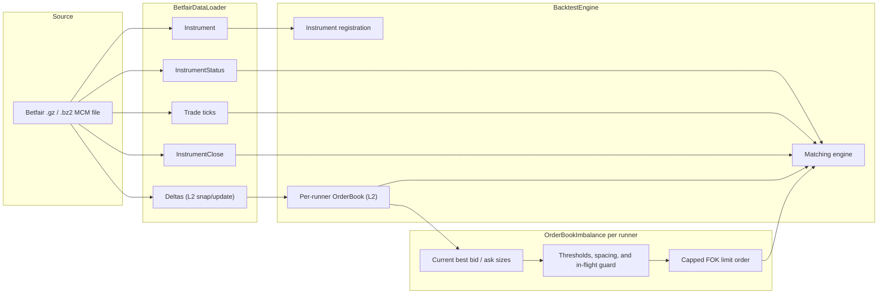
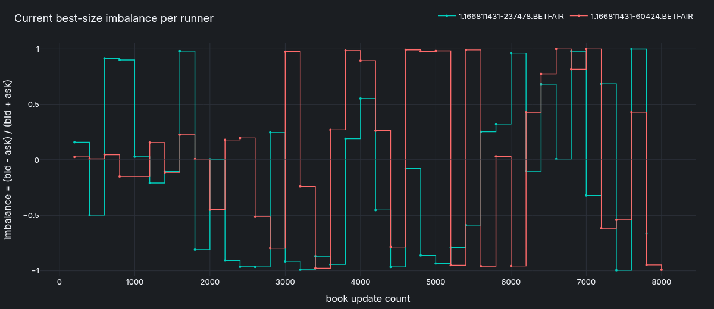
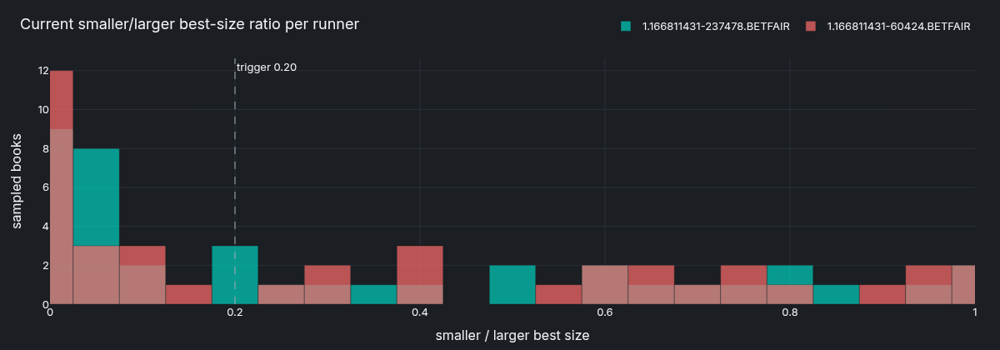
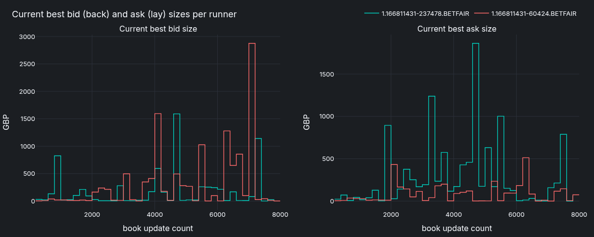

# Book Imbalance Backtest (Betfair)

:::note
This **Rust-only** tutorial sends raw Betfair streaming data directly to the Rust `BacktestEngine`.
It does not use Python or Parquet.
:::

This tutorial backtests the Rust `OrderBookImbalance` strategy on a Betfair MATCH_ODDS market.
It loads a raw historical streaming file, feeds it through `BacktestEngine`, and runs a strategy
instance for each runner. Python tutorials use the same Rust implementation through the built-in registry.

## Introduction

Betfair is a sports betting exchange where participants back (bid) and lay
(ask) outcomes at decimal odds. Each runner has its own L2 order book that
behaves like a financial order book.

The strategy reads the current best bid/ask sizes from a managed L2 MBP book. It submits a capped
fill-or-kill (FOK) limit order against the thinner side when the larger size exceeds the minimum
and the smaller/larger ratio falls below the threshold. Trigger spacing and an in-flight order
check limit repeated orders. Prices and sizes use exact arithmetic.

This is a teaching strategy with no demonstrated trading edge. Its signals describe current quoted
liquidity; repeated updates do not accumulate into volume totals.



## Prerequisites

- A working Rust toolchain ([rustup.rs](https://rustup.rs)).
- The NautilusTrader repository cloned and building.
- A Betfair historical `.gz` file containing MCM (Market Change Message)
  data. Source it from
  [Betfair historic data](https://historicdata.betfair.com/), a third-party
  archive, or by recording the Exchange Streaming API yourself.

Place the file at:

```text
test_data/local/betfair/1.253378068.gz
```

The example's `DATA_FILE` constant points to this gitignored path. The repository does not include that
self-recorded market. To run with the bundled sample used for the panels below, pass
`test_data/betfair/1-166811431.bz2`. The loader reads both `.gz` and `.bz2` files.

## Loading the data

`BetfairDataLoader` reads gzip- or bzip2-compressed Betfair Exchange Streaming API files and parses
each line into Nautilus domain objects:

```rust
use nautilus_betfair::loader::{BetfairDataItem, BetfairDataLoader};
use nautilus_model::types::Currency;

let mut loader = BetfairDataLoader::new(Currency::GBP(), None);
let items = loader.load(&filepath)?;
```

The loader returns a `Vec<BetfairDataItem>`:

| Variant             | Description                                     | Maps to `Data` enum?          |
| :------------------ | :---------------------------------------------- | :---------------------------- |
| `Instrument`        | Runner definition from market definition.       | No (added separately)         |
| `Status`            | Market status transition (PreOpen, Trading...). | Yes, `Data::InstrumentStatus` |
| `Deltas`            | Order book snapshot or delta update.            | Yes, `Data::BookDeltas`       |
| `Trade`             | Incremental trade tick from cumulative volumes. | Yes, `Data::Trade`            |
| `Ticker`            | Last traded price, volume, BSP near/far.        | -                             |
| `StartingPrice`     | Betfair Starting Price for a runner.            | -                             |
| `BspBookDelta`      | BSP-specific book delta.                        | -                             |
| `InstrumentClose`   | Settlement event.                               | Yes, `Data::InstrumentClose`  |
| `SequenceCompleted` | Batch completion marker.                        | -                             |
| `RaceRunnerData`    | GPS tracking data (horse/greyhound racing).     | -                             |
| `RaceProgress`      | Race-level progress data.                       | -                             |
| `CricketMatch`      | Cricket match data (from CCM).                  | -                             |

The backtest engine accepts the `Data` enum. The example converts statuses, deltas, trades, and
settlement events, collects instruments separately, and skips the remaining Betfair-specific types:

```rust
use nautilus_model::data::Data;

let mut instruments = AHashMap::new();
let mut data: Vec<Data> = Vec::new();

for item in items {
    match item {
        BetfairDataItem::Instrument(inst) => {
            instruments.insert(inst.id(), *inst);
        }
        BetfairDataItem::Deltas(d) => {
            data.push(Data::BookDeltas(Box::new(d)));
        }
        BetfairDataItem::Status(s) => {
            data.push(Data::InstrumentStatus(s));
        }
        BetfairDataItem::Trade(t) => {
            data.push(Data::Trade(t));
        }
        BetfairDataItem::InstrumentClose(c) => {
            data.push(Data::InstrumentClose(c));
        }
        _ => {}
    }
}
```

`Data::BookDeltas` boxes its `OrderBookDeltas` payload to keep the enum small.

The loader emits instruments on every market definition update. The map removes duplicates and keeps the
latest version of each instrument.

Market status events let the simulated matching engine observe suspensions and closures. Keep them
in the replay when testing order placement.

## The strategy

NautilusTrader ships `OrderBookImbalance` and `OrderBookImbalanceConfig` in
[`crates/trading/src/examples/strategies/orderbook_imbalance`](https://github.com/nautechsystems/nautilus_trader/tree/develop/crates/trading/src/examples/strategies/orderbook_imbalance).
Its runtime state lives in `state.rs`.

Each instance subscribes to one runner with `managed: true`. The data engine updates the cached
book before calling `on_book_deltas`. The strategy compares the current best sizes, buys at the
ask when the bid is larger, and sells at the bid when the ask is larger. It requires:

- A positive spread and positive best sizes.
- A larger best size strictly above `100`.
- A smaller/larger size ratio strictly below `0.20`.
- At least one second since the last signal.
- No in-flight orders for this strategy.

The example caps each FOK order at `1.00` and the available thinner size. Stop releases the book
subscription, cancels this strategy's open orders, closes positions, and prints update/signal counts.
Resume restores the subscription; reset clears runtime state. For signal-only replay, set
`.dry_run(true)`: the strategy sends no order commands, including during shutdown.

## Backtest engine setup

### Create the engine and venue

Betfair is a cash-settled betting exchange. The venue uses
`AccountType::Cash`, `OmsType::Netting`, and `BookType::L2_MBP`:

```rust
let mut engine = BacktestEngine::new(BacktestEngineConfig::default())?;

engine.add_venue(
    SimulatedVenueConfig::builder()
        .venue(Venue::from("BETFAIR"))
        .oms_type(OmsType::Netting)
        .account_type(AccountType::Cash)
        .book_type(BookType::L2_MBP)
        .starting_balances(vec![Money::from("1_000_000 GBP")])
        .fee_model(FeeModelAny::MakerTaker(MakerTakerFeeModel::zero()).into())
        .build()?,
)?;
```

### Add instruments, strategies, and data

```rust
for instrument in instruments.values() {
    engine.add_instrument(instrument)?;
}

use nautilus_model::{identifiers::StrategyId, types::Quantity};
use nautilus_trading::{
    examples::strategies::{OrderBookImbalance, OrderBookImbalanceConfig},
    strategy::StrategyConfig,
};

instrument_ids.sort();
for (index, instrument_id) in instrument_ids.into_iter().enumerate() {
    let tag = format!("{index:03}");
    let base = StrategyConfig {
        strategy_id: Some(StrategyId::from(format!("OrderBookImbalance-{tag}"))),
        order_id_tag: Some(tag),
        ..Default::default()
    };
    let config = OrderBookImbalanceConfig::builder()
        .base(base)
        .instrument_id(instrument_id)
        .max_trade_size(Quantity::from("1.00"))
        .log_interval(200)
        .build();
    engine.add_strategy(OrderBookImbalance::from_config(config)?)?;
}

engine.add_data(data, None, true, true)?;
```

Unique strategy IDs and order ID tags keep each runner's orders and trigger state separate.

The `add_data` parameters are `(data, client_id, validate, sort)`. With `validate: true`, the engine checks
that the first element's instrument is registered. It assumes that the batch is homogeneous. With `sort:
true`, it sorts the data by timestamp.

### Run

```rust
engine.run(None, None, None, false)?;
```

The four parameters are `(start, end, run_config_id, streaming)`. With `None` for `start` and `end`, the
engine uses the full time range of the loaded data.

## What happens during the run

For each data point in timestamp order the engine:

1. Advances the clock to the data timestamp.
1. Routes the data to the simulated exchange, which applies each delta to
   the per-instrument `OrderBook` and runs the matching engine cycle.
1. Publishes the data through the data engine and message bus, which calls
   the strategy's `on_book_deltas` callback after updating its managed book.
1. Drains command queues and settles venues (processes any pending orders).

The matching engine maintains a separate execution book and processes the strategy's FOK orders.
A signal does not guarantee a fill: account checks, market status, and available liquidity still apply.

## Results

The following panels show sampled current best sizes from the bundled
`test_data/betfair/1-166811431.bz2` replay. They describe quoted liquidity, rather than accumulated
delta sizes or traded volume. Order results depend on the stream, thresholds, and simulated account.
Inspect the backtest summary together with order and position reports when changing those inputs.



**Figure 1.** Signed current-book imbalance, `(bid - ask) / (bid + ask)`. Positive values indicate
larger best bid size. The strategy uses the smaller/larger ratio shown in Figure 2.



**Figure 2.** Distribution of sampled smaller/larger ratios. A ratio below `0.20` meets the ratio
condition; the minimum size, spread, spacing, and in-flight checks must also pass.



**Figure 3.** Current best bid (back) and ask (lay) sizes in GBP. These are resting sizes, with no
cumulative summation across updates.

### Regenerate the panels

The strategy logs `[runner] update #N: bid=B ask=A ratio=R` every `LOG_INTERVAL` updates. The
example uses `200` for the panel sampling interval. Run from the repository root after building
the Python extension:

```bash
CARGO_BUILD_JOBS=8 cargo run -p nautilus-betfair --features examples --profile nextest \
    --example betfair-backtest -- test_data/betfair/1-166811431.bz2 > /tmp/betfair.log 2>&1

BETFAIR_LOG=/tmp/betfair.log \
    uv run --project python --no-sync \
        python docs/tutorials/assets/backtest_book_imbalance_betfair/render_panels.py
```

## Running the example

```bash
# Debug build
cargo run -p nautilus-betfair --features examples --example betfair-backtest

# Release build (recommended)
cargo run -p nautilus-betfair --features examples --release --example betfair-backtest

# Custom data file
cargo run -p nautilus-betfair --features examples --release --example betfair-backtest -- path/to/file.gz

# Shipped sample file
cargo run -p nautilus-betfair --features examples --release --example betfair-backtest -- test_data/betfair/1-166811431.bz2
```

## Complete source

The complete example is at
[`crates/adapters/betfair/examples/betfair_backtest.rs`](https://github.com/nautechsystems/nautilus_trader/tree/develop/crates/adapters/betfair/examples/betfair_backtest.rs).

## Next steps

- Change thresholds and trigger spacing, then compare fills and final positions.
- Set `.dry_run(true)` to inspect signals without order commands.
- Load several markets and assign a distinct strategy ID and order ID tag to every instance.
