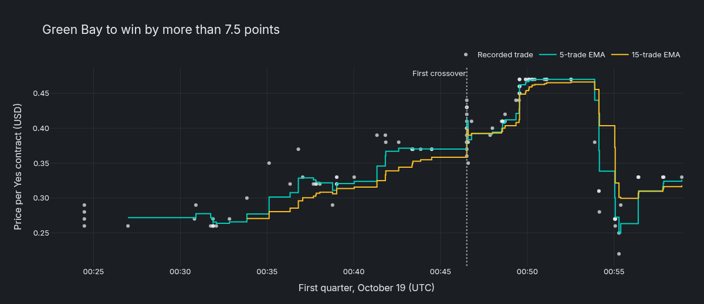
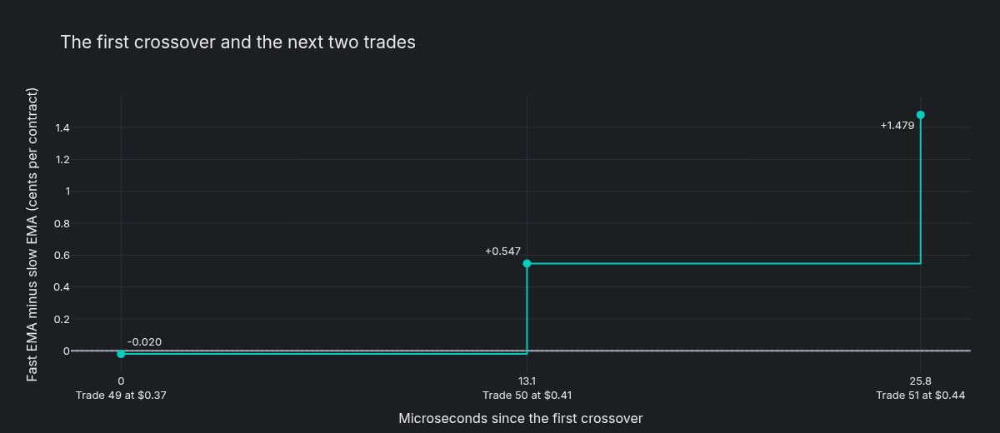

# Replay Kalshi NFL Trades (FinFeed)

Download the first-quarter trades for an NFL point spread from FinFeed, save them in a Parquet
catalog, and replay them through NautilusTrader's `BacktestEngine`. A Python actor uses the
recorded prices to demonstrate a directional exponential moving average (EMA) crossover. The toy
signal has no expected alpha advantage.

## Prerequisites

Use a FinFeed key with Prediction Markets historical trade access for the first run. In a source
checkout, [build the Python extension](../getting_started/installation.md#from-source).

## 1. Choose the market and replay window

The contract asks whether Green Bay wins its October 18, 2026 game against Dallas by more than
7.5 points. Its FinFeed outcome ID is `KXNFLSPREAD-26OCT18DALGB-GB8_YES`. Each price is in USD per
contract. The replay covers the first-quarter play-by-play window
`[2026-10-19 00:22:29, 2026-10-19 00:59:00]` UTC. These are the kickoff and quarter-end `wallclock`
timestamps in the [ESPN play-by-play data][play-by-play].

## 2. Download and cache the trades

Run the [complete program][python-program] from the repository root:

```bash
uv run --project python --no-sync python examples/backtest/finfeed_kalshi_nfl_ema_cross.py
```

The program reads `FINFEED_API_KEY` or prompts for the key. The async download loads the instrument,
then requests trades with the first-quarter bounds.

```python
loader = FinFeedDataLoader(api_key=api_key, timeout_secs=120)
instrument = await loader.request_instrument(INSTRUMENT_ID)
trades = await loader.request_trades(INSTRUMENT_ID, start=START, end=END)
```

The loader retrieves the covering UTC hour and filters the returned records to the requested window.
FinFeed supplies one trade timestamp, which the loader uses for both `ts_event` and `ts_init`.
See [FinFeed historical data](../integrations/finfeed.md#historical-data).

`ParquetDataCatalog` stores the instrument and `TradeTick` records at
`~/Downloads/Data/FinFeed/kalshi-dallas-green-bay-20261019-q1` by default. Set `NAUTILUS_DATA_DIR`
to put the `FinFeed` subdirectory under a different base path. Run the same command again to replay
the catalog offline without a key. If the program reports a missing instrument or trades, use a
new base path to download a fresh catalog.

## 3. Replay the cached trades

The program opens the catalog and uses the same outcome and time bounds to load the replay input.
The catalog query takes timestamps in Unix nanoseconds.

```python
catalog = ParquetDataCatalog(str(CATALOG_PATH))
instruments = catalog.instruments(instrument_ids=[str(INSTRUMENT_ID)])
trades = catalog.query_trades(
    identifiers=[str(INSTRUMENT_ID)],
    start=dt_to_unix_nanos(START),
    end=dt_to_unix_nanos(END),
)
```

The program checks for one instrument and a nonempty trade list, then passes both to
`replay(instruments[0], trades)`. Inside `replay`, the program creates a `BacktestEngine` with
analysis disabled, adds a simulated USD cash venue for the instrument, and creates a
`TradeEmaCross` actor. The engine runs the actor on the catalog trades.

```python
engine.add_instrument(instrument)
engine.add_data(trades)
engine.add_actor(actor)
engine.run()
```

The actor subscribes to the outcome and updates its 5-trade and 15-trade EMAs each time `on_trade`
receives a price. Each period counts trades, so several prints within one millisecond can move the
averages several times.

Each EMA starts from the average of its first 5 or 15 prices. At trade 15 the fast EMA is above the
slow EMA, establishing the initial `long` signal. After warm-up, a fast EMA moving above the slow
EMA changes the signal to `long`. A fast EMA moving to or below the slow EMA changes it to `flat`.
The actor observes prices and records signals only.



**Panel A.** Each dot is a recorded trade. Each EMA starts when its warm-up completes and holds
its last value between trades.

## 4. Inspect the first crossover

The reference replay contains 111 trades in 29 distinct UTC minutes and produces six crossovers.
The program prints a SHA-256 digest of the ordered trade ticks as JSON. A different digest means
the serialized replay input differs from the reference:

```text
53b426167ab00db770c5583c37a92c93654bdc10a201d609f38d52ccc315d22f
```

On trade 49, the fast EMA moves below the slow EMA, changing the signal to `flat`. The fast EMA is
about $0.382932 and the slow EMA is about $0.383130 after the update. The $0.41 print 13.1
microseconds later moves the fast EMA back above the slow EMA and returns the signal to `long`.



**Panel B.** The signed labels give the fast EMA minus the slow EMA in cents per contract.

| Trade            | Timestamp (UTC)               | FinFeed trade ID                     | Price (USD) | Contracts |
| ---------------- | ----------------------------- | ------------------------------------ | ----------: | --------: |
| 49 (flat signal) | 2026-10-19 00:46:30.758915900 | 2775a731-eb90-4330-bae3-ccc195523805 |        0.37 |     64.00 |
| 50 (long signal) | 2026-10-19 00:46:30.758929000 | b0b93ff0-3eaa-42e0-bd72-bfbb8197fd0a |        0.41 |     43.00 |
| 51               | 2026-10-19 00:46:30.758941700 | dbcd0a57-d2e4-48c1-a271-3522aa4a815c |        0.44 |     72.45 |

All three prints fall within 26 microseconds. Evaluating an order after either signal would
require bid and ask prices, available size, and an execution model.

## Regenerate the panels

Replay the reference game and window. Verify the printed digest matches step 4 before rendering the
reference panels. Use the same `NAUTILUS_DATA_DIR` setting for both commands so they read the same
catalog. The renderer writes both PNGs next to the script. Panel A uses labels for the reference game
and quarter.

With Plotly, Kaleido, and Chrome installed, run from the repository root:

```bash
uv run --project python --no-sync \
    python docs/tutorials/assets/backtest_kalshi_nfl_finfeed/render_panels.py
```

## Use another game or quarter

1. Choose an ordinary USD 1 binary point spread for one Kalshi game. Check the supported
   [Kalshi contract types](../integrations/finfeed.md#kalshi-metadata-and-precision) and use the
   [FinFeed market listings](../integrations/finfeed.md#python-rest-access) to find the exact
   `_YES` outcome ID with `FinFeedHttpClient.get_listings`.
1. Find the wall-clock timestamps for both ends of the replay window in a play-by-play source.
   Convert them to UTC, including the UTC date, and set `START` and `END` as timezone-aware
   datetimes.
1. Set `INSTRUMENT_ID` with `finfeed_instrument_id("KALSHI", ...)` and the exact Yes outcome ID.
   Choose a new `CATALOG_PATH` so the program downloads the instrument and trades for this window.
1. Check FinFeed's historical availability for the outcome and date, then run the program with your
   FinFeed key. If the definition is unavailable or the window has no recorded trades, try another
   spread or window.
1. Use the catalog query in step 3 to inspect the first and last returned `ts_event` values and
   gaps between trades. These times are Unix nanoseconds. Sparse trading and missing data can both
   produce gaps. See [FinFeed's coverage limits](../integrations/finfeed.md#coverage-and-truncation).

The first 15 trades warm up both EMAs and establish their initial relation. A replay can warm up
and still produce zero crossovers. The renderer expects a crossover for Panel B.

[play-by-play]: https://site.api.espn.com/apis/site/v2/sports/football/nfl/summary?event=401873007
[python-program]: https://github.com/nautechsystems/nautilus_trader/blob/develop/examples/backtest/finfeed_kalshi_nfl_ema_cross.py
