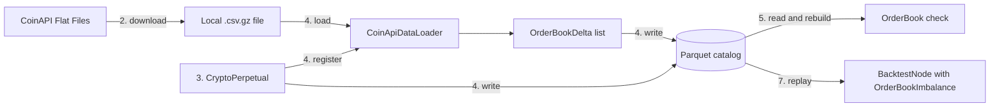
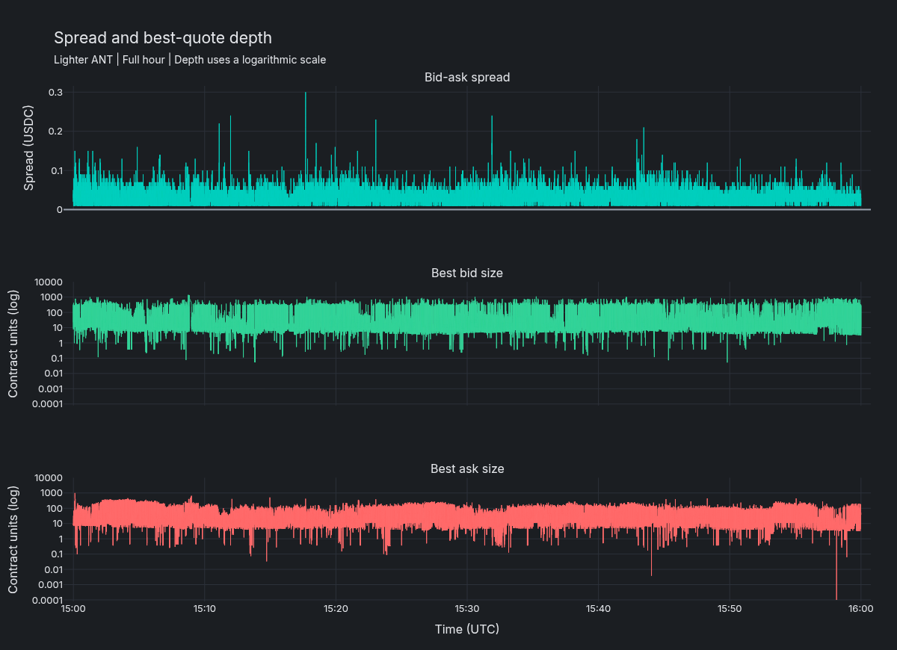
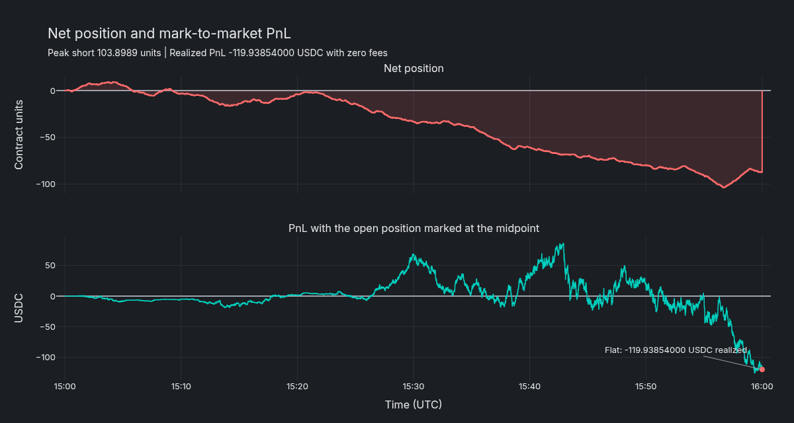

# Backtest with Equity Perpetual Order Book Data (CoinAPI)

Download one hour of Lighter's `ANT` equity perpetual order book from CoinAPI. Store it in a
Parquet catalog and replay it to backtest an order book imbalance strategy. Later runs reuse the
catalog and work offline.

The Lighter Core perpetual gives synthetic exposure to Anthropic's publicly traded stock
(`ANT` on Nasdaq). The contract settles in USDC. See
[Lighter's equity market rules](https://docs.lighter.xyz/trading/real-world-assets-rwas).

Each step shows the Rust and Python code side by side. The complete programs are
[`coinapi_lighter_book_imbalance.rs`][rust-program] and
[`coinapi_lighter_book_imbalance.py`][python-program].

## How CoinAPI represents Lighter order book data

CoinAPI [Flat Files](https://www.coinapi.io/products/flat-files?ref=nautilus) are `.csv.gz` exports
served over an S3-compatible API. Each full-book file holds one symbol for one UTC partition: a
snapshot followed by all recorded updates. The object key names the dataset, the UTC hour, the
exchange, and the symbol; see the [file layout](../integrations/coinapi.md#file-layout).

The rows have empty order IDs, so they describe price levels: an L2 market-by-price (MBP) book. The
loader converts the rows to `OrderBookDelta` values and groups them into batches. Each batch is one
replay event.

| Batch                  | Contents                                                                               |
| ---------------------- | -------------------------------------------------------------------------------------- |
| First                  | `CLEAR`, then one `ADD` per price level, all `F_SNAPSHOT`: the book at the hour start. |
| Later                  | Consecutive rows with the same `time_exchange` value.                                  |
| Last delta of each one | Carries the `F_LAST` flag, which marks the end of the loader batch.                    |

The loader takes `ts_event` from CoinAPI's `time_exchange` field and `ts_init` from `time_coinapi`.
Every update row after the snapshot has a distinct `time_exchange` in this file, so each forms
its own batch. The export gives no venue message boundaries for those rows. See the
[timestamp rules](../integrations/coinapi.md#timestamps).



The catalog is the hand-off point: steps 5 to 8 read only from it. The programs run steps 2 to 4
only when the catalog path does not exist, so later runs need no API key or network access.

## Prerequisites

- A CoinAPI key with Flat Files access and usage credits. CoinAPI charges for listing and
  downloading files. The first run downloads one compressed file of about 13.3 MB. See
  [Flat Files access](https://www.coinapi.io/products/flat-files/docs?ref=nautilus).
- **Rust**: A source checkout. To use the crates in your own project, see
  [Run a Backtest (Rust)](../how_to/run_rust_backtest.md) for setup and dependencies.
- **Python**: Python 3.13, 3.14, or 3.15, NautilusTrader 2.x with the CoinAPI adapter
  (`pip install -U --pre nautilus_trader`), and pandas (`pip install pandas`).

Run the complete program from the repository root. For Python in a source checkout, build the
Python extension first.

```bash tab="Rust"
cargo run --bin coinapi-lighter-book-imbalance --package nautilus-tutorials --features examples
```

```bash tab="Python"
uv run --project python --no-sync --with pandas \
    python examples/backtest/coinapi_lighter_book_imbalance.py
```

A run reads `COINAPI_API_KEY` only when it downloads the file. The Python program prompts for the
key, without echoing it, when the variable is unset.

## 1. Choose the file and storage paths

| Name           | Value                                         | Purpose                                                          |
| -------------- | --------------------------------------------- | ---------------------------------------------------------------- |
| `BUCKET`       | `coinapi`                                     | CoinAPI bucket that holds historical files, including this hour. |
| `OBJECT_KEY`   | `T-LIMITBOOK_FULL/D-2026112315/E-LIGHTER/...` | Full-book file for `LIGHTER_PERP_ANT_USD`.                       |
| `FILE_SHA256`  | `5a05a328...`                                 | SHA-256 of the export behind the reference run.                  |
| Instrument ID  | `ANT-PERP.LIGHTER`                            | Native Lighter adapter ID for the contract.                      |
| Book type      | `L2_MBP`                                      | Price-level book, which matches the file's empty order IDs.      |
| Data directory | `NAUTILUS_DATA_DIR/CoinAPI`                   | Storage root. The default is `~/Downloads/Data/CoinAPI`.         |
| File path      | `<data directory>/<OBJECT_KEY>`               | Downloaded file. Its `D-` directory gives the loader the date.   |
| Catalog path   | `lighter-ant-20261123-15`                     | Catalog for this file. Rename it for another hour.               |

```rust tab="Rust"
const BUCKET: &str = "coinapi";
const OBJECT_KEY: &str =
    "T-LIMITBOOK_FULL/D-2026112315/E-LIGHTER/IDDI-48047693+SC-LIGHTER_PERP_ANT_USD+S-ANT.csv.gz";
const FILE_SHA256: &str = "5a05a328f1622c88091238ad190d7e63c370d1d3e845f5b5d0f5b49401ccf8e1";
const RUN_ID: &str = "coinapi-lighter";

let instrument_id = InstrumentId::from("ANT-PERP.LIGHTER");
let book_type = BookType::L2_MBP;

let data_dir = match std::env::var_os("NAUTILUS_DATA_DIR") {
    Some(dir) => PathBuf::from(dir),
    None => std::env::home_dir()
        .context("home directory not found, set NAUTILUS_DATA_DIR")?
        .join("Downloads")
        .join("Data"),
}
.join("CoinAPI");

let filepath = data_dir.join(OBJECT_KEY);
let catalog_path = data_dir.join("lighter-ant-20261123-15");
```

```python tab="Python"
BUCKET = "coinapi"
OBJECT_KEY = (
    "T-LIMITBOOK_FULL/D-2026112315/E-LIGHTER/IDDI-48047693+SC-LIGHTER_PERP_ANT_USD+S-ANT.csv.gz"
)
FILE_SHA256 = "5a05a328f1622c88091238ad190d7e63c370d1d3e845f5b5d0f5b49401ccf8e1"
INSTRUMENT_ID = InstrumentId.from_str("ANT-PERP.LIGHTER")
BOOK_TYPE = BookType.L2_MBP

DATA_DIR = Path(os.environ.get("NAUTILUS_DATA_DIR", "~/Downloads/Data")).expanduser() / "CoinAPI"
FILEPATH = DATA_DIR / OBJECT_KEY
CATALOG_PATH = DATA_DIR / "lighter-ant-20261123-15"
```

## 2. Download the full-book file

Create a `CoinApiDataLoader` and download the file when it is not already on disk. A failed download
leaves no partial file at the destination.

Then compare the file's SHA-256 with `FILE_SHA256`. The checksum pins the exact export behind the
reference run. A mismatch stops the run before parsing; verify the file before you replace it.

```rust tab="Rust"
let loader = CoinApiDataLoader::new(None); // Reads COINAPI_API_KEY to download
if !filepath.is_file() {
    loader
        .download_flat_file(BUCKET, OBJECT_KEY, &filepath)
        .await?;
}

let file = std::fs::read(&filepath)?;
let file_digest = digest::digest(&digest::SHA256, &file);
let checksum = hex::encode(file_digest);
anyhow::ensure!(
    checksum == FILE_SHA256,
    "unexpected SHA-256 for {}, verify the selected export",
    filepath.display()
);
```

```python tab="Python"
async def download(api_key: str) -> None:
    loader = CoinApiDataLoader(api_key=api_key)
    await loader.download_flat_file(BUCKET, OBJECT_KEY, FILEPATH)


if not FILEPATH.is_file():
    api_key = os.environ.get("COINAPI_API_KEY") or getpass("CoinAPI API key: ")
    asyncio.run(download(api_key))
    del api_key

with FILEPATH.open("rb") as file:
    checksum = file_digest(file, "sha256").hexdigest()

if checksum != FILE_SHA256:
    raise ValueError(f"Unexpected SHA-256 for {FILEPATH}, verify the selected export")
```

The download method is async. The Python program runs it with `asyncio.run`; in a notebook with a
running event loop, use `await download(api_key)` instead.

## 3. Define the Lighter contract

`CoinApiDataLoader` converts the file with an instrument definition that you register. It does not
need the live client's instrument mapper, which does not support Lighter. `CryptoPerpetual` matches
the native Lighter adapter's model for this contract.

| Setting                                 | Value              | Meaning                                                                |
| --------------------------------------- | ------------------ | ---------------------------------------------------------------------- |
| `instrument_id`                         | `ANT-PERP.LIGHTER` | Native Lighter adapter ID.                                             |
| `raw_symbol`, `base_currency`           | `ANT`              | Lighter market symbol.                                                 |
| `quote_currency`, `settlement_currency` | `USDC`             | Native settlement currency. CoinAPI's `USD` suffix does not change it. |
| `is_inverse`                            | `false`            | Sizes are in contract units.                                           |
| `price_precision`, `price_increment`    | 2, `0.01`          | Venue tick size. Export prices use up to two decimal places.           |
| `size_precision`, `size_increment`      | 4, `0.0001`        | Venue lot size. Export sizes use up to four decimal places.            |
| `min_quantity`                          | `0.1000`           | Minimum order quantity, in contract units.                             |
| `min_notional`                          | 10 USDC            | Minimum order value, checked separately from the quantity.             |
| `margin_init`                           | 0.10               | Initial margin of 10% of the order value.                              |
| `margin_maint`                          | 0.06               | Maintenance margin of 6% of the position value.                        |

The minimum quantity, minimum notional, and margin rates use
[Lighter's ANT market metadata](https://mainnet.zklighter.elliot.ai/api/v1/orderBookDetails?market_id=10902)
as assumptions for this hour. Verify the historical terms for your research period.

```rust tab="Rust"
let usdc = Currency::USDC();
let raw_symbol = Symbol::from("ANT");
let base_currency = Currency::get_or_create_crypto("ANT");
let price_increment = Price::from("0.01");
let size_increment = Quantity::from("0.0001");
let min_quantity = Quantity::from("0.1000");
let min_notional = Money::from_decimal(dec!(10), usdc)?;
let instrument = CryptoPerpetual::builder()
    .instrument_id(instrument_id)
    .raw_symbol(raw_symbol)
    .base_currency(base_currency)
    .quote_currency(usdc)
    .settlement_currency(usdc)
    .is_inverse(false)
    .price_precision(2)
    .size_precision(4)
    .price_increment(price_increment)
    .size_increment(size_increment)
    .min_quantity(min_quantity)
    .min_notional(min_notional)
    .margin_init(dec!(0.10))
    .margin_maint(dec!(0.06))
    .ts_event(UnixNanos::default())
    .ts_init(UnixNanos::default())
    .build()?;
```

```python tab="Python"
usdc = Currency.from_str("USDC")
instrument = CryptoPerpetual(
    instrument_id=INSTRUMENT_ID,
    raw_symbol=Symbol("ANT"),
    base_currency=Currency.from_str("ANT"),
    quote_currency=usdc,
    settlement_currency=usdc,
    is_inverse=False,
    price_precision=2,
    size_precision=4,
    price_increment=Price.from_str("0.01"),
    size_increment=Quantity.from_str("0.0001"),
    min_quantity=Quantity.from_str("0.1000"),
    min_notional=Money.from_decimal(Decimal(10), usdc),
    margin_init=Decimal("0.10"),
    margin_maint=Decimal("0.06"),
    ts_event=0,
    ts_init=0,
)
```

## 4. Write the data to a catalog

Register the contract with the loader so the conversion uses its price and size precision. A value
finer than that precision fails the load instead of being rounded. In Rust, the two `None` arguments
are the optional REST symbol ID and consolidated OHLCV file symbol ID, which book files do not need.
Local loading requires no credentials.

Load the entire file. A row `limit` can cut a book event short and leave an incomplete book. See
[order book data](../integrations/coinapi.md#order-book-data) for limits and chunked streaming.

```rust tab="Rust"
let instrument = InstrumentAny::CryptoPerpetual(instrument);
loader.add_instrument(instrument.clone(), None, None)?;
let deltas = loader.load_book_deltas(&filepath, instrument_id, None, None)?;

std::fs::create_dir_all(&catalog_path)?;
let catalog = ParquetDataCatalog::builder().uri(&catalog_path).build()?;
let instruments = vec![instrument];
catalog.write_instruments(instruments)?;
catalog.write_to_parquet(&deltas, None, None, None)?;
```

```python tab="Python"
loader = CoinApiDataLoader()
loader.add_instrument(instrument)
deltas = loader.load_book_deltas(FILEPATH, INSTRUMENT_ID)

CATALOG_PATH.mkdir(parents=True)
catalog = ParquetDataCatalog(str(CATALOG_PATH))
catalog.write_instruments([instrument])
catalog.write_order_book_deltas(deltas)
```

The programs create the catalog folder only after a complete download and load. Delete the catalog
path if a write fails, and after you change `OBJECT_KEY`, `FILE_SHA256`, or a contract setting from
step 3. Otherwise later runs reuse the old data and definition, and skip the checksum.

## 5. Rebuild the book to check the data

The backtest engine rebuilds the book from the deltas itself. Rebuilding it here first checks the
data before any strategy runs. The code reads the instrument and deltas back from the catalog, so it
checks the same data the backtest uses.

Check that the deltas open with a snapshot: a `CLEAR` flagged `F_SNAPSHOT`. Then apply the deltas
in their original order. At the end of each batch (`F_LAST`), count the batch and any locked or
crossed book, where the best bid is at or above the best ask. Check the book's integrity after each
snapshot batch and at the end of the file. Both programs then print these counts and the top
three levels of the final book.

```rust tab="Rust"
let mut catalog = ParquetDataCatalog::builder().uri(&catalog_path).build()?;
let instrument_ids = vec![instrument_id.to_string()];
let instrument = catalog
    .instruments(Some(&instrument_ids), None, None)?
    .into_iter()
    .next()
    .context("instrument missing from catalog")?;
let deltas = catalog
    .order_book_deltas()
    .identifiers(instrument_ids)
    .execute()?;

let first = deltas.first().context("catalog has no book deltas")?;
anyhow::ensure!(
    first.action == BookAction::Clear && RecordFlag::F_SNAPSHOT.matches(first.flags),
    "book deltas do not open with a snapshot"
);

let mut book = OrderBook::new(instrument_id, book_type);
let mut batches = 0;
let mut locked_or_crossed = 0;

for delta in &deltas {
    book.apply_delta(delta)?;
    if !RecordFlag::F_LAST.matches(delta.flags) {
        continue;
    }

    batches += 1;

    if RecordFlag::F_SNAPSHOT.matches(delta.flags) {
        book_check_integrity(&book)?;
    }

    if let (Some(bid), Some(ask)) = (book.best_bid_price(), book.best_ask_price())
        && bid >= ask
    {
        locked_or_crossed += 1;
    }
}

book_check_integrity(&book)?;
let top_levels = book.pprint(3, None);
println!("Loaded {} deltas in {batches} batches", deltas.len());
println!("Locked or crossed books: {locked_or_crossed}");
println!("{top_levels}");
```

```python tab="Python"
catalog = ParquetDataCatalog(str(CATALOG_PATH))
[instrument] = catalog.instruments(instrument_ids=[str(INSTRUMENT_ID)])
deltas = catalog.query_order_book_deltas(identifiers=[str(INSTRUMENT_ID)])

first = deltas[0]
if first.action != BookAction.CLEAR or not RecordFlag.F_SNAPSHOT.matches(first.flags):
    raise ValueError("Book deltas do not open with a snapshot")

book = OrderBook(INSTRUMENT_ID, BOOK_TYPE)
batches = 0
locked_or_crossed = 0

for delta in deltas:
    book.apply_delta(delta)
    if not RecordFlag.F_LAST.matches(delta.flags):
        continue

    batches += 1

    if RecordFlag.F_SNAPSHOT.matches(delta.flags):
        book.check_integrity()

    bid, ask = book.best_bid_price(), book.best_ask_price()
    if bid is not None and ask is not None and bid.as_decimal() >= ask.as_decimal():
        locked_or_crossed += 1

book.check_integrity()
print(f"Loaded {len(deltas):,} deltas in {batches:,} batches")
print(f"Locked or crossed books: {locked_or_crossed:,}")
print(book.pprint(3))
```

The replay encounters 12,418 batches with a locked or crossed book. Level changes can arrive
separately, so a completed loader batch can still show an intermediate venue book. Keep every
delta in the catalog. The integrity check rejects crossed books, so the programs run it after
each snapshot and at the end. The strategy and the figures skip books without a positive spread.

## 6. Configure the backtest

The strategy is the built-in Rust `OrderBookImbalance`, which the Binance and Bybit tutorials also
use from Python. It watches the sizes at the best bid and best ask. When one side is much larger, it
sends a fill-or-kill (FOK) limit order against the thinner side: it buys at the best ask when the
bid side is larger, and sells at the best bid when the ask side is larger. It skips books without a
positive spread and closes its position when it stops.

The venue uses a fixed 300 ms delay for order submission, modification, and cancellation. This
matches [Lighter Core's Standard-tier settings](https://docs.lighter.xyz/trading/trading-fees)
for taker orders and keeps the regular-order fee at zero. Orders in this strategy take liquidity.
The model is optimistic because it adds no client processing time, network transit, or jitter.
The simulator uses FOK for this example. The [live Lighter adapter](../integrations/lighter.md#time-in-force)
rejects FOK orders.

The delay lets you test whether a signal's price and size are still executable when the order
is processed. The 300 ms delay sets the earliest time an order is eligible. During the replay,
the engine applies the next book update before matching eligible orders. A FOK order fills only
if the updated book can satisfy the full quantity at the limit price or better.

To compare with zero delay, set `order_delay` in Rust or `order_delay_ns` in Python to zero and
replay the same catalog.

| Strategy setting               | Value    | Effect                                                                                   |
| ------------------------------ | -------- | ---------------------------------------------------------------------------------------- |
| `trigger_min_size`             | 1.0      | The larger best-quote size must exceed one contract unit.                                |
| `trigger_imbalance_ratio`      | 0.20     | The smaller size must be below 20% of the larger size.                                   |
| `max_trade_size`               | `0.2500` | Each signal order is for the smaller of 0.25 contract units and the thinner side's size. |
| `min_seconds_between_triggers` | 1.0      | At least one second passes between signals.                                              |
| `book_type`                    | `L2_MBP` | The strategy subscribes to the same book type as the data.                               |

| Venue setting       | Value                 | Effect                                                         |
| ------------------- | --------------------- | -------------------------------------------------------------- |
| `name`              | `LIGHTER`             | Taken from the instrument ID, so the two always match.         |
| `account_type`      | `MARGIN`              | Positions need only margin, so the strategy can sell short.    |
| `oms_type`          | `NETTING`             | One position per instrument.                                   |
| `starting_balances` | 100,000 USDC          | Balance available for margin and PnL.                          |
| `margin_model`      | `StandardMarginModel` | Applies the instrument's margin rates to full notional.        |
| `book_type`         | `L2_MBP`              | The matching engine fills orders against the price-level book. |
| `fee_model`         | Zero maker and taker  | This teaching run charges no fees.                             |
| `latency_model`     | `StaticLatencyModel`  | Makes order commands eligible for processing after 300 ms.     |

| Run setting             | Value                                   | Effect                                                                                           |
| ----------------------- | --------------------------------------- | ------------------------------------------------------------------------------------------------ |
| `data_type`             | `OrderBookDelta`                        | Reads the instrument's book deltas from the catalog path.                                        |
| `emit_quotes_from_book` | `true`                                  | Without it, the risk engine denies the closing market order with `MARKET_PRICE_UNAVAILABLE`.     |
| `raise_exception`       | `true`                                  | A failed run stops with its error instead of returning no results.                               |
| `id`                    | `coinapi-lighter` (Rust only)           | Run ID. Rust uses it to find the engine for the strategy; Python uses the generated `config.id`. |
| `dispose_on_completion` | `true` (Rust default), `False` (Python) | Python keeps the engine after the run to generate reports; Rust disposes it.                     |
| Log level               | `ERROR` (Python only)                   | Keeps the printed reports readable; Rust keeps the default log output.                           |

**Simulation limits**: Matching against the book captures the cost of crossing the spread and filling
across multiple price levels. The run omits funding. The export does not establish venue-message
boundaries or individual queue positions. The strategy demonstrates the data workflow and has no
demonstrated edge.

```rust tab="Rust"
let data_engine = DataEngineConfig::builder()
    .emit_quotes_from_book(true)
    .build();
let engine = BacktestEngineConfig::builder()
    .data_engine(data_engine)
    .build();

let fees = MakerTakerFeeModel::zero();
let order_delay = DurationNanos::from_millis(300);
let latency =
    StaticLatencyModel::new(DurationNanos::ZERO, order_delay, order_delay, order_delay);
let venue = BacktestVenueConfig::builder()
    .name(instrument_id.venue.as_str())
    .oms_type(OmsType::Netting)
    .account_type(AccountType::Margin)
    .starting_balances(vec!["100000 USDC".to_string()])
    .book_type(book_type)
    .margin_model(MarginModelAny::Standard(StandardMarginModel))
    .fee_model(FeeModelAny::MakerTaker(fees))
    .latency_model(LatencyModelAny::Static(latency))
    .build()?;

let catalog_location = catalog_path.display().to_string();
let catalog_config = DataCatalogConfig::new(catalog_location, None, None);
let data = BacktestDataConfig::builder()
    .catalog(catalog_config)
    .data_type(NautilusDataType::OrderBookDelta)
    .instrument_id(instrument_id)
    .build()?;

let config = BacktestRunConfig::builder()
    .id(RUN_ID.to_string())
    .engine(engine)
    .venues(vec![venue])
    .data(vec![data])
    .raise_exception(true)
    .build()?;

let max_trade_size = Quantity::from("0.2500");
let strategy_config = OrderBookImbalanceConfig::builder()
    .instrument_id(instrument_id)
    .book_type(book_type)
    .max_trade_size(max_trade_size)
    .trigger_min_size(dec!(1.0))
    .trigger_imbalance_ratio(dec!(0.20))
    .min_seconds_between_triggers(1.0)
    .build();
```

```python tab="Python"
order_delay_ns = 300_000_000
latency = StaticLatencyModel(
    base_latency_nanos=0,
    insert_latency_nanos=order_delay_ns,
    update_latency_nanos=order_delay_ns,
    cancel_latency_nanos=order_delay_ns,
)
config = BacktestRunConfig(
    engine=BacktestEngineConfig(
        logging=LoggerConfig(stdout_level=LogLevel.ERROR),
        data_engine=DataEngineConfig(emit_quotes_from_book=True),
    ),
    venues=[
        BacktestVenueConfig(
            name=str(INSTRUMENT_ID.venue),
            oms_type=OmsType.NETTING,
            account_type=AccountType.MARGIN,
            starting_balances=["100000 USDC"],
            book_type=BOOK_TYPE,
            margin_model=StandardMarginModel(),
            fee_model=MakerTakerFeeModel(maker_rate=Decimal(0), taker_rate=Decimal(0)),
            latency_model=latency,
        ),
    ],
    data=[
        BacktestDataConfig(
            catalog=DataCatalogConfig(path=str(CATALOG_PATH)),
            data_type=NautilusDataType.OrderBookDelta,
            instrument_id=instrument.id,
        ),
    ],
    dispose_on_completion=False,
    raise_exception=True,
)

strategy_config = OrderBookImbalanceConfig(
    instrument_id=instrument.id,
    book_type=BOOK_TYPE,
    max_trade_size=Quantity.from_str("0.2500"),
    trigger_min_size=Decimal("1.0"),
    trigger_imbalance_ratio=Decimal("0.20"),
    min_seconds_between_triggers=1.0,
)
```

## 7. Run the backtest from the catalog

`BacktestNode` builds the engine from the configuration, loads the deltas from the catalog, and
runs the strategy on them. With `batch_deltas` at its default of `true`, it groups deltas into
batches ending at `F_LAST`. The engine applies the whole batch before the strategy sees the book.
After the snapshot, that means one row at a time for this export. The strategy can act before
the next price-level update if the resulting book has a positive spread.

The data configuration sets no start or end time, so the replay begins with the opening snapshot and
the strategy starts with a complete book. A later start would skip that snapshot and replay updates
onto an empty book.

```rust tab="Rust"
let mut node = BacktestNode::new(vec![config])?;
node.build()?;

let strategy = OrderBookImbalance::from_config(strategy_config)?;
node.get_engine_mut(RUN_ID)
    .context("engine not built")?
    .add_strategy(strategy)?;

let results = node.run()?;
```

```python tab="Python"
node = BacktestNode(configs=[config])

try:
    node.build()
    node.add_builtin_strategy(config.id, "OrderBookImbalance", strategy_config)
    results = node.run()

    orders = node.generate_orders_report(config.id)
    executions = node.generate_fills_report(config.id)
    positions = node.generate_positions_report(config.id)
    account = node.generate_account_report(config.id, venue=INSTRUMENT_ID.venue)
finally:
    node.dispose()
```

## 8. Review the results

The Rust program prints the run totals and PnL statistics. The Python program prints the order,
fill, position, and account reports, then checks that the final position is flat. The account
report records balance changes, and the position report holds the realized PnL of closed positions.

```rust tab="Rust"
for result in &results {
    println!(
        "Orders: {}, positions: {}",
        result.total_orders, result.total_positions
    );
    println!("PnL statistics: {:?}", result.stats_pnls);
}
```

```python tab="Python"
print(orders["status"].value_counts().to_string())
print(executions.groupby(["order_type", "order_side"]).size().to_string())
print(
    executions[["ts_event", "order_side", "order_type", "last_qty", "last_px", "commission"]]
    .tail(8)
    .to_string(),
)
print(
    positions[
        [
            "side",
            "quantity",
            "peak_qty",
            "avg_px_open",
            "avg_px_close",
            "realized_pnl",
            "commissions",
        ]
    ].to_string(),
)
print(account[["total", "locked", "free", "currency"]].tail().to_string())

assert not positions.empty, "No positions opened; inspect the selected file and signal"
assert positions["ts_closed"].notna().all(), "The strategy left an open position"
assert positions["side"].eq("FLAT").all()
assert positions["quantity"].map(Decimal).eq(Decimal(0)).all()
```

### Reference run

| Result        | Reference value                                                      |
| ------------- | -------------------------------------------------------------------- |
| Data window   | 2026-11-23, `[15:00, 16:00)` UTC                                     |
| Deltas loaded | 721,355 in 721,026 batches, including the 330-delta opening snapshot |
| Iterations    | 721,026, one per batch                                               |
| Orders        | 3,074 total, with 2,033 filled, 1,035 canceled, and 6 denied         |
| Filled orders | 842 FOK buys, 1,190 FOK sells, and one market buy                    |
| Positions     | 10, all closed                                                       |
| Realized PnL  | -119.938540 USDC with zero fees                                      |
| Final balance | 99,880.06146000 USDC                                                 |

The strategy sizes each FOK order from the thinner quote, so a signal can produce an order
below the venue minimums. The risk engine denies five orders below the minimum quantity and
one below the minimum notional.

The strategy triggers 3,073 times in the hour with a one-second cooldown. With no delay, 3,067
FOK orders fill. With 300 ms of delay, 2,032 fill and 1,035 cancel. For example, at 15:00:01.192149
UTC the strategy submits a buy at the best ask of 89.33 USDC. When the replay processes the
order at 15:00:01.527446 UTC, the best ask is 89.34 USDC and the order cancels unfilled.

The fill report counts 2,036 executions. Two FOK orders and the closing buy each fill at
two price levels.

After the last update, the strategy submits a market buy to close a short of 86.8989 contract
units. The backtest settles the order after the 300 ms delay, at 16:00:00.217869800 UTC.
The data ends before that timestamp, so the two fills consume the final available book.

| Level | Quantity | Price (USDC) |
| ----- | -------- | ------------ |
| 1     | 52.2888  | 88.80        |
| 2     | 34.6101  | 88.81        |

The prices match the two best asks printed in step 5. The order consumes all 52.2888 units
at the best ask and fills the rest one tick higher, for an average price of about 88.80398 USDC.

### Figures

The figures use the Python program's data and reports. They show changes to the best quotes and
skip batches with an empty side or without a positive spread. Markers show individual fills.


**Figure 1.** The upper panel shows the best ask over the hour. The lower panel uses a finer
price and time scale to show both quotes and fills near the end of the replay. The two diamonds
show where the closing buy fills after the final quote.



**Figure 2.** The positive spread is in `[0.01, 0.30]` USDC, including among states that last at
least one millisecond. Of 708,607 measured intervals with a positive spread, 642,534 are shorter
than 10 microseconds. Each interval runs from receipt time (`ts_init`) to the next batch.
Best-quote sizes span `[0.0001, 1404.7683]` contract units. The bid and ask panels use the same
logarithmic scale.



**Figure 3.** Cumulative signed fills take the position from a peak long of 9.2500 units to a
peak short of 103.8989 units. The closing market buy brings the remaining position back to zero.
With the open position marked at the midpoint, total PnL peaks at about 85.95 USDC around 15:43.
The account balance records PnL when fills reduce or close positions.

At the final midpoint of 88.785 USDC, total PnL before the closing fills is -118.2889555
USDC. Buying across two ask levels costs 1.6495845 USDC against that mark. Once flat, the
marked PnL equals the account's realized balance change of -119.938540 USDC.

## Regenerate the figures

From a source checkout, with a Chrome-compatible browser for Kaleido:

```bash
uv run --project python --no-sync --with pandas --with plotly --with kaleido \
    python docs/tutorials/assets/backtest_orderbook_coinapi/render_panels.py
```

The renderer runs the Python program, so it reuses the catalog or downloads the file as in step 2.
Its docstring gives the command that installs a browser for Kaleido.

## Use another hour

The loader downloads objects but does not list them. To test another hour, list the available
objects with CoinAPI's [S3 SDK guide](https://www.coinapi.io/products/flat-files/docs/s3-api/sdk?ref=nautilus)
and select the `LIGHTER_PERP_ANT_USD` file. Update `OBJECT_KEY` and `FILE_SHA256` after you verify the
new file, and change the catalog path. Check the file schema, the opening snapshot, and the
instrument precision before you load it. The [CoinAPI integration guide](../integrations/coinapi.md#flat-files)
describes the buckets, the accepted CSV layout, and the timestamp rules.

[rust-program]: https://github.com/nautechsystems/nautilus_trader/blob/develop/examples/tutorials/src/bin/coinapi_lighter_book_imbalance.rs
[python-program]: https://github.com/nautechsystems/nautilus_trader/blob/develop/examples/backtest/coinapi_lighter_book_imbalance.py
