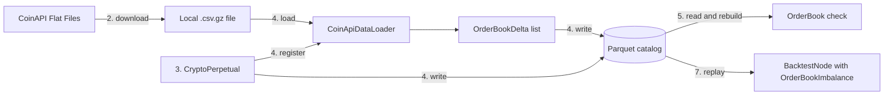
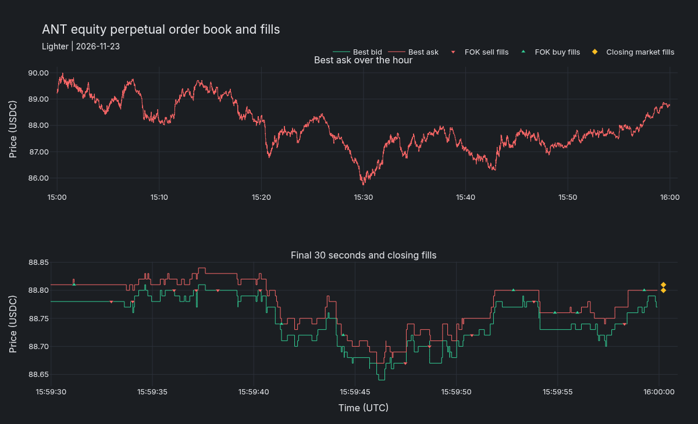

# Backtest with Pre-IPO Order Book Data (CoinAPI)

Download one hour of Lighter ANTHROPIC pre-IPO perpetual order book data from CoinAPI, store it in a
Parquet catalog, and backtest an order book imbalance strategy on it. The download is cached
locally, so later runs work offline.

This market gives synthetic exposure to Anthropic's pre-IPO valuation. Lighter normalizes the
contract with an assumed share count of one billion and uses an internal pricing mechanism. The
perpetual does not give ownership of company shares. See Lighter's
[market specifications](https://docs.lighter.xyz/trading/real-world-assets-rwas/market-specifications)
and [pre-IPO market rules](https://docs.lighter.xyz/trading/real-world-assets-rwas/pre-ipo-markets).

The tutorial has eight steps:

1. [Choose the file and storage paths](#1-choose-the-file-and-storage-paths): select the CoinAPI
   export and where to store it.
1. [Download the full-book file](#2-download-the-full-book-file): fetch the export and verify its
   checksum.
1. [Define the Lighter contract](#3-define-the-lighter-contract): create the instrument the loader
   uses to convert prices and sizes.
1. [Write the data to a catalog](#4-write-the-data-to-a-catalog): convert the file to order book
   deltas and save them with the instrument.
1. [Rebuild the book to check the data](#5-rebuild-the-book-to-check-the-data): read the deltas
   back, apply them, and check the book.
1. [Configure the backtest](#6-configure-the-backtest): set up the venue, the margin account, and the
   strategy.
1. [Run the backtest from the catalog](#7-run-the-backtest-from-the-catalog): load the catalog into
   `BacktestNode` and run the strategy.
1. [Review the results](#8-review-the-results): compare orders, fills, and PnL with the reference run.

Each step shows the Rust and Python code side by side. The complete programs are
[`coinapi_lighter_book_imbalance.rs`][rust-program] and
[`coinapi_lighter_book_imbalance.py`][python-program].

## How CoinAPI represents Lighter order book data

CoinAPI [Flat Files](https://www.coinapi.io/products/flat-files?ref=nautilus) are `.csv.gz` exports
served over an S3-compatible API. Each full-book file holds one symbol for one UTC partition, and
its object key describes its contents:

| Key part                        | Meaning                                                         |
| ------------------------------- | --------------------------------------------------------------- |
| `T-LIMITBOOK_FULL`              | Full-book dataset: a snapshot followed by all recorded updates. |
| `D-2026100100`                  | UTC date and hour: `[00:00, 01:00)` on 2026-10-01.              |
| `E-LIGHTER`                     | Exchange.                                                       |
| `IDDI-47534074`                 | CoinAPI numeric symbol ID.                                      |
| `SC-LIGHTER_PERP_ANTHROPIC_USD` | CoinAPI symbol ID.                                              |
| `S-ANTHROPIC`                   | Exchange symbol.                                                |

The catalog stores the instrument definition and the order book history for the hour:

| Data                     | Source                  | Nautilus object                            |
| ------------------------ | ----------------------- | ------------------------------------------ |
| Instrument definition    | You define it (step 3). | `CryptoPerpetual` `ANTHROPIC-PERP.LIGHTER` |
| Book history of the hour | The file's rows.        | List of `OrderBookDelta` values            |

The rows have empty order IDs, so they describe price levels: an L2 market-by-price (MBP) book. The
loader groups the deltas into batches. Each batch is one book event:

| Batch                  | Contents                                                                               |
| ---------------------- | -------------------------------------------------------------------------------------- |
| First                  | `CLEAR`, then one `ADD` per price level, all `F_SNAPSHOT`: the book at the hour start. |
| Later                  | Level updates that share one exchange timestamp.                                       |
| Last delta of each one | Carries the `F_LAST` flag. The book is complete only after this delta.                 |

Each delta's `ts_event` is the exchange time (`time_exchange`) and its `ts_init` is the time CoinAPI
received the update (`time_coinapi`). Book rows carry only a time of day, so the loader takes the UTC
date from the `D-2026100100` directory in the file path. The integration guide's
[timestamp rules](../integrations/coinapi.md#timestamps) cover rows near midnight. Level updates can
have separate timestamps, so `F_LAST` marks the end of a loader event, not an atomic venue update.



The catalog is the hand-off point: steps 5 to 8 read only from it. After the first run, the
programs skip steps 2 to 4 and need no API key or network access.

## Prerequisites

- A CoinAPI key with Flat Files access and enough usage credits for the first download. Listing and
  downloading files incur charges, and a retried download starts again and can be charged again.
  See [Flat Files access](https://www.coinapi.io/products/flat-files/docs?ref=nautilus).
- **Rust**: A source checkout. To use the crates in your own project, see
  [Run a Backtest (Rust)](../how_to/run_rust_backtest.md) for setup and dependencies.
- **Python**: Python 3.13, 3.14, or 3.15, NautilusTrader 2.x with the CoinAPI adapter
  (`pip install -U --pre nautilus_trader`), and pandas (`pip install pandas`).

Run the complete program from the repository root. For Python in a source checkout, build the
Python extension first.

```bash tab="Rust"
cargo run --bin coinapi-lighter-book-imbalance --package nautilus-tutorials --features examples
```

```bash tab="Python"
uv run --project python --no-sync --with pandas \
    python examples/backtest/coinapi_lighter_book_imbalance.py
```

A run reads `COINAPI_API_KEY` only when it downloads the file. The Python program prompts for the
key, without echoing it, when the variable is unset.

## 1. Choose the file and storage paths

| Name           | Value                                         | Purpose                                                          |
| -------------- | --------------------------------------------- | ---------------------------------------------------------------- |
| `BUCKET`       | `coinapi`                                     | CoinAPI bucket that holds historical files, including this hour. |
| `OBJECT_KEY`   | `T-LIMITBOOK_FULL/D-2026100100/E-LIGHTER/...` | Full-book file for `LIGHTER_PERP_ANTHROPIC_USD`, about 279 KB.   |
| `FILE_SHA256`  | `2ed141be...`                                 | SHA-256 of the export behind the reference run.                  |
| Instrument ID  | `ANTHROPIC-PERP.LIGHTER`                      | Native Lighter adapter ID for the contract.                      |
| Book type      | `L2_MBP`                                      | Price-level book, which matches the file's empty order IDs.      |
| Data directory | `NAUTILUS_DATA_DIR/CoinAPI`                   | Storage root. The default is `~/Downloads/Data/CoinAPI`.         |
| File path      | `<data directory>/<OBJECT_KEY>`               | Downloaded file. It keeps CoinAPI's partition directories.       |
| Catalog path   | `lighter-anthropic-20261001-00`               | Catalog for this file. Rename it for another hour.               |

**Buckets**: The `coinapi-daily-tail` bucket retains only the previous day's daily files, so this
hour comes from the historical `coinapi` bucket. See the
[full-book file layout](https://www.coinapi.io/products/flat-files/docs/datasets/limitbook?ref=nautilus)
when you select another partition.

```rust tab="Rust"
const BUCKET: &str = "coinapi";
const OBJECT_KEY: &str = "T-LIMITBOOK_FULL/D-2026100100/E-LIGHTER/IDDI-47534074+SC-LIGHTER_PERP_ANTHROPIC_USD+S-ANTHROPIC.csv.gz";
const FILE_SHA256: &str = "2ed141be6480c56ff16322e08bbc43398edc710875fe81093e0635ff672e48e4";
const RUN_ID: &str = "coinapi-lighter";

let instrument_id = InstrumentId::from("ANTHROPIC-PERP.LIGHTER");
let book_type = BookType::L2_MBP;

let data_dir = match std::env::var_os("NAUTILUS_DATA_DIR") {
    Some(dir) => PathBuf::from(dir),
    None => std::env::home_dir()
        .context("home directory not found, set NAUTILUS_DATA_DIR")?
        .join("Downloads")
        .join("Data"),
}
.join("CoinAPI");

let filepath = data_dir.join(OBJECT_KEY);
let catalog_path = data_dir.join("lighter-anthropic-20261001-00");
```

```python tab="Python"
BUCKET = "coinapi"
OBJECT_KEY = (
    "T-LIMITBOOK_FULL/D-2026100100/E-LIGHTER/"
    "IDDI-47534074+SC-LIGHTER_PERP_ANTHROPIC_USD+S-ANTHROPIC.csv.gz"
)
FILE_SHA256 = "2ed141be6480c56ff16322e08bbc43398edc710875fe81093e0635ff672e48e4"
INSTRUMENT_ID = InstrumentId.from_str("ANTHROPIC-PERP.LIGHTER")
BOOK_TYPE = BookType.L2_MBP

DATA_DIR = Path(os.environ.get("NAUTILUS_DATA_DIR", "~/Downloads/Data")).expanduser() / "CoinAPI"
FILEPATH = DATA_DIR / OBJECT_KEY
CATALOG_PATH = DATA_DIR / "lighter-anthropic-20261001-00"
```

## 2. Download the full-book file

The programs run steps 2 to 4 only when the catalog path does not exist; later runs skip them and
need no API key or network access.

Create a `CoinApiDataLoader` and download the file when it is not already on disk. The loader handles
authentication and streams the response to a temporary file, which it moves to the destination only
after the complete download, so a failed download leaves no partial file at the destination. A file
already on disk, such as one kept after a failed catalog write, is reused without another download.

Then compare the file's SHA-256 with `FILE_SHA256`. The checksum pins the exact export behind the
reference run. A mismatch stops the run before parsing; verify the file before you replace it.

```rust tab="Rust"
let loader = CoinApiDataLoader::new(None); // Reads COINAPI_API_KEY to download
if !filepath.is_file() {
    loader
        .download_flat_file(BUCKET, OBJECT_KEY, &filepath)
        .await?;
}

let file = std::fs::read(&filepath)?;
let file_digest = digest::digest(&digest::SHA256, &file);
let checksum = hex::encode(file_digest);
anyhow::ensure!(
    checksum == FILE_SHA256,
    "unexpected SHA-256 for {}, verify the selected export",
    filepath.display()
);
```

```python tab="Python"
async def download(api_key: str) -> None:
    loader = CoinApiDataLoader(api_key=api_key)
    await loader.download_flat_file(BUCKET, OBJECT_KEY, FILEPATH)


if not FILEPATH.is_file():
    api_key = os.environ.get("COINAPI_API_KEY") or getpass("CoinAPI API key: ")
    asyncio.run(download(api_key))
    del api_key

with FILEPATH.open("rb") as file:
    checksum = file_digest(file, "sha256").hexdigest()

if checksum != FILE_SHA256:
    raise ValueError(f"Unexpected SHA-256 for {FILEPATH}, verify the selected export")
```

The download method is async. The Python program runs it with `asyncio.run`; in a notebook with a
running event loop, use `await download(api_key)` instead.

## 3. Define the Lighter contract

`CoinApiDataLoader` converts the file with an instrument definition that you register. It does not
need the live client's instrument mapper, which does not support Lighter. `CryptoPerpetual` matches
the native Lighter adapter's model for this contract.

| Setting                                 | Value                    | Meaning                                                                |
| --------------------------------------- | ------------------------ | ---------------------------------------------------------------------- |
| `instrument_id`                         | `ANTHROPIC-PERP.LIGHTER` | Native Lighter adapter ID.                                             |
| `raw_symbol`, `base_currency`           | `ANTHROPIC`              | Lighter market symbol.                                                 |
| `quote_currency`, `settlement_currency` | `USDC`                   | Native settlement currency. CoinAPI's `USD` suffix does not change it. |
| `is_inverse`                            | `false`                  | Sizes are contract units, not USDC amounts.                            |
| `price_precision`, `price_increment`    | 1, `0.1`                 | Venue tick size. The export's prices have one decimal place.           |
| `size_precision`, `size_increment`      | 5, `0.00001`             | Venue lot size. The export's sizes have five decimal places.           |
| `min_quantity`                          | `0.00250`                | Minimum order quantity, in contract units.                             |
| `min_notional`                          | 10 USDC                  | Minimum order value, checked separately from the quantity.             |
| `margin_init`                           | 0.20                     | Initial margin: 20% of the order value.                                |
| `margin_maint`                          | 0.12                     | Maintenance margin: 12% of the position value.                         |
| `ts_event`, `ts_init`                   | 0                        | The definition has no event time.                                      |

**Assumed terms**: The minimum order, minimum notional, and margin rates are assumptions based on
native metadata, not a reconstruction of historical venue rules. Verify the terms for your research
period before you draw conclusions from PnL.

```rust tab="Rust"
let usdc = Currency::USDC();
let raw_symbol = Symbol::from("ANTHROPIC");
let base_currency = Currency::get_or_create_crypto("ANTHROPIC");
let price_increment = Price::from("0.1");
let size_increment = Quantity::from("0.00001");
let min_quantity = Quantity::from("0.00250");
let min_notional = Money::from_decimal(dec!(10), usdc)?;
let instrument = CryptoPerpetual::builder()
    .instrument_id(instrument_id)
    .raw_symbol(raw_symbol)
    .base_currency(base_currency)
    .quote_currency(usdc)
    .settlement_currency(usdc)
    .is_inverse(false)
    .price_precision(1)
    .size_precision(5)
    .price_increment(price_increment)
    .size_increment(size_increment)
    .min_quantity(min_quantity)
    .min_notional(min_notional)
    .margin_init(dec!(0.20))
    .margin_maint(dec!(0.12))
    .ts_event(UnixNanos::default())
    .ts_init(UnixNanos::default())
    .build()?;
```

```python tab="Python"
usdc = Currency.from_str("USDC")
instrument = CryptoPerpetual(
    instrument_id=INSTRUMENT_ID,
    raw_symbol=Symbol("ANTHROPIC"),
    base_currency=Currency.from_str("ANTHROPIC"),
    quote_currency=usdc,
    settlement_currency=usdc,
    is_inverse=False,
    price_precision=1,
    size_precision=5,
    price_increment=Price.from_str("0.1"),
    size_increment=Quantity.from_str("0.00001"),
    min_quantity=Quantity.from_str("0.00250"),
    min_notional=Money.from_decimal(Decimal(10), usdc),
    margin_init=Decimal("0.20"),
    margin_maint=Decimal("0.12"),
    ts_event=0,
    ts_init=0,
)
```

## 4. Write the data to a catalog

Register the contract with the loader so the conversion uses its price and size precision. A value
finer than that precision fails the load instead of being rounded. In Rust, the two `None` arguments
are the optional REST symbol ID and consolidated OHLCV file symbol ID, which book files do not need.
Local loading requires no credentials.

Load the entire file in its original order. Do not set a row `limit`: it can cut a snapshot or
update event short, and the last delta it returns still carries `F_LAST`, so the book looks complete
when it is not. To bound memory while you write a larger file to the catalog, `stream_book_deltas`
yields chunks that end at event boundaries and can exceed `chunk_size` (100,000 deltas by default in
Python). Streaming helps only this step: step 5 reads every delta back, and the replay loads all data
at once unless `BacktestRunConfig` sets `chunk_size`.

The loader reads the date from the `D-` directory that contains the file. If you move the file out
of its original partition, pass `date` explicitly.

```rust tab="Rust"
let instrument = InstrumentAny::CryptoPerpetual(instrument);
loader.add_instrument(instrument.clone(), None, None)?;
let deltas = loader.load_book_deltas(&filepath, instrument_id, None, None)?;

std::fs::create_dir_all(&catalog_path)?;
let catalog = ParquetDataCatalog::builder().uri(&catalog_path).build()?;
let instruments = vec![instrument];
catalog.write_instruments(instruments)?;
catalog.write_to_parquet(&deltas, None, None, None)?;
```

```python tab="Python"
loader = CoinApiDataLoader()
loader.add_instrument(instrument)
deltas = loader.load_book_deltas(FILEPATH, INSTRUMENT_ID)

CATALOG_PATH.mkdir(parents=True)
catalog = ParquetDataCatalog(str(CATALOG_PATH))
catalog.write_instruments([instrument])
catalog.write_order_book_deltas(deltas)
```

The programs create the catalog folder only after a complete download and load, so a failed download
or load leaves no catalog. If a write fails, delete the catalog path before the next run.

Later runs read the instrument and deltas only from the catalog and skip steps 2 to 4, including the
checksum. After you change `OBJECT_KEY`, `FILE_SHA256`, or a contract setting from step 3, delete the
catalog path or choose a new one; otherwise the run uses the old data and definition.

## 5. Rebuild the book to check the data

The backtest engine rebuilds the book from the deltas itself. Rebuilding it here first checks the
data before any strategy runs. The code reads the instrument and deltas back from the catalog, so it
checks the same data the backtest uses.

Check that the deltas open with a snapshot: a `CLEAR` flagged `F_SNAPSHOT`. Then apply the deltas
in their original order. At the end of each batch (`F_LAST`), count the batch and any locked or
crossed book, where the best bid is at or above the best ask. Check the book's integrity after each
snapshot batch and at the end of the file. Both programs then print these counts and the top
three levels of the final book.

```rust tab="Rust"
let mut catalog = ParquetDataCatalog::builder().uri(&catalog_path).build()?;
let instrument_ids = vec![instrument_id.to_string()];
let instrument = catalog
    .instruments(Some(&instrument_ids), None, None)?
    .into_iter()
    .next()
    .context("instrument missing from catalog")?;
let deltas = catalog
    .order_book_deltas()
    .identifiers(instrument_ids)
    .execute()?;

let first = deltas.first().context("catalog has no book deltas")?;
anyhow::ensure!(
    first.action == BookAction::Clear && RecordFlag::F_SNAPSHOT.matches(first.flags),
    "book deltas do not open with a snapshot"
);

let mut book = OrderBook::new(instrument_id, book_type);
let mut batches = 0;
let mut locked_or_crossed = 0;

for delta in &deltas {
    book.apply_delta(delta)?;
    if !RecordFlag::F_LAST.matches(delta.flags) {
        continue;
    }

    batches += 1;

    if RecordFlag::F_SNAPSHOT.matches(delta.flags) {
        book_check_integrity(&book)?;
    }

    if let (Some(bid), Some(ask)) = (book.best_bid_price(), book.best_ask_price())
        && bid >= ask
    {
        locked_or_crossed += 1;
    }
}

book_check_integrity(&book)?;
let top_levels = book.pprint(3, None);
println!("Loaded {} deltas in {batches} batches", deltas.len());
println!("Locked or crossed books: {locked_or_crossed}");
println!("{top_levels}");
```

```python tab="Python"
catalog = ParquetDataCatalog(str(CATALOG_PATH))
[instrument] = catalog.instruments(instrument_ids=[str(INSTRUMENT_ID)])
deltas = catalog.query_order_book_deltas(identifiers=[str(INSTRUMENT_ID)])

first = deltas[0]
if first.action != BookAction.CLEAR or not RecordFlag.F_SNAPSHOT.matches(first.flags):
    raise ValueError("Book deltas do not open with a snapshot")

book = OrderBook(INSTRUMENT_ID, BOOK_TYPE)
batches = 0
locked_or_crossed = 0

for delta in deltas:
    book.apply_delta(delta)
    if not RecordFlag.F_LAST.matches(delta.flags):
        continue

    batches += 1

    if RecordFlag.F_SNAPSHOT.matches(delta.flags):
        book.check_integrity()

    bid, ask = book.best_bid_price(), book.best_ask_price()
    if bid is not None and ask is not None and bid.as_decimal() >= ask.as_decimal():
        locked_or_crossed += 1

book.check_integrity()
print(f"Loaded {len(deltas):,} deltas in {batches:,} batches")
print(f"Locked or crossed books: {locked_or_crossed:,}")
print(book.pprint(3))
```

**Locked and crossed books**: This file has none, but other partitions can briefly produce locked
or crossed books while level changes apply. Keep every delta in the catalog. The integrity check
fails on a crossed book, so the programs check only snapshot batches and the final book. The
strategy and the figures skip books without a positive spread.

## 6. Configure the backtest

The strategy is the built-in Rust `OrderBookImbalance`, which the Binance and Bybit tutorials also
use from Python. It watches the sizes at the best bid and best ask. When one side is much larger, it
sends a fill-or-kill (FOK) limit order against the thinner side: it buys at the best ask when the
bid side is larger, and sells at the best bid when the ask side is larger. It skips books without a
positive spread and closes its position when it stops.

| Strategy setting               | Value     | Effect                                                                                   |
| ------------------------------ | --------- | ---------------------------------------------------------------------------------------- |
| `trigger_min_size`             | 1.0       | The larger best-quote size must exceed one contract unit.                                |
| `trigger_imbalance_ratio`      | 0.20      | The smaller size must be below 20% of the larger size.                                   |
| `max_trade_size`               | `0.01000` | Each signal order is for the smaller of 0.01 contract units and the thinner side's size. |
| `min_seconds_between_triggers` | 1.0       | At least one second passes between signals.                                              |
| `book_type`                    | `L2_MBP`  | The strategy subscribes to the same book type as the data.                               |

| Venue setting       | Value                 | Effect                                                         |
| ------------------- | --------------------- | -------------------------------------------------------------- |
| `name`              | `LIGHTER`             | Taken from the instrument ID, so the two always match.         |
| `account_type`      | `MARGIN`              | Positions need only margin, so the strategy can sell short.    |
| `oms_type`          | `NETTING`             | One position per instrument.                                   |
| `starting_balances` | 100,000 USDC          | Balance available for margin and PnL.                          |
| `margin_model`      | `StandardMarginModel` | Applies the 20% and 12% rates without a leverage reduction.    |
| `book_type`         | `L2_MBP`              | The matching engine fills orders against the price-level book. |
| `fee_model`         | Zero maker and taker  | This teaching run charges no fees.                             |

| Run setting             | Value                                   | Effect                                                                                           |
| ----------------------- | --------------------------------------- | ------------------------------------------------------------------------------------------------ |
| `data_type`             | `OrderBookDelta`                        | Reads the instrument's book deltas from the catalog path.                                        |
| `emit_quotes_from_book` | `true`                                  | Gives the risk engine a price for the market order that closes the position.                     |
| `raise_exception`       | `true`                                  | A failed run stops with its error instead of returning no results.                               |
| `id`                    | `coinapi-lighter` (Rust only)           | Run ID. Rust uses it to find the engine for the strategy; Python uses the generated `config.id`. |
| `dispose_on_completion` | `true` (Rust default), `False` (Python) | Python keeps the engine after the run to generate reports; Rust disposes it.                     |
| Log level               | `ERROR` (Python only)                   | Keeps the printed reports readable; Rust keeps the default log output.                           |

**Closing price**: `emit_quotes_from_book` makes the data engine cache top-of-book quotes derived
from the deltas. Without them, the risk engine denies the closing market order with
`MARKET_PRICE_UNAVAILABLE` and leaves the position open.

**Simulation limits**: The run omits funding, network latency, transaction costs, and IPO conversion
or settlement. L2 data cannot establish individual order queue positions, and simulated fills do not
predict live execution. The strategy demonstrates the data workflow; it has no demonstrated edge.

```rust tab="Rust"
let data_engine = DataEngineConfig::builder()
    .emit_quotes_from_book(true)
    .build();
let engine = BacktestEngineConfig::builder()
    .data_engine(data_engine)
    .build();

let fees = MakerTakerFeeModel::zero();
let venue = BacktestVenueConfig::builder()
    .name(instrument_id.venue.as_str())
    .oms_type(OmsType::Netting)
    .account_type(AccountType::Margin)
    .starting_balances(vec!["100000 USDC".to_string()])
    .book_type(book_type)
    .margin_model(MarginModelAny::Standard(StandardMarginModel))
    .fee_model(FeeModelAny::MakerTaker(fees))
    .build()?;

let catalog_location = catalog_path.display().to_string();
let catalog_config = DataCatalogConfig::new(catalog_location, None, None);
let data = BacktestDataConfig::builder()
    .catalog(catalog_config)
    .data_type(NautilusDataType::OrderBookDelta)
    .instrument_id(instrument_id)
    .build()?;

let config = BacktestRunConfig::builder()
    .id(RUN_ID.to_string())
    .engine(engine)
    .venues(vec![venue])
    .data(vec![data])
    .raise_exception(true)
    .build()?;

let max_trade_size = Quantity::from("0.01000");
let strategy_config = OrderBookImbalanceConfig::builder()
    .instrument_id(instrument_id)
    .book_type(book_type)
    .max_trade_size(max_trade_size)
    .trigger_min_size(dec!(1.0))
    .trigger_imbalance_ratio(dec!(0.20))
    .min_seconds_between_triggers(1.0)
    .build();
```

```python tab="Python"
config = BacktestRunConfig(
    engine=BacktestEngineConfig(
        logging=LoggerConfig(stdout_level=LogLevel.ERROR),
        data_engine=DataEngineConfig(emit_quotes_from_book=True),
    ),
    venues=[
        BacktestVenueConfig(
            name=str(INSTRUMENT_ID.venue),
            oms_type=OmsType.NETTING,
            account_type=AccountType.MARGIN,
            starting_balances=["100000 USDC"],
            book_type=BOOK_TYPE,
            margin_model=StandardMarginModel(),
            fee_model=MakerTakerFeeModel(maker_rate=Decimal(0), taker_rate=Decimal(0)),
        ),
    ],
    data=[
        BacktestDataConfig(
            catalog=DataCatalogConfig(path=str(CATALOG_PATH)),
            data_type=NautilusDataType.OrderBookDelta,
            instrument_id=instrument.id,
        ),
    ],
    dispose_on_completion=False,
    raise_exception=True,
)

strategy_config = OrderBookImbalanceConfig(
    instrument_id=instrument.id,
    book_type=BOOK_TYPE,
    max_trade_size=Quantity.from_str("0.01000"),
    trigger_min_size=Decimal("1.0"),
    trigger_imbalance_ratio=Decimal("0.20"),
    min_seconds_between_triggers=1.0,
)
```

## 7. Run the backtest from the catalog

`BacktestNode` builds the engine from the configuration, loads the deltas from the catalog, and
runs the strategy on them. With `batch_deltas` at its default of `true`, it groups the deltas into
batches that end at each `F_LAST` delta, so the strategy only acts on complete books. The data
configuration sets no start or end time, so the replay begins with the opening snapshot and the
strategy starts with a complete book. A later start would skip that snapshot and replay updates onto
an empty book.

```rust tab="Rust"
let mut node = BacktestNode::new(vec![config])?;
node.build()?;

let strategy = OrderBookImbalance::from_config(strategy_config)?;
node.get_engine_mut(RUN_ID)
    .context("engine not built")?
    .add_strategy(strategy)?;

let results = node.run()?;
```

```python tab="Python"
node = BacktestNode(configs=[config])

try:
    node.build()
    node.add_builtin_strategy(config.id, "OrderBookImbalance", strategy_config)
    results = node.run()

    orders = node.generate_orders_report(config.id)
    executions = node.generate_fills_report(config.id)
    positions = node.generate_positions_report(config.id)
    account = node.generate_account_report(config.id, venue=INSTRUMENT_ID.venue)
finally:
    node.dispose()
```

## 8. Review the results

Check order statuses, fills, positions, and balances together, and inspect commissions and the final
position exposure as well as PnL. Order status counts include orders with no fills. The account
report records balance changes, and the position report holds the realized PnL of closed positions.

The Rust program prints the run totals and PnL statistics. The Python program prints the run
result, the order status counts, the fill counts by order type and side, the last eight fills, the
position with its realized PnL and commissions, and the last balance changes. It then checks that
the final position is flat.

```rust tab="Rust"
for result in &results {
    println!(
        "Orders: {}, positions: {}",
        result.total_orders, result.total_positions
    );
    println!("PnL statistics: {:?}", result.stats_pnls);
}
```

```python tab="Python"
print(orders["status"].value_counts().to_string())
print(executions.groupby(["order_type", "order_side"]).size().to_string())
print(
    executions[["ts_event", "order_side", "order_type", "last_qty", "last_px", "commission"]]
    .tail(8)
    .to_string(),
)
print(
    positions[
        [
            "side",
            "quantity",
            "peak_qty",
            "avg_px_open",
            "avg_px_close",
            "realized_pnl",
            "commissions",
        ]
    ].to_string(),
)
print(account[["total", "locked", "free", "currency"]].tail().to_string())

assert not positions.empty, "No positions opened; inspect the selected file and signal"
assert positions["ts_closed"].notna().all(), "The strategy left an open position"
assert positions["side"].eq("FLAT").all()
assert positions["quantity"].map(Decimal).eq(Decimal(0)).all()
```

### Reference run

Compare the data counts first.

| Result         | Reference value                                               |
| -------------- | ------------------------------------------------------------- |
| Deltas loaded  | 15,047 in 14,814 batches; the 234-delta snapshot is one batch |
| Iterations     | 14,814 backtest iterations, one per batch                     |
| Window         | 2026-10-01, `[00:00, 01:00)` UTC                              |
| Orders         | 234, all filled                                               |
| Order types    | 233 FOK limit orders: 232 sells and one buy; one market buy   |
| Peak short     | 2.30689 contract units                                        |
| Average prices | About 2120.30 USDC to open and 2120.80 USDC to close          |
| Realized PnL   | -1.157298 USDC, with zero fees                                |
| Final balance  | 99,998.84270200 USDC                                          |

The Python program prints the counts, statuses, position values, and final balance in this table.
Its fill counts show the closing market buy as six fills, and it does not print the snapshot size.
The Rust program prints the delta and batch counts, the order and position totals, and the PnL. A
successful replay shows that the data pipeline works, not that this strategy is profitable.

The FOK orders build the short position. The final market buy closes it at 00:59:58.300495500 UTC
and fills against six ask levels at the same simulated timestamp:

| Level | Quantity | Price (USDC) |
| ----- | -------- | ------------ |
| 1     | 0.23177  | 2120.5       |
| 2     | 0.11033  | 2120.7       |
| 3     | 1.55518  | 2120.8       |
| 4     | 0.12877  | 2120.9       |
| 5     | 0.16205  | 2121.0       |
| 6     | 0.11879  | 2121.1       |

The first three levels match the asks that step 5 prints for the final book. The order consumes
several levels, so most of it fills above the best ask of 2120.5.

### Figures

The figures use the same pinned export, complete hour, configuration, and reports as the Python
program. The renderer records the best bid and ask with their sizes after each completed batch, and
skips books with an empty side or without a positive spread. Lines step from one book state to the
next; markers show individual fills.



**Figure 1.** The FOK sells build the short position, and one FOK buy reduces it. The diamonds at
the end mark the six closing fills from the table above. Sharp quote spikes include intermediate
states that last microseconds between recorded level updates. This zero-latency strategy can fill at
these prices.


**Figure 2.** Across all states, the spread is in `[0.1, 2.1]` USDC. For states that last at least
one millisecond, it is in `[0.1, 0.9]` USDC. Durations use receipt time (`ts_init`) until the next
recorded update: 7,342 of 14,813 measured intervals are shorter than 10 microseconds. Best-quote
sizes vary across several orders of magnitude, so depth uses a logarithmic axis. Sizes are contract
units, not company shares.


**Figure 3.** Position and PnL over the hour:

- **Position**: The top panel shows cumulative signed fill quantities. The short reaches 2.30689
  units, and the final market buy returns it to zero.
- **Marked PnL**: The bottom panel marks the open position at the midpoint, so it shows realized and
  unrealized PnL together. PnL peaks near 1.7 USDC around 00:22, after the price falls while the
  strategy holds 0.68689 units short. It falls below -2 USDC near 00:58 with the full short.
- **Closing cost**: Just before the close, the short marked at the midpoint of 2120.4 is down
  0.234182 USDC. The six closing fills cost another 0.923116 USDC against that midpoint; their
  volume-weighted price is about 0.40 above it.
- **Realized PnL**: Once flat, PnL equals the account's balance change of -1.157298 USDC. The
  balance changes only when fills reduce or close the position, so it does not show these swings.

## Regenerate the figures

The figure renderer uses Plotly and Kaleido, and Kaleido needs a Chrome-compatible browser. From a
source checkout, run:

```bash
uv run --project python --no-sync --with pandas --with plotly --with kaleido \
    python docs/tutorials/assets/backtest_orderbook_coinapi/render_panels.py
```

If Kaleido reports that Chrome is missing, install its browser once with:

```bash
uv run --project python --no-sync --with plotly --with kaleido plotly_get_chrome -y
```

The renderer runs the Python program, so it reuses the catalog or downloads the file as in step 2.
It prints the spread ranges and the short-interval count from Figure 2, writes PNG files to
`docs/tutorials/assets/backtest_orderbook_coinapi/`, and keeps exact decimals until it converts
values to plot coordinates. If the marked PnL after the close differs from the account's balance
change, the renderer stops with an error before it writes any files.

## Use another hour

The loader downloads objects but does not list them. To test another hour, list the available
objects with CoinAPI's [S3 SDK guide](https://www.coinapi.io/products/flat-files/docs/s3-api/sdk?ref=nautilus)
and select the ANTHROPIC file. Update `OBJECT_KEY` and `FILE_SHA256` together after you verify the
new file, and change the catalog path. Check the file schema, the opening snapshot, and the
instrument precision before you load it. The [CoinAPI integration guide](../integrations/coinapi.md#flat-files)
describes the accepted CSV layout and timestamp rules.

[rust-program]: https://github.com/nautechsystems/nautilus_trader/blob/develop/examples/tutorials/src/bin/coinapi_lighter_book_imbalance.rs
[python-program]: https://github.com/nautechsystems/nautilus_trader/blob/develop/examples/backtest/coinapi_lighter_book_imbalance.py
