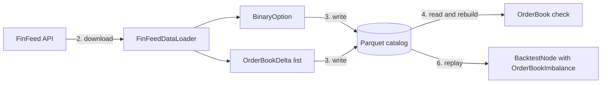
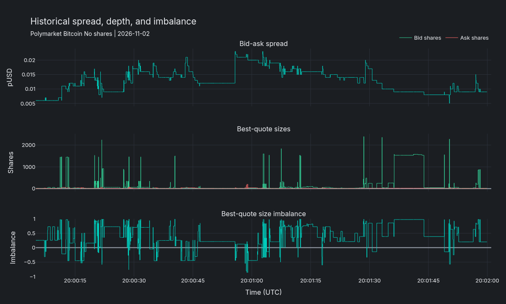
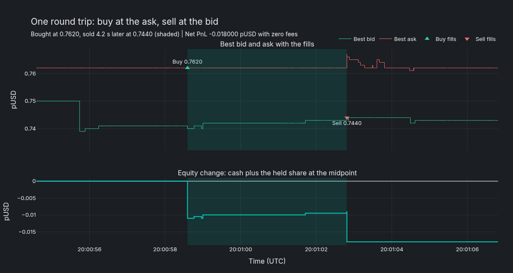

# Backtest with Polymarket Order Book Data (FinFeed)

Download two minutes of Polymarket order book history from FinFeed, store it in a Parquet catalog,
and backtest an order book imbalance strategy on it. The market is a daily Bitcoin price threshold,
and the strategy trades its Yes shares. The replay ends before the market expires and the strategy
closes its own position, so the result does not depend on a settlement payout.

The tutorial has seven steps:

1. [Choose the market and time window](#1-choose-the-market-and-time-window): set the outcome, the
   replay window, and where to store the data.
1. [Download the book history](#2-download-the-book-history): fetch the instrument definition and
   the order book deltas from FinFeed.
1. [Write the data to a catalog](#3-write-the-data-to-a-catalog): save both to a Parquet catalog
   that later runs reuse.
1. [Rebuild the book to check the data](#4-rebuild-the-book-to-check-the-data): read the deltas
   back, apply them, and inspect the best bid and ask.
1. [Configure the backtest](#5-configure-the-backtest): set up the venue, the account, and the
   strategy.
1. [Run the backtest from the catalog](#6-run-the-backtest-from-the-catalog): load the catalog
   into `BacktestNode` and run the strategy.
1. [Review the results](#7-review-the-results): compare orders, fills, and PnL with the reference
   run.

Each step shows the Rust and Python code side by side. The complete programs are
[`finfeed_polymarket_book_imbalance.rs`][rust-program] and
[`finfeed_polymarket_book_imbalance.py`][python-program].

## How FinFeed represents Polymarket data

A Polymarket market asks a yes/no question, such as whether Bitcoin is above 76K on November 3,
2026. Yes shares and No shares trade in separate order books. A winning share redeems for 1 pUSD and
a losing share for nothing, so share prices lie between 0 and 1 pUSD.

FinFeed assigns each outcome its own ID. For one outcome, the tutorial loads the instrument
definition and the order book history:

| FinFeed data                    | Example                                    | Nautilus object                  |
| ------------------------------- | ------------------------------------------ | -------------------------------- |
| Outcome: one side of the market | `BITCOIN-ABOVE-76K-ON-NOVEMBER-3-2026_YES` | `BinaryOption` instrument.       |
| Book history of that outcome    | Snapshots and level updates by UTC hour    | List of `OrderBookDelta` values. |

The `_YES` suffix selects the Yes shares only, not the whole market. To load the No shares, select
the `_NO` ID separately.

The loader groups the deltas into batches. Each batch is one book event:

| Batch                  | Contents                                                                                 |
| ---------------------- | ---------------------------------------------------------------------------------------- |
| First                  | `CLEAR`, then one `ADD` per price level, all `F_SNAPSHOT`: the book at the window start. |
| Later                  | Changes to price levels, or a new full snapshot when FinFeed records one.                |
| Last delta of each one | Carries the `F_LAST` flag. The book is complete only after this delta.                   |

The loader keeps FinFeed's record order and exchange timestamps, even when an exchange timestamp
goes backward. It stamps the first snapshot with the window start, and every later delta keeps
FinFeed's exchange timestamp as `ts_event`. The loader derives `ts_init` so that it never goes
backward, and the replay uses `ts_init` for ordering and for the window bounds. `ts_init` does not
record when the data was received.



The catalog is the hand-off point: steps 4 to 7 read only from it. After the first run, the
programs skip steps 2 and 3 and need no API key or network access.

## Prerequisites

- A FinFeed key with Prediction Markets historical order book access. The first run sends at least
  three requests: one for the instrument definition and two book pages of up to 10,000 records each,
  plus any retries. The adapter's local attempt allowance does not show FinFeed's billing units or
  your remaining quota. See [FinFeed authentication](../integrations/finfeed.md#authentication-and-environment).
- **Rust**: A source checkout. To use the crates in your own project, see
  [Run a Backtest (Rust)](../how_to/run_rust_backtest.md) for setup and dependencies.
- **Python**: Python 3.13, 3.14, or 3.15, NautilusTrader 2.x (`pip install -U --pre nautilus_trader`),
  and pandas (`pip install pandas`).

Run the complete program from the repository root. For Python in a source checkout, build the
Python extension first.

```bash tab="Rust"
cargo run --bin finfeed-polymarket-book-imbalance --package nautilus-tutorials --features examples
```

```bash tab="Python"
uv run --project python --no-sync --with pandas \
    python examples/backtest/finfeed_polymarket_book_imbalance.py
```

The first run reads `FINFEED_API_KEY`. The Python program prompts for the key, without echoing it,
when the variable is unset.

## 1. Choose the market and time window

| Name           | Value                                      | Purpose                                                                       |
| -------------- | ------------------------------------------ | ----------------------------------------------------------------------------- |
| `MARKET_ID`    | `BITCOIN-ABOVE-76K-ON-NOVEMBER-3-2026_YES` | FinFeed ID of the Yes outcome.                                                |
| Instrument ID  | `<MARKET_ID>.FINFEED_POLYMARKET`           | Nautilus instrument ID for FinFeed's Polymarket data.                         |
| Start          | 2026-11-02 20:00:05 UTC                    | Window start. The book at this time seeds the replay.                         |
| End            | 2026-11-02 20:02:00 UTC                    | Window end, inclusive.                                                        |
| Book type      | `L2_MBP`                                   | Price-level book (market by price), the only book FinFeed supplies.           |
| Data directory | `NAUTILUS_DATA_DIR/FinFeed`                | Storage root. The default is `~/Downloads/Data/FinFeed`.                      |
| Catalog path   | `btc-above-76k-nov3-20261102-20`           | Catalog for this outcome and window. Rename it for another outcome or window. |

**Window start**: The loader needs a book snapshot at or before the start in the same UTC hour. The
window starts a few seconds after 20:00 for this reason.

**Window date**: FinFeed sets this outcome's `EndDateIso` to 00:00 UTC on November 3. The adapter
uses that time as the instrument expiration, the simulated trading cutoff, so the window falls on
November 2. The cutoff is not the actual resolution time and does not set a payout.

**Instrument ID**: `finfeed_instrument_id` in Python and `to_instrument_id` in Rust build the ID from
the exchange and `MARKET_ID`, and reject an unknown exchange or invalid outcome ID. Keep this
`FINFEED_POLYMARKET` ID; the native Polymarket adapter uses different instrument IDs.

```rust tab="Rust"
const MARKET_ID: &str = "BITCOIN-ABOVE-76K-ON-NOVEMBER-3-2026_YES";
const RUN_ID: &str = "finfeed-polymarket";

let instrument_id = to_instrument_id("POLYMARKET", MARKET_ID)?;
let start = UnixNanos::from("2026-11-02T20:00:05Z");
let end = UnixNanos::from("2026-11-02T20:02:00Z");
let book_type = BookType::L2_MBP;

let data_dir = match std::env::var_os("NAUTILUS_DATA_DIR") {
    Some(dir) => PathBuf::from(dir),
    None => std::env::home_dir()
        .context("home directory not found, set NAUTILUS_DATA_DIR")?
        .join("Downloads")
        .join("Data"),
};
let catalog_path = data_dir
    .join("FinFeed")
    .join("btc-above-76k-nov3-20261102-20");
```

```python tab="Python"
MARKET_ID = "BITCOIN-ABOVE-76K-ON-NOVEMBER-3-2026_YES"
INSTRUMENT_ID = finfeed_instrument_id("POLYMARKET", MARKET_ID)
START = datetime(2026, 11, 2, 20, 0, 5, tzinfo=UTC)
END = datetime(2026, 11, 2, 20, 2, tzinfo=UTC)
BOOK_TYPE = BookType.L2_MBP

DATA_DIR = Path(os.environ.get("NAUTILUS_DATA_DIR", "~/Downloads/Data")).expanduser() / "FinFeed"
CATALOG_PATH = DATA_DIR / "btc-above-76k-nov3-20261102-20"
```

## 2. Download the book history

The programs run this step and step 3 only when the catalog path does not exist; later runs skip
both and need no API key or network access.

Create a `FinFeedDataLoader`, request the instrument definition, then request the book deltas for
the window from the same loader. The loader keeps the definition and needs it first: its price
increment and share precision control how FinFeed's records convert to deltas. No node or actor is
needed: the loader uses the same pagination and snapshot rebuild code as the adapter's data client.

The `BinaryOption` definition also sets the `pUSD` currency. It reflects FinFeed's metadata at
download time and does not reconstruct the venue's historical trading rules.

```rust tab="Rust"
let loader = FinFeedDataLoader::new(None); // Reads FINFEED_API_KEY
let instrument = loader.request_instrument(instrument_id).await?;
let deltas = loader
    .request_book_deltas(instrument_id, start, end, None)
    .await?;
```

```python tab="Python"
async def download(api_key: str) -> tuple[BinaryOption, list[OrderBookDelta]]:
    loader = FinFeedDataLoader(api_key=api_key)
    instrument = await loader.request_instrument(INSTRUMENT_ID)
    deltas = await loader.request_book_deltas(INSTRUMENT_ID, start=START, end=END)
    return instrument, deltas


api_key = os.environ.get("FINFEED_API_KEY") or getpass("FinFeed API key: ")
instrument, deltas = asyncio.run(download(api_key))
```

The loader methods are async. The Python program runs them with `asyncio.run`; in a notebook with a
running event loop, use `await download(api_key)` instead.

The book request returns every delta in the window or raises an error. Its first request covers the
UTC hour that contains the window start. It then follows FinFeed's overlapping pages of up to 10,000
records and keeps their record order. The request fails when:

- The start hour has no snapshot at or before the window start.
- Two pages do not join without ambiguity.
- The loader's attempt allowance runs out.
- FinFeed sends a book action the adapter does not support.

See [historical book limits](../integrations/finfeed.md#historical-books) for details.

## 3. Write the data to a catalog

A Parquet catalog stores the instrument and its deltas on disk. The backtest in step 6 reads its
data from this catalog, and later runs reuse it instead of downloading again.

```rust tab="Rust"
std::fs::create_dir_all(&catalog_path)?;
let catalog = ParquetDataCatalog::new(&catalog_path, None, None, None, None);
let instruments = vec![InstrumentAny::BinaryOption(instrument)];
catalog.write_instruments(instruments)?;
catalog.write_to_parquet(&deltas, None, None, None)?;
```

```python tab="Python"
CATALOG_PATH.mkdir(parents=True)
catalog = ParquetDataCatalog(str(CATALOG_PATH))
catalog.write_instruments([instrument])
catalog.write_order_book_deltas(deltas)
```

The programs create the catalog folder only after a complete download, so a failed download leaves
no catalog. If a write fails, delete the catalog path before the next run.

## 4. Rebuild the book to check the data

The backtest engine rebuilds the book from the deltas itself. Rebuilding it here first checks the
data before any strategy runs. The code reads the instrument and deltas back from the catalog, so it
checks the same data the backtest uses.

Apply the deltas in their original order and check the book's integrity at the end of each batch
(`F_LAST`). Both programs then print the delta and batch counts and the top three levels of the final
book.

```rust tab="Rust"
let mut catalog = ParquetDataCatalog::new(&catalog_path, None, None, None, None);
let instrument_ids = vec![instrument_id.to_string()];
let instrument = catalog
    .instruments(Some(&instrument_ids), None, None)?
    .into_iter()
    .next()
    .context("instrument missing from catalog")?;
let deltas = catalog.order_book_deltas(Some(instrument_ids), None, None)?;

let mut book = OrderBook::new(instrument_id, book_type);
let mut batches = 0;

for delta in &deltas {
    book.apply_delta(delta)?;
    if RecordFlag::F_LAST.matches(delta.flags) {
        book_check_integrity(&book)?;
        batches += 1;
    }
}

let top_levels = book.pprint(3, None);
println!("Loaded {} deltas in {batches} batches", deltas.len());
println!("{top_levels}");
```

```python tab="Python"
catalog = ParquetDataCatalog(str(CATALOG_PATH))
[instrument] = catalog.instruments(instrument_ids=[str(INSTRUMENT_ID)])
deltas = catalog.query_order_book_deltas(identifiers=[str(INSTRUMENT_ID)])

book = OrderBook(INSTRUMENT_ID, BOOK_TYPE)
batches = 0

for delta in deltas:
    book.apply_delta(delta)
    if RecordFlag.F_LAST.matches(delta.flags):
        book.check_integrity()
        batches += 1

print(f"Loaded {len(deltas):,} deltas in {batches:,} batches")
print(book.pprint(3))
```

A clean rebuild shows that the returned events form a valid book. It does not show that FinFeed
recorded every venue event: the replay depends on FinFeed's snapshots and updates, and missing
source events can leave gaps. FinFeed's polling subscriptions are a separate, sampled data path,
which this tutorial does not use.

## 5. Configure the backtest

The strategy is the built-in Rust `OrderBookImbalance`, the same one the other order book tutorials
use. It watches the sizes at the best bid and best ask. When one side is much larger, it sends a
fill-or-kill limit order against the thinner side: it buys at the best ask when the bid side is
larger, and sells at the best bid when the ask side is larger.

| Strategy setting               | Value    | Effect                                                     |
| ------------------------------ | -------- | ---------------------------------------------------------- |
| `trigger_min_size`             | 100      | The larger best-quote size must exceed 100 shares.         |
| `trigger_imbalance_ratio`      | 0.20     | The smaller size must be below 20% of the larger size.     |
| `max_trade_size`               | 1        | Each order is for at most one share.                       |
| `min_seconds_between_triggers` | 1.0      | At least one second passes between signals.                |
| `book_type`                    | `L2_MBP` | The strategy subscribes to the same book type as the data. |

| Venue setting       | Value                | Effect                                                         |
| ------------------- | -------------------- | -------------------------------------------------------------- |
| `name`              | `FINFEED_POLYMARKET` | Taken from the instrument ID, so the two always match.         |
| `account_type`      | `CASH`               | Buys pay in full. A sell needs Yes shares already held.        |
| `oms_type`          | `NETTING`            | One position per instrument.                                   |
| `base_currency`     | `pUSD`               | The account holds one currency, the instrument's pUSD.         |
| `starting_balances` | 1,000 pUSD           | Cash available for buying shares.                              |
| `book_type`         | `L2_MBP`             | The matching engine fills orders against the price-level book. |
| `fee_model`         | Zero maker and taker | This teaching run charges no fees.                             |

| Run setting             | Value                                   | Effect                                                                                               |
| ----------------------- | --------------------------------------- | ---------------------------------------------------------------------------------------------------- |
| `data_type`             | `OrderBookDelta`                        | Reads the instrument's book deltas from the catalog path.                                            |
| `emit_quotes_from_book` | `true`                                  | Gives the risk engine a price for the market sell that closes any Yes shares still held at shutdown. |
| `raise_exception`       | `true`                                  | A failed run stops with its error instead of returning no results.                                   |
| `dispose_on_completion` | `true` (Rust default), `False` (Python) | Python keeps the engine after the run to generate reports; Rust disposes it.                         |
| Log level               | `ERROR` (Python only)                   | Keeps the printed reports readable; Rust keeps the default log output.                               |

**Selling without shares**: The cash account cannot short. The matching engine rejects a sell for
more shares than the account holds, so a sell signal without inventory produces a rejected order. A
sell signal never buys No shares.

**Simulation limits**: The run assumes zero execution latency and does not model live order
routing, venue fees, queue position, or settlement. Simulated fills and PnL do not show an edge or
predict live results.

```rust tab="Rust"
let data_engine = DataEngineConfig::builder()
    .emit_quotes_from_book(true)
    .build();
let engine = BacktestEngineConfig::builder()
    .data_engine(data_engine)
    .build();

let fees = MakerTakerFeeModel::zero();
let venue = BacktestVenueConfig::builder()
    .name(instrument_id.venue.as_str())
    .oms_type(OmsType::Netting)
    .account_type(AccountType::Cash)
    .base_currency(instrument.quote_currency())
    .starting_balances(vec!["1000 pUSD".to_string()])
    .book_type(book_type)
    .fee_model(FeeModelAny::MakerTaker(fees))
    .build()?;

let catalog_location = catalog_path.display().to_string();
let catalog_config = DataCatalogConfig::new(catalog_location, None, None);
let data = BacktestDataConfig::builder()
    .catalog(catalog_config)
    .data_type(NautilusDataType::OrderBookDelta)
    .instrument_id(instrument_id)
    .build()?;

let config = BacktestRunConfig::builder()
    .id(RUN_ID.to_string())
    .engine(engine)
    .venues(vec![venue])
    .data(vec![data])
    .raise_exception(true)
    .build()?;

let max_trade_size = Quantity::from("1.000000");
let strategy_config = OrderBookImbalanceConfig::builder()
    .instrument_id(instrument_id)
    .book_type(book_type)
    .max_trade_size(max_trade_size)
    .trigger_min_size(dec!(100))
    .trigger_imbalance_ratio(dec!(0.20))
    .min_seconds_between_triggers(1.0)
    .build();
```

```python tab="Python"
config = BacktestRunConfig(
    engine=BacktestEngineConfig(
        logging=LoggerConfig(stdout_level=LogLevel.ERROR),
        data_engine=DataEngineConfig(emit_quotes_from_book=True),
    ),
    venues=[
        BacktestVenueConfig(
            name=str(INSTRUMENT_ID.venue),
            oms_type=OmsType.NETTING,
            account_type=AccountType.CASH,
            base_currency=instrument.currency,
            starting_balances=["1000 pUSD"],
            book_type=BOOK_TYPE,
            fee_model=MakerTakerFeeModel(maker_rate=Decimal(0), taker_rate=Decimal(0)),
        ),
    ],
    data=[
        BacktestDataConfig(
            catalog=DataCatalogConfig(path=str(CATALOG_PATH)),
            data_type=NautilusDataType.OrderBookDelta,
            instrument_id=instrument.id,
        ),
    ],
    dispose_on_completion=False,
    raise_exception=True,
)

strategy_config = OrderBookImbalanceConfig(
    instrument_id=instrument.id,
    book_type=BOOK_TYPE,
    max_trade_size=Quantity.from_str("1.000000"),
    trigger_min_size=Decimal("100.0"),
    trigger_imbalance_ratio=Decimal("0.20"),
    min_seconds_between_triggers=1.0,
)
```

## 6. Run the backtest from the catalog

`BacktestNode` builds the engine from the configuration, loads the deltas from the catalog, and
runs the strategy on them. With `batch_deltas` at its default of `true`, it groups the deltas into
batches that end at each `F_LAST` delta, so the strategy only acts on complete books. The data
configuration sets no start or end time, so the replay begins with the initial snapshot. A later
start would skip that snapshot and replay updates onto an empty book.

```rust tab="Rust"
let mut node = BacktestNode::new(vec![config])?;
node.build()?;

let strategy = OrderBookImbalance::from_config(strategy_config)?;
node.get_engine_mut(RUN_ID)
    .context("engine not built")?
    .add_strategy(strategy)?;

let results = node.run()?;
```

```python tab="Python"
node = BacktestNode(configs=[config])

try:
    node.build()
    node.add_builtin_strategy(config.id, "OrderBookImbalance", strategy_config)
    results = node.run()

    orders = node.generate_orders_report(config.id)
    executions = node.generate_fills_report(config.id)
    positions = node.generate_positions_report(config.id)
    account = node.generate_account_report(config.id, venue=INSTRUMENT_ID.venue)
finally:
    node.dispose()
```

## 7. Review the results

Check order statuses, fills, positions, and cash balances together. Rejected orders have no fills,
and the final position must be flat. The Rust program prints the run totals and PnL statistics; the
Python program prints the full reports and checks that the final position is flat.

```rust tab="Rust"
for result in &results {
    println!(
        "Orders: {}, positions: {}",
        result.total_orders, result.total_positions
    );
    println!("PnL statistics: {:?}", result.stats_pnls);
}
```

```python tab="Python"
print(orders["status"].value_counts().to_string())
print(
    executions[
        ["ts_event", "order_side", "order_type", "last_qty", "last_px", "commission"]
    ].to_string(),
)
print(
    positions[
        ["side", "quantity", "peak_qty", "avg_px_open", "avg_px_close", "realized_pnl"]
    ].to_string(),
)
print(account[["total", "locked", "free", "currency"]].tail().to_string())

assert not positions.empty, "No positions opened; inspect the selected window and signal"
assert positions["ts_closed"].notna().all(), "The strategy left an open position"
assert positions["side"].eq("FLAT").all()
assert positions["quantity"].map(Decimal).eq(Decimal(0)).all()
```

### Reference run

Compare the data counts first. If FinFeed refreshes its history or metadata, the data and every
result below can change.

| Result        | Reference value                      |
| ------------- | ------------------------------------ |
| Deltas loaded | 13,900 in 13,774 batches             |
| Window        | 2026-11-02, 20:00:05 to 20:02:00 UTC |
| Orders        | 37: 2 filled, 35 rejected            |
| Final balance | 999.982000 pUSD                      |
| Realized PnL  | -0.018000 pUSD, with zero fees       |

The Python program prints every result in this table except the window, which is its input. The
Rust program prints the delta and batch counts, the order and position totals, and the PnL.

Both fills are fill-or-kill limit orders:

| Time (UTC)         | Side | Shares   | Price (pUSD) |
| ------------------ | ---- | -------- | ------------ |
| 20:00:58.591842700 | Buy  | 1.000000 | 0.7620       |
| 20:01:02.811306200 | Sell | 1.000000 | 0.7440       |

The rejected orders are sell signals without shares to sell. The sell fill closes the position
before the replay ends, so the backtest sends no closing market order.

### Figures

The figures use the same cached data, configuration, and reports as the Python program. The
renderer records the best bid and ask with their sizes after each completed batch, and skips books
with an empty side or with the bid at or above the ask, because they have no valid spread. Lines step
from one book state to the next; markers show fills.


**Figure 1.** The strategy buys one share at the ask and sells it at the bid about four seconds
later. Both fills come from the rebuilt book.



**Figure 2.** The spread ranges from 0.0050 to 0.0230 pUSD. Large ask sizes often produce a sell
signal, but the cash account can only sell shares it holds. The plot shows the signed imbalance
`(bid_size - ask_size) / (bid_size + ask_size)`; the strategy itself compares the smaller size with
the larger size.



**Figure 3.** The round trip, zoomed in. The shaded band marks the four seconds the strategy holds
one Yes share; the position is flat for the rest of the replay. The loss is the buy price minus the
sell price: 0.7620 - 0.7440 = 0.0180 pUSD for one share. Equity is cash plus the held share at the
midpoint. The buy moves 0.7620 pUSD of cash into the share, so equity drops only by half the spread;
neither the cash change nor that drop is a realized loss. Once the position closes, the equity
change equals the run's net PnL.

## Regenerate the figures

The figure renderer uses Plotly and Kaleido, and Kaleido needs a Chrome-compatible browser. From a
source checkout, run:

```bash
uv run --project python --no-sync --with pandas --with plotly --with kaleido \
    python docs/tutorials/assets/backtest_orderbook_finfeed/render_panels.py
```

If Kaleido reports that Chrome is missing, install its browser once with:

```bash
uv run --project python --no-sync --with plotly --with kaleido plotly_get_chrome -y
```

The renderer runs the Python program, so it reuses the catalog or downloads the data as in step 2.
It prints the spread range, writes PNG files to `docs/tutorials/assets/backtest_orderbook_finfeed/`,
and keeps exact decimals until it converts values to plot coordinates. Figure 3 needs a run with
exactly one buy followed by one sell; otherwise the renderer stops with an error before it writes
any files.

[rust-program]: https://github.com/nautechsystems/nautilus_trader/blob/develop/examples/tutorials/src/bin/finfeed_polymarket_book_imbalance.rs
[python-program]: https://github.com/nautechsystems/nautilus_trader/blob/develop/examples/backtest/finfeed_polymarket_book_imbalance.py
