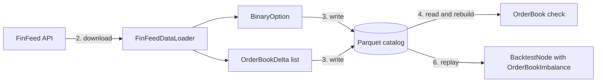
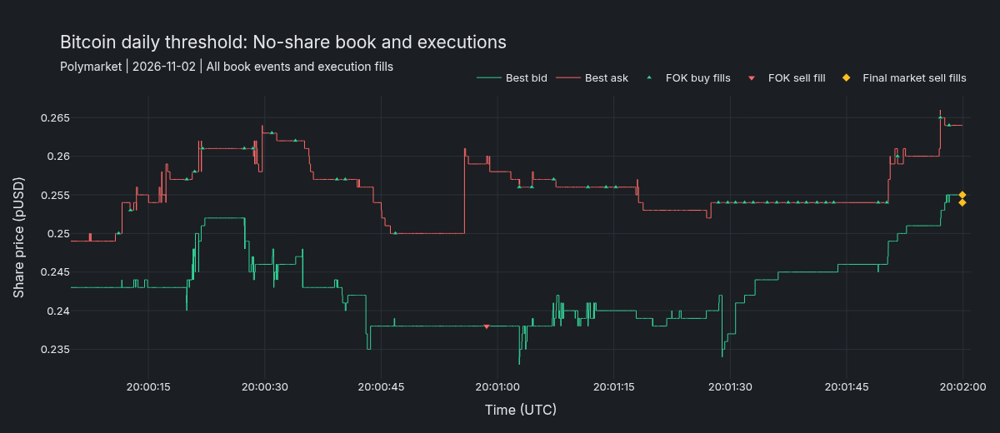
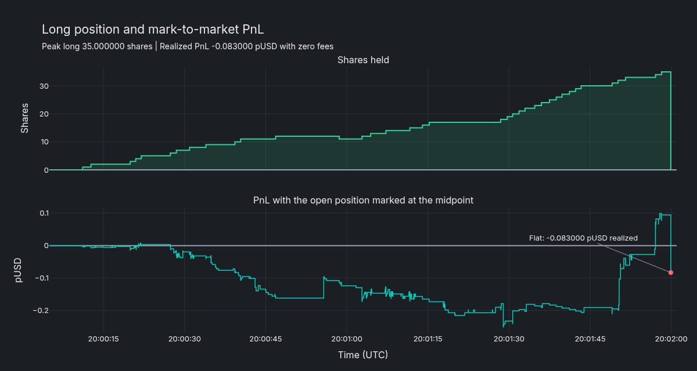

# Backtest with Polymarket Order Book Data (FinFeed)

Download two minutes of Polymarket order book history from FinFeed, store it in a Parquet catalog,
and backtest an order book imbalance strategy on it. The market is a daily Bitcoin price threshold,
and the strategy trades its No shares. The replay ends before the market expires and the strategy
closes its own position, so the result does not depend on a settlement payout.

Each step shows the Rust and Python code side by side. The complete programs are
[`finfeed_polymarket_book_imbalance.rs`][rust-program] and
[`finfeed_polymarket_book_imbalance.py`][python-program].

## How FinFeed represents Polymarket data

A Polymarket market asks a yes/no question, such as whether Bitcoin is above 76K on November 3,
2026. Yes shares and No shares trade in separate order books. A winning share redeems for 1 pUSD and
a losing share for nothing, so share prices lie between 0 and 1 pUSD.

FinFeed assigns each outcome its own ID. For one outcome, the tutorial loads the instrument
definition and the order book history:

| FinFeed data                    | Example                                   | Nautilus object                  |
| ------------------------------- | ----------------------------------------- | -------------------------------- |
| Outcome: one side of the market | `BITCOIN-ABOVE-76K-ON-NOVEMBER-3-2026_NO` | `BinaryOption` instrument.       |
| Book history of that outcome    | Snapshots and level updates by UTC hour   | List of `OrderBookDelta` values. |

The `_NO` suffix selects the No shares only, not the whole market. To load the Yes shares, select
the `_YES` ID separately.

The loader groups the deltas into batches. Each batch is one book event:

| Batch                  | Contents                                                                                 |
| ---------------------- | ---------------------------------------------------------------------------------------- |
| First                  | `CLEAR`, then one `ADD` per price level, all `F_SNAPSHOT`: the book at the window start. |
| Later                  | Changes to price levels, or a new full snapshot when FinFeed records one.                |
| Last delta of each one | Carries the `F_LAST` flag. The book is complete only after this delta.                   |

The loader keeps FinFeed's record order. It stamps the first snapshot with the window start. Every
later delta keeps FinFeed's exchange timestamp as `ts_event`, which can go backward. The loader
derives `ts_init` so that it never goes backward, and the replay uses `ts_init` for ordering and for
the window bounds. See the [replay rules](../integrations/finfeed.md#historical-books).



The catalog is the hand-off point: steps 4 to 7 read only from it. The programs run steps 2 and 3
only when the catalog path does not exist, so later runs need no API key or network access.

## Prerequisites

- A FinFeed key with Prediction Markets historical order book access. The first run sends at least
  three requests: one for the instrument definition and two book pages. The loader spaces its
  requests 10 seconds apart, so that run takes about a minute. See
  [FinFeed authentication](../integrations/finfeed.md#authentication-and-environment).
- **Rust**: A source checkout. To use the crates in your own project, see
  [Run a Backtest (Rust)](../how_to/run_rust_backtest.md) for setup and dependencies.
- **Python**: Python 3.13, 3.14, or 3.15, NautilusTrader 2.x (`pip install -U --pre nautilus_trader`),
  and pandas (`pip install pandas`).

Run the complete program from the repository root. For Python in a source checkout, build the
Python extension first.

```bash tab="Rust"
cargo run --bin finfeed-polymarket-book-imbalance --package nautilus-tutorials --features examples
```

```bash tab="Python"
uv run --project python --no-sync --with pandas \
    python examples/backtest/finfeed_polymarket_book_imbalance.py
```

The first run reads `FINFEED_API_KEY`. The Python program prompts for the key, without echoing it,
when the variable is unset.

## 1. Choose the market and time window

| Name           | Value                                     | Purpose                                                                       |
| -------------- | ----------------------------------------- | ----------------------------------------------------------------------------- |
| `MARKET_ID`    | `BITCOIN-ABOVE-76K-ON-NOVEMBER-3-2026_NO` | FinFeed ID of the No outcome.                                                 |
| Instrument ID  | `<MARKET_ID>.FINFEED_POLYMARKET`          | Nautilus instrument ID for FinFeed's Polymarket data.                         |
| Start          | 2026-11-02 20:00:05 UTC                   | Window start. The book at this time seeds the replay.                         |
| End            | 2026-11-02 20:02:00 UTC                   | Window end, inclusive.                                                        |
| Book type      | `L2_MBP`                                  | Price-level book (market by price), the only book FinFeed supplies.           |
| Order delay    | 0 ms                                      | Reference value of `ORDER_DELAY_MS`.                                          |
| Data directory | `NAUTILUS_DATA_DIR/FinFeed`               | Storage root. The default is `~/Downloads/Data/FinFeed`.                      |
| Catalog path   | `btc-above-76k-nov3-no-20261102-20`       | Catalog for this outcome and window. Rename it for another outcome or window. |

**Window start**: The loader needs a book snapshot at or before the start in the same UTC hour. The
window starts a few seconds after 20:00 for this reason.

**Window date**: The reference instrument definition from FinFeed sets expiry to 00:00 UTC on
November 3. Simulated trading stops at expiry, so the window falls on November 2.

**Instrument ID**: `finfeed_instrument_id` in Python and `to_instrument_id` in Rust build the ID from
the exchange and `MARKET_ID`. Keep this `FINFEED_POLYMARKET` ID; the native Polymarket adapter uses
different instrument IDs.

```rust tab="Rust"
const MARKET_ID: &str = "BITCOIN-ABOVE-76K-ON-NOVEMBER-3-2026_NO";
const RUN_ID: &str = "finfeed-polymarket";
const ORDER_DELAY_MS: u64 = 0;

let instrument_id = to_instrument_id("POLYMARKET", MARKET_ID)?;
let start = UnixNanos::from("2026-11-02T20:00:05Z");
let end = UnixNanos::from("2026-11-02T20:02:00Z");
let book_type = BookType::L2_MBP;

let data_dir = match std::env::var_os("NAUTILUS_DATA_DIR") {
    Some(dir) => PathBuf::from(dir),
    None => std::env::home_dir()
        .context("home directory not found, set NAUTILUS_DATA_DIR")?
        .join("Downloads")
        .join("Data"),
};
let catalog_path = data_dir
    .join("FinFeed")
    .join("btc-above-76k-nov3-no-20261102-20");
```

```python tab="Python"
MARKET_ID = "BITCOIN-ABOVE-76K-ON-NOVEMBER-3-2026_NO"
INSTRUMENT_ID = finfeed_instrument_id("POLYMARKET", MARKET_ID)
START = datetime(2026, 11, 2, 20, 0, 5, tzinfo=UTC)
END = datetime(2026, 11, 2, 20, 2, tzinfo=UTC)
BOOK_TYPE = BookType.L2_MBP
ORDER_DELAY_MS = 0

DATA_DIR = Path(os.environ.get("NAUTILUS_DATA_DIR", "~/Downloads/Data")).expanduser() / "FinFeed"
CATALOG_PATH = DATA_DIR / "btc-above-76k-nov3-no-20261102-20"
```

## 2. Download the book history

Create a `FinFeedDataLoader`, request the instrument definition, then request the book deltas for
the window from the same loader. The loader needs the definition first: its price increment and
share precision control how FinFeed's records convert to deltas. The definition reflects FinFeed's
metadata at download time and does not reconstruct the venue's historical trading rules.

```rust tab="Rust"
let loader = FinFeedDataLoader::new(None); // Reads FINFEED_API_KEY
let instrument = loader.request_instrument(instrument_id).await?;
let deltas = loader
    .request_book_deltas(instrument_id, start, end, None)
    .await?;
```

```python tab="Python"
async def download(api_key: str) -> tuple[BinaryOption, list[OrderBookDelta]]:
    loader = FinFeedDataLoader(api_key=api_key)
    instrument = await loader.request_instrument(INSTRUMENT_ID)
    deltas = await loader.request_book_deltas(INSTRUMENT_ID, start=START, end=END)
    return instrument, deltas


api_key = os.environ.get("FINFEED_API_KEY") or getpass("FinFeed API key: ")
instrument, deltas = asyncio.run(download(api_key))
```

The loader methods are async. The Python program runs them with `asyncio.run`; in a notebook with a
running event loop, use `await download(api_key)` instead.

The book request returns every delta in the window or raises an error; it returns no partial
result. See [historical books](../integrations/finfeed.md#historical-books) for the failure
conditions.

## 3. Write the data to a catalog

A Parquet catalog stores the instrument and its deltas on disk. The backtest in step 6 reads its
data from this catalog, and later runs reuse it instead of downloading again.

```rust tab="Rust"
std::fs::create_dir_all(&catalog_path)?;
let catalog = ParquetDataCatalog::builder().uri(&catalog_path).build()?;
let instruments = vec![InstrumentAny::BinaryOption(instrument)];
catalog.write_instruments(instruments)?;
catalog.write_to_parquet(&deltas, None, None, None)?;
```

```python tab="Python"
CATALOG_PATH.mkdir(parents=True)
catalog = ParquetDataCatalog(str(CATALOG_PATH))
catalog.write_instruments([instrument])
catalog.write_order_book_deltas(deltas)
```

The programs create the catalog folder only after a complete download, so a failed download leaves
no catalog. If a write fails, delete the catalog path before the next run.

## 4. Rebuild the book to check the data

The backtest engine rebuilds the book from the deltas itself. Rebuilding it here first checks the
data before any strategy runs. The code reads the instrument and deltas back from the catalog, so it
checks the same data the backtest uses.

Check that the catalog opens with a `CLEAR` delta flagged `F_SNAPSHOT` at the selected start.
Every remaining delta in the opening batch must be a snapshot `ADD` at that time. The last delta
in the catalog must be within the selected window and end a batch (`F_LAST`). Apply the deltas in
order and check the book's integrity at the end of each batch. Both programs print the delta and
batch counts and the top three levels of the final book.

```rust tab="Rust"
let mut catalog = ParquetDataCatalog::builder().uri(&catalog_path).build()?;
let instrument_ids = vec![instrument_id.to_string()];
let Some(InstrumentAny::BinaryOption(instrument)) = catalog
    .instruments(Some(&instrument_ids), None, None)?
    .into_iter()
    .next()
else {
    anyhow::bail!("binary option missing from catalog");
};
let deltas = catalog
    .order_book_deltas()
    .identifiers(instrument_ids)
    .execute()?;

let first = deltas.first().context("catalog has no book deltas")?;
let last = deltas.last().context("catalog has no book deltas")?;
anyhow::ensure!(
    first.action == BookAction::Clear && RecordFlag::F_SNAPSHOT.matches(first.flags),
    "book deltas do not open with a snapshot"
);
anyhow::ensure!(
    first.ts_init == start && last.ts_init <= end,
    "catalog book deltas do not match the selected window"
);
anyhow::ensure!(
    RecordFlag::F_LAST.matches(last.flags),
    "catalog ends with an incomplete book batch"
);

let snapshot_end = deltas
    .iter()
    .position(|delta| RecordFlag::F_LAST.matches(delta.flags))
    .context("catalog has no complete book batch")?;
anyhow::ensure!(
    deltas[1..=snapshot_end].iter().all(|delta| {
        delta.action == BookAction::Add
            && RecordFlag::F_SNAPSHOT.matches(delta.flags)
            && delta.ts_init == first.ts_init
    }),
    "catalog opens with an incomplete book snapshot"
);

let mut book = OrderBook::new(instrument_id, book_type);
let mut batches = 0;

for delta in &deltas {
    book.apply_delta(delta)?;
    if RecordFlag::F_LAST.matches(delta.flags) {
        book_check_integrity(&book)?;
        batches += 1;
    }
}

let top_levels = book.pprint(3, None);
println!("Loaded {} deltas in {batches} batches", deltas.len());
println!("{top_levels}");
```

```python tab="Python"
catalog = ParquetDataCatalog(str(CATALOG_PATH))
[instrument] = catalog.instruments(instrument_ids=[str(INSTRUMENT_ID)])
deltas = catalog.query_order_book_deltas(identifiers=[str(INSTRUMENT_ID)])

if not deltas:
    raise ValueError("Catalog has no book deltas")

first, last = deltas[0], deltas[-1]
if first.action != BookAction.CLEAR or not RecordFlag.F_SNAPSHOT.matches(first.flags):
    raise ValueError("Book deltas do not open with a snapshot")
if first.ts_init != dt_to_unix_nanos(START) or last.ts_init > dt_to_unix_nanos(END):
    raise ValueError("Catalog book deltas do not match the selected window")
if not RecordFlag.F_LAST.matches(last.flags):
    raise ValueError("Catalog ends with an incomplete book batch")

snapshot_end = next(i for i, delta in enumerate(deltas) if RecordFlag.F_LAST.matches(delta.flags))
if any(
    delta.action != BookAction.ADD
    or not RecordFlag.F_SNAPSHOT.matches(delta.flags)
    or delta.ts_init != first.ts_init
    for delta in deltas[1 : snapshot_end + 1]
):
    raise ValueError("Catalog opens with an incomplete book snapshot")

book = OrderBook(INSTRUMENT_ID, BOOK_TYPE)
batches = 0

for delta in deltas:
    book.apply_delta(delta)
    if RecordFlag.F_LAST.matches(delta.flags):
        book.check_integrity()
        batches += 1

print(f"Loaded {len(deltas):,} deltas in {batches:,} batches")
print(book.pprint(3))
```

The complete programs also print `Replay input SHA-256`. It covers each delta in replay order
and these instrument fields:

- Instrument ID, currency, activation time, and expiration time.
- Price and size increments and the tick scheme.
- Minimum and maximum quantity, notional, and price.

The fingerprint excludes the metadata fetch time. Compare it with the [reference run](#reference-run)
to tell whether you replayed the same inputs. Archive the entire catalog to repeat the run if
FinFeed revises the data or metadata.

A clean rebuild checks the consistency of the recorded events. FinFeed can omit venue events even
when the book rebuilds cleanly.

## 5. Configure the backtest

The strategy is the built-in Rust `OrderBookImbalance`, the same one the other order book tutorials
use. It watches the sizes at the best bid and best ask. When one side is much larger, it sends a
fill-or-kill (FOK) limit order against the thinner side: it buys at the best ask when the bid side
is larger, and sells at the best bid when the ask side is larger. It closes its position when it
stops.

| Strategy setting               | Value    | Effect                                                     |
| ------------------------------ | -------- | ---------------------------------------------------------- |
| `trigger_min_size`             | 100      | The larger best-quote size must exceed 100 shares.         |
| `trigger_imbalance_ratio`      | 0.20     | The smaller size must be below 20% of the larger size.     |
| `max_trade_size`               | 1        | Each signal order is for at most one share.                |
| `min_seconds_between_triggers` | 1.0      | At least one second passes between signals.                |
| `book_type`                    | `L2_MBP` | The strategy subscribes to the same book type as the data. |

| Venue setting       | Value                | Effect                                                         |
| ------------------- | -------------------- | -------------------------------------------------------------- |
| `name`              | `FINFEED_POLYMARKET` | Taken from the instrument ID, so the two always match.         |
| `account_type`      | `CASH`               | Buys pay in full. A sell needs No shares already held.         |
| `oms_type`          | `NETTING`            | One position per instrument.                                   |
| `base_currency`     | `pUSD`               | The account holds one currency, the instrument's pUSD.         |
| `starting_balances` | 1,000 pUSD           | Cash available for buying shares.                              |
| `book_type`         | `L2_MBP`             | The matching engine fills orders against the price-level book. |
| `fee_model`         | Zero maker and taker | This teaching run charges no fees.                             |
| `latency_model`     | `StaticLatencyModel` | Delays order commands by `ORDER_DELAY_MS` (default 0).         |

| Run setting             | Value                                   | Effect                                                                       |
| ----------------------- | --------------------------------------- | ---------------------------------------------------------------------------- |
| `data_type`             | `OrderBookDelta`                        | Reads the instrument's book deltas from the catalog path.                    |
| `emit_quotes_from_book` | `true`                                  | Gives the risk engine a price for the market sell that closes the position.  |
| `raise_exception`       | `true`                                  | A failed run stops with its error instead of returning no results.           |
| `dispose_on_completion` | `true` (Rust default), `False` (Python) | Python keeps the engine after the run to generate reports; Rust disposes it. |
| Log level               | `ERROR` (Python only)                   | Keeps the printed reports readable; Rust keeps the default log output.       |

**Selling without shares**: The cash account cannot short. The matching engine rejects a sell for
more shares than the account holds, and a sell signal never buys the opposite outcome. In this
window the two books are close complements: a No bid at price `p` matches a Yes ask at or near
`1 - p`. The No book gives mostly buy signals, so the Yes book gives mostly sell signals that this
account cannot fill.

`ORDER_DELAY_MS` determines when the simulated exchange can first process an order command.
With a positive delay, the exchange can process the order against a later book state. A FOK order
then cancels if the book can no longer fill the whole quantity at its limit price or better.

The simulation omits live routing, venue fees, queue position, and settlement. Its fills and PnL
do not predict live results.

```rust tab="Rust"
let data_engine = DataEngineConfig::builder()
    .emit_quotes_from_book(true)
    .build();
let engine = BacktestEngineConfig::builder()
    .data_engine(data_engine)
    .build();

let fees = MakerTakerFeeModel::zero();
let order_delay = DurationNanos::from_millis(ORDER_DELAY_MS);
let latency =
    StaticLatencyModel::new(DurationNanos::ZERO, order_delay, order_delay, order_delay);
let venue = BacktestVenueConfig::builder()
    .name(instrument_id.venue.as_str())
    .oms_type(OmsType::Netting)
    .account_type(AccountType::Cash)
    .base_currency(instrument.currency)
    .starting_balances(vec!["1000 pUSD".to_string()])
    .book_type(book_type)
    .fee_model(FeeModelAny::MakerTaker(fees))
    .latency_model(LatencyModelAny::Static(latency))
    .build()?;

let catalog_location = catalog_path.display().to_string();
let catalog_config = DataCatalogConfig::new(catalog_location, None, None);
let data = BacktestDataConfig::builder()
    .catalog(catalog_config)
    .data_type(NautilusDataType::OrderBookDelta)
    .instrument_id(instrument_id)
    .build()?;

let config = BacktestRunConfig::builder()
    .id(RUN_ID.to_string())
    .engine(engine)
    .venues(vec![venue])
    .data(vec![data])
    .raise_exception(true)
    .build()?;

let max_trade_size = Quantity::from("1.000000");
let strategy_config = OrderBookImbalanceConfig::builder()
    .instrument_id(instrument_id)
    .book_type(book_type)
    .max_trade_size(max_trade_size)
    .trigger_min_size(dec!(100))
    .trigger_imbalance_ratio(dec!(0.20))
    .min_seconds_between_triggers(1.0)
    .build();
```

```python tab="Python"
order_delay_ns = ORDER_DELAY_MS * 1_000_000
latency = StaticLatencyModel(
    base_latency_nanos=0,
    insert_latency_nanos=order_delay_ns,
    update_latency_nanos=order_delay_ns,
    cancel_latency_nanos=order_delay_ns,
)

config = BacktestRunConfig(
    engine=BacktestEngineConfig(
        logging=LoggerConfig(stdout_level=LogLevel.ERROR),
        data_engine=DataEngineConfig(emit_quotes_from_book=True),
    ),
    venues=[
        BacktestVenueConfig(
            name=str(INSTRUMENT_ID.venue),
            oms_type=OmsType.NETTING,
            account_type=AccountType.CASH,
            base_currency=instrument.currency,
            starting_balances=["1000 pUSD"],
            book_type=BOOK_TYPE,
            fee_model=MakerTakerFeeModel(maker_rate=Decimal(0), taker_rate=Decimal(0)),
            latency_model=latency,
        ),
    ],
    data=[
        BacktestDataConfig(
            catalog=DataCatalogConfig(path=str(CATALOG_PATH)),
            data_type=NautilusDataType.OrderBookDelta,
            instrument_id=instrument.id,
        ),
    ],
    dispose_on_completion=False,
    raise_exception=True,
)

strategy_config = OrderBookImbalanceConfig(
    instrument_id=instrument.id,
    book_type=BOOK_TYPE,
    max_trade_size=Quantity.from_str("1.000000"),
    trigger_min_size=Decimal("100.0"),
    trigger_imbalance_ratio=Decimal("0.20"),
    min_seconds_between_triggers=1.0,
)
```

## 6. Run the backtest from the catalog

`BacktestNode` builds the engine from the configuration, loads the deltas from the catalog, and
runs the strategy on them. With `batch_deltas` at its default of `true`, it groups the deltas into
batches that end at each `F_LAST` delta, so the strategy only acts on complete books. The data
configuration sets no start or end time, so the replay begins with the initial snapshot. A later
start would skip that snapshot and replay updates onto an empty book.

In this run, the Rust program logs `Out-of-order update` warnings for records whose exchange
timestamp goes backward. The replay still applies these records in FinFeed's order.

```rust tab="Rust"
let mut node = BacktestNode::new(vec![config])?;
node.build()?;

let strategy = OrderBookImbalance::from_config(strategy_config)?;
node.get_engine_mut(RUN_ID)
    .context("engine not built")?
    .add_strategy(strategy)?;

let results = node.run()?;
```

```python tab="Python"
node = BacktestNode(configs=[config])

try:
    node.build()
    node.add_builtin_strategy(config.id, "OrderBookImbalance", strategy_config)
    results = node.run()

    orders = node.generate_orders_report(config.id)
    executions = node.generate_fills_report(config.id)
    positions = node.generate_positions_report(config.id)
    account = node.generate_account_report(config.id, venue=INSTRUMENT_ID.venue)
finally:
    node.dispose()
```

## 7. Review the results

The Rust program prints the run totals and PnL statistics. The Python program prints the order,
fill, position, and account reports, then checks that the final position is flat. If no position
opens, it reports that outcome before reading the report columns.

```rust tab="Rust"
for result in &results {
    println!(
        "Orders: {}, positions: {}",
        result.total_orders, result.total_positions
    );
    println!("PnL statistics: {:?}", result.stats_pnls);
}
```

```python tab="Python"
if positions.empty:
    raise ValueError(
        "No positions opened, check the replay window, signal thresholds, and order delay",
    )

print(orders["status"].value_counts().to_string())
print(executions.groupby(["order_type", "order_side"]).size().to_string())
print(
    executions[["ts_event", "order_side", "order_type", "last_qty", "last_px", "commission"]]
    .tail(8)
    .to_string(),
)
print(
    positions[
        ["side", "quantity", "peak_qty", "avg_px_open", "avg_px_close", "realized_pnl"]
    ].to_string(),
)
print(account[["total", "locked", "free", "currency"]].tail().to_string())

assert positions["ts_closed"].notna().all(), "The strategy left an open position"
assert positions["side"].eq("FLAT").all()
assert positions["quantity"].map(Decimal).eq(Decimal(0)).all()
```

### Reference run

Compare the printed replay input SHA-256 with
`3712f0b79ee56bd8df534acd02c84e4e8f6f838264dea51115c29bcdfc6a5e2b`.
A different fingerprint means the inputs differ and the results may change. The reference results
and figures below use a delay of 0 ms.

| Result        | Reference value                                               |
| ------------- | ------------------------------------------------------------- |
| Deltas loaded | 13,901 in 13,777 batches; the 125-delta snapshot is one batch |
| Window        | 2026-11-02, 20:00:05 to 20:02:00 UTC                          |
| Orders        | 38, all filled                                                |
| Order types   | 37 FOK limit orders: 36 buys and one sell; one market sell    |
| Peak position | 35 shares                                                     |
| Report prices | Average open 0.2562 pUSD, average close 0.2540 pUSD           |
| Realized PnL  | -0.083000 pUSD, with zero fees                                |
| Final balance | 999.917000 pUSD                                               |

The FOK buys build the position one share at a time, and the FOK sell at 20:00:58 reduces it by one
share. The final market sell closes 35 shares at 20:01:59.913902100 UTC and fills against two bid
levels:

| Level | Shares    | Price (pUSD) |
| ----- | --------- | ------------ |
| 1     | 15.000000 | 0.2550       |
| 2     | 20.000000 | 0.2540       |

These levels match the bids that step 4 prints for the final book. The best bid holds only 15
shares, so most of the order fills below it. The average price for the market sell alone is about
0.25443 pUSD.

### Compare order delays

Set `ORDER_DELAY_MS` to 100 in either program and rerun it against the same catalog. This is an
illustrative delay. The historical data does not measure how long a live order takes to reach
Polymarket. Both programs report total orders and PnL. Use the Python order report for the FOK
breakdown.

| Result              | 0 ms           | 100 ms         |
| ------------------- | -------------- | -------------- |
| Total orders        | 38             | 37             |
| FOK orders          | 37             | 36             |
| FOK orders filled   | 37             | 35             |
| FOK orders canceled | 0              | 1              |
| Realized PnL        | -0.083000 pUSD | -0.079000 pUSD |

At 20:01:04.413080500 UTC, the strategy submits a one-share FOK buy at the best ask of
0.2560 pUSD. At zero delay, it fills immediately. With 100 ms of delay, the replay processes the
order at 20:01:04.521425600 UTC, when the best ask is 0.2580 pUSD. The ask exceeds the limit
price, so the order cancels unfilled.

Both runs close their position. The delay changes which orders fill and the position the strategy
holds before the close.

### Figures

The figures use the same cached data and reports as the Python program. They show the best bid and
ask after each completed batch, and skip books with an empty side or with the bid at or above the
ask. Lines step from one book state to the next; markers show fills.



**Figure 1.** The FOK buys fill at the best ask in `[0.2500, 0.2650]` pUSD, and the one FOK sell
fills at the best bid of 0.2380 pUSD. The diamonds at the end mark the two closing fills from the
table above.


**Figure 2.** The spread is in `[0.0050, 0.0230]` pUSD. The best bid size exceeds the best ask size
in 85% of the book states, and the strategy fills 36 FOK buys and one FOK sell. The plot shows the signed
imbalance `(bid_size - ask_size) / (bid_size + ask_size)`; the strategy itself compares the smaller
size with the larger size.



**Figure 3.** Position and PnL over the window:

- **Position**: The top panel shows cumulative signed fill quantities. The position reaches 35
  shares at 20:01:58, and the final market sell returns it to zero.
- **Marked PnL**: The bottom panel marks the open position at the midpoint, so it shows realized and
  unrealized PnL together. Each buy at the ask loses half the spread against the midpoint at once.
  PnL falls to -0.2510 pUSD at 20:01:28, then rises to 0.0945 pUSD as the No price rises.
- **Closing cost**: Just before the close, the 35 shares are worth 9.0825 pUSD at the midpoint of
  0.2595. The two closing fills return 8.9050 pUSD, which is 0.1775 pUSD less.
- **Realized PnL**: Once flat, PnL equals the account's balance change of -0.083000 pUSD.

## Regenerate the figures

Set `ORDER_DELAY_MS` to 0 in the Python program to reproduce the reference figures. Run the
renderer from a source checkout with a Chrome-compatible browser for Kaleido.

```bash
uv run --project python --no-sync --with pandas --with plotly --with kaleido \
    python docs/tutorials/assets/backtest_orderbook_finfeed/render_panels.py
```

The renderer runs the Python program, so it reuses the catalog or downloads the data as in step 2.
Its docstring gives the command that installs a browser for Kaleido.

## Use another outcome or window

If FinFeed no longer serves the reference window or you want to try another market, find a
Polymarket outcome with `get_listings` in the [FinFeed REST guide](../integrations/finfeed.md#python-rest-access).
Use its FinFeed outcome ID, ending in `_YES` or `_NO`.

Update `MARKET_ID`, the start, and the end in step 1. Pick a window before the instrument's
expiration. Start at or after a book snapshot in the same UTC hour. Give the new window its own
catalog path so the program collects the matching definition and deltas. If the strategy opens no
position, compare the fills at zero delay and check the signal thresholds against the book sizes.

With a positive delay, the strategy needs book updates that advance the replay clock beyond the
last signal by at least `ORDER_DELAY_MS`. A pending order can otherwise fill after the strategy
has tried to close its position. Check that the Python position report ends flat. If it leaves
an open position, extend the replay past the last signal and use a new catalog.

Leave more than `ORDER_DELAY_MS` between the final book update and expiration so the closing
market order can reach the simulated exchange before trading stops.

[rust-program]: https://github.com/nautechsystems/nautilus_trader/blob/develop/examples/tutorials/src/bin/finfeed_polymarket_book_imbalance.rs
[python-program]: https://github.com/nautechsystems/nautilus_trader/blob/develop/examples/backtest/finfeed_polymarket_book_imbalance.py
