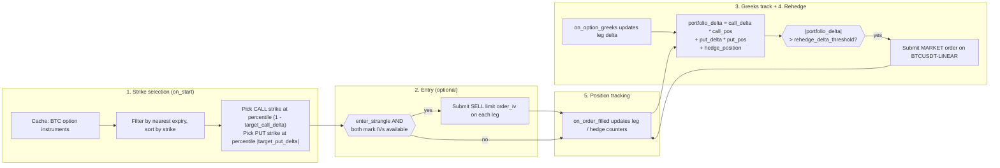
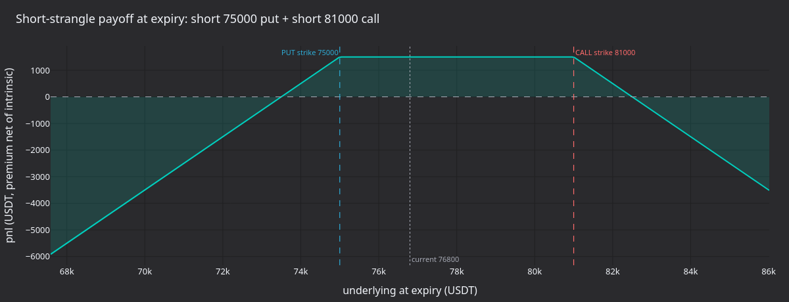
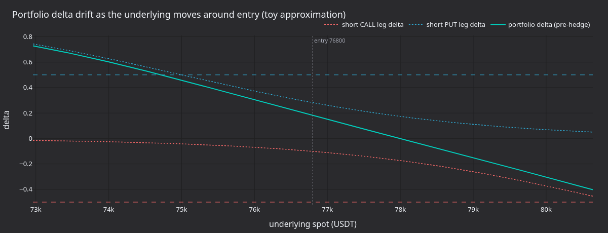

# Delta-Neutral Options Strategy (Bybit)

:::note
This **Rust-only** tutorial runs a live delta-neutral
short-volatility strategy on Bybit using the Rust `LiveNode`.
:::

This tutorial runs a short out-of-the-money (OTM) strangle on Bybit BTC options and delta-hedges with the
BTCUSDT perpetual. The strategy selects call and put strikes at startup and enters through implied-volatility
limit orders. It tracks portfolio delta from venue-provided Greeks. When delta moves beyond a threshold, it
submits market hedge orders on the perpetual.

:::warning
This strategy trades real money on mainnet. Setting `enter_strangle: false`
only disables the initial strangle entry orders.
The strategy still loads existing positions from the cache at startup.
It still submits hedge orders on the perpetual when portfolio delta breaches the threshold.
If the account holds option or hedge positions from a prior
session, the strategy will trade.
:::

## Prerequisites

- Completion of the [options data tutorial](options_data_bybit.md), which
  covers instrument discovery, Greeks subscriptions, and the `DataActor`
  pattern.
- A Bybit API key with **trading permissions** for options and linear
  perpetuals.
- Environment variables for Bybit mainnet, which the example targets by
  default (see [Running the example](#running-the-example) for testnet):

```bash
export BYBIT_API_KEY="your-api-key"
export BYBIT_API_SECRET="your-api-secret"
```

## Strategy overview

The `DeltaNeutralVol` strategy ships in the trading crate's `examples`
module and runs in five stages:

1. **Strike selection**: queries the instrument cache for all BTC
   options, filters to the nearest expiry, selects OTM call and put
   strikes by percentile rank.
1. **Entry**: places SELL limit orders on both legs priced by implied
   volatility (through Bybit's `order_iv` parameter). Entry is optional and
   disabled by default in the example.
1. **Greeks tracking**: subscribes to `OptionGreeks` for both legs.
   Deltas and IVs come directly from Bybit's option ticker stream.
1. **Rehedging**: calculates portfolio delta and submits a market order on
   the BTCUSDT perpetual when the threshold is breached. Triggers on
   every Greeks update and on a periodic safety timer.
1. **Position tracking**: tracks call, put, and hedge positions through
   `on_order_filled`. Loads existing positions from the cache at
   startup.



### Portfolio delta

The strategy calculates net exposure as:

```text
portfolio_delta = call_delta * call_position
                + put_delta * put_position
                + hedge_position
```

A short strangle starts near delta-neutral because the call and put
deltas offset. With the default `target_call_delta = 0.20` and
`target_put_delta = -0.20`, the two legs cancel at entry. As the
underlying moves, net delta drifts and the strategy hedges to bring it
back toward zero.

## Configuration

The example file at
[`crates/adapters/bybit/examples/node_delta_neutral.rs`](https://github.com/nautechsystems/nautilus_trader/tree/develop/crates/adapters/bybit/examples/node_delta_neutral.rs)
configures the strategy:

```rust
let hedge_instrument_id = InstrumentId::from("BTCUSDT-LINEAR.BYBIT");

let strategy_config = DeltaNeutralVolConfig::builder()
    .option_family("BTC".to_string())
    .hedge_instrument_id(hedge_instrument_id)
    .client_id(client_id)
    .contracts(1)
    .rehedge_delta_threshold(0.5)
    .rehedge_interval_secs(30)
    .enter_strangle(false)
    .iv_param_key("order_iv".to_string())
    .build();

let strategy = DeltaNeutralVol::new(strategy_config);
```

The table shows struct defaults and example overrides. The example overrides `enter_strangle` to `false` and
`iv_param_key` to `"order_iv"`:

| Parameter                 | Default    | Example          | Description                                 |
| ------------------------- | ---------- | ---------------- | ------------------------------------------- |
| `option_family`           | required   | `"BTC"`          | Underlying filter for instrument discovery. |
| `hedge_instrument_id`     | required   | `BTCUSDT-LINEAR` | Perpetual used for delta hedging.           |
| `client_id`               | required   | `"BYBIT"`        | Data and execution client identifier.       |
| `target_call_delta`       | `0.20`     | -                | Target call delta for strike selection.     |
| `target_put_delta`        | `-0.20`    | -                | Target put delta for strike selection.      |
| `contracts`               | `1`        | -                | Contracts per leg.                          |
| `rehedge_delta_threshold` | `0.5`      | -                | Portfolio delta that triggers a hedge.      |
| `rehedge_interval_secs`   | `30`       | -                | Periodic rehedge timer interval.            |
| `enter_strangle`          | `true`     | `false`          | Place entry orders when Greeks arrive.      |
| `entry_iv_offset`         | `0.0`      | -                | Vol points below mark IV for entry pricing. |
| `iv_param_key`            | `"px_vol"` | `"order_iv"`     | Adapter-specific IV parameter key.          |

The `iv_param_key` differs between venues. Bybit uses `order_iv`, which the adapter maps to the `orderIv`
field in the place-order API. OKX uses `px_vol`. For IV-based order placement, set the correct key for the
venue.

## Node setup

The example configures both data and execution clients with `Option` and
`Linear` product types:

```rust
let data_config = BybitDataClientConfig {
    api_key: None,
    api_secret: None,
    product_types: vec![BybitProductType::Option, BybitProductType::Linear],
    ..Default::default()
};

let exec_config = BybitExecutionClientConfig {
    api_key: None,
    api_secret: None,
    product_types: vec![BybitProductType::Option, BybitProductType::Linear],
    account_id: Some(account_id),
    ..Default::default()
};
```

Both product types are needed: `Option` for the strangle legs, `Linear`
for the BTCUSDT perpetual hedge instrument. The execution client requires
`account_id` for order identity tracking.

```rust
let mut node = LiveNode::builder(trader_id, environment)?
    .with_name("BYBIT-DELTA-NEUTRAL-001".to_string())
    .add_data_client(None, Box::new(data_factory), Box::new(data_config))?
    .add_exec_client(None, Box::new(exec_factory), Box::new(exec_config))?
    .with_reconciliation(true)
    .with_delay_post_stop_secs(5)
    .build()?;

node.add_strategy(strategy)?;
node.run().await?;
```

At startup, `with_reconciliation(true)` queries Bybit for open orders and positions. Reconciliation loads the
cache before the strategy starts. The strategy then loads any existing positions from a prior session.

## How the strategy works

### Strike selection

At startup, the strategy queries the cache for all option instruments that match `option_family`. It removes
expired options and selects the nearest expiry. It separates calls and puts, then sorts each list by strike
price.

The strategy selects strikes by percentile in the sorted list:

- **Call**: index = `(1.0 - target_call_delta) * count`. With 0.20
  target delta and 50 calls, this selects the 40th strike (80th
  percentile, OTM).
- **Put**: index = `|target_put_delta| * count`. With -0.20 target
  delta, this selects the 10th strike (20th percentile, OTM).

This is a heuristic. Strike price ordering approximates delta ordering
for options at the same expiry. A production strategy would subscribe
to Greeks for all strikes first, then select by actual delta.

### Entry via implied volatility

When `enter_strangle` is `true` and both mark IVs have arrived, the
strategy places SELL limit orders using the `order_iv` parameter:

```rust
let mut call_params = Params::new();
call_params.insert("order_iv".to_string(), json!(call_entry_iv.to_string()));

self.submit_order(call_order, None, Some(client_id), Some(call_params))?;
```

Bybit converts `orderIv` to a limit price on the server and gives it priority over any explicit price. The
`entry_iv_offset` setting subtracts vol points from mark IV. An offset of 0.02 sells two vol points below mark
for faster fills.

:::note
In Bybit's demo environment, new orders carry `order_iv` through the HTTP create-order endpoint.
Demo does not support order amendments through `order_iv`.
The adapter discards the modification with a warning before it reaches the API.
:::

### Rehedging

Two triggers check portfolio delta:

- **Greeks updates**: On each update, `on_option_greeks` updates the leg's delta value, then calculates portfolio delta again.
- **Periodic timer**: checks every `rehedge_interval_secs`, including when Greeks updates stop.

When `|portfolio_delta| > rehedge_delta_threshold`, the strategy submits
a market order on the hedge instrument. A `hedge_pending` flag prevents
duplicate submissions while an order is in flight.

### Position tracking

The strategy tracks positions through `on_order_filled`. It does not query the cache on every tick. Each fill
updates the corresponding position counter (call, put, or hedge).

At startup, the strategy loads the counters from the cache that reconciliation populates. For the selected
call, selected put, and hedge instrument, it sums the signed quantity of every open position. It does not
filter by strategy, so positions opened elsewhere on those instruments count. Option positions on other
strikes do not count.

:::warning
Use an account with no unrelated positions on the hedge instrument.
At startup, the strategy treats any open `BTCUSDT-LINEAR` position as part of the hedge.
With no option positions, an unrelated perpetual position larger than `rehedge_delta_threshold` exceeds the threshold
once Greeks arrive for both legs. The strategy then submits a market order to close that position.
:::

### Shutdown

On stop the strategy cancels open orders, unsubscribes from all data feeds, and resets the hedge-pending flag.
It does not close positions. To close the strangle and hedge, use manual action or a separate exit strategy.

## What the run produces

A 30-second mainnet run with `enter_strangle: false` against a clean
account places no orders. The strategy logs the discovered instruments
and the strike selection:

```text
Selected call: BTC-28APR26-81000-C-USDT-OPTION.BYBIT (strike=81000)
Selected put: BTC-28APR26-75000-P-USDT-OPTION.BYBIT (strike=75000)
Strangle: 1 contracts per leg, hedge on BTCUSDT-LINEAR.BYBIT
```

The log shows instrument discovery and strike selection. The panels below show the mechanics around the actual
selected strikes (75,000 / 81,000) at the captured underlying.



**Figure 1.** *Pnl at expiry of the short 75,000 PUT plus short 81,000 CALL combination, assuming a 1,500 USDT
total premium and zero discount. The flat top is the credit-only zone between strikes. Loss increases linearly
past either strike.*


**Figure 2.** *Synthetic Brownian delta drift over 150 seconds with `rehedge_delta_threshold=0.5`. The dotted
curve is the unhedged drift. The line is the strategy's portfolio delta after each market hedge (crosses).*



**Figure 3.** *Illustrative short call and short put deltas across a 5% spot range around entry. The panel
also shows the resulting portfolio delta before hedging. Negative gamma compresses the curve in the wings and
steepens it across the strikes.*


**Figure 4.** *The strike-selection heuristic against an illustrative IV smile. The CALL strike is at the (1 -
0.20) percentile and the PUT at the 0.20 percentile. Both legs are OTM with approximately equal-magnitude
deltas around the underlying.*

### Regenerate the panels

The log comes from `bybit-delta-neutral`, the live trading binary. It connects to Bybit mainnet with your API
keys. With the default config, it places no entry orders. It submits hedge orders if the account holds
positions on the selected legs or the hedge instrument.

After building NautilusTrader from source, run these commands from the repository root:

```bash
make sync

cargo build --release --example bybit-delta-neutral --package nautilus-bybit --features examples
timeout 30 ./target/release/examples/bybit-delta-neutral > /tmp/bybit_dn.log 2>&1

DN_LOG=/tmp/bybit_dn.log \
    uv run --project python --no-sync \
        python docs/tutorials/assets/delta_neutral_options_bybit/render_panels.py
```

The renderer parses selected strikes from the log. The panels are illustrative: the captured run uses a clean
account and places no orders.

## Risk considerations

- **Gamma risk**: a short strangle has negative gamma. Large underlying
  moves increase delta exposure faster than the rehedge timer responds.
  Tighten `rehedge_delta_threshold` and reduce `rehedge_interval_secs`
  for faster response, at the cost of more hedge trades.
- **Vega risk**: an IV spike increases mark-to-market loss on the short
  options. The strategy does not manage vega exposure.
- **Liquidity**: OTM crypto options can have wide spreads. Hedge quality
  degrades when the underlying gaps or the perpetual trades in coarse
  size increments.
- **Lifecycle risk**: stopping the strategy stops hedging. Positions
  remain open and unhedged until manually managed.

## Running the example

:::warning
The example trades on Bybit **mainnet** by default. It has no network
constant: both client configs use `..Default::default()`, which selects
`BybitEnvironment::Mainnet` and reads `BYBIT_API_KEY` and
`BYBIT_API_SECRET`. To run on testnet:

1. Import `BybitEnvironment` from `nautilus_bybit::common::enums` in `node_delta_neutral.rs`.
1. Add `environment: BybitEnvironment::Testnet` to both `data_config` and `exec_config`.
1. Rebuild the example.

On testnet, the adapter reads `BYBIT_TESTNET_API_KEY` and `BYBIT_TESTNET_API_SECRET`.
:::

```bash
cargo run --example bybit-delta-neutral --package nautilus-bybit --features examples
```

The example runs with `enter_strangle: false` by default, so it does not place strangle entry orders. It still
loads existing positions and submits hedge orders if portfolio delta breaches the threshold. On a clean
account with no prior positions, the strategy places no orders.

Stop with Ctrl+C. The strategy cancels open orders and unsubscribes
before shutdown.

## Complete source

- Example runner: [`crates/adapters/bybit/examples/node_delta_neutral.rs`](https://github.com/nautechsystems/nautilus_trader/tree/develop/crates/adapters/bybit/examples/node_delta_neutral.rs)
- Strategy implementation: [`crates/trading/src/examples/strategies/delta_neutral_vol/`](https://github.com/nautechsystems/nautilus_trader/tree/develop/crates/trading/src/examples/strategies/delta_neutral_vol/)
- Strategy README with full config reference: [`crates/trading/src/examples/strategies/delta_neutral_vol/README.md`](https://github.com/nautechsystems/nautilus_trader/tree/develop/crates/trading/src/examples/strategies/delta_neutral_vol/README.md)

## See also

- [Options data and Greeks on Bybit](options_data_bybit.md): prerequisite
  tutorial covering Greeks subscriptions and option chain snapshots.
- [Options](../concepts/options.md): option instrument types and data
  architecture.
- [Bybit integration](../integrations/bybit.md#options-trading): options
  order parameters including `order_iv` and `mmp`.
