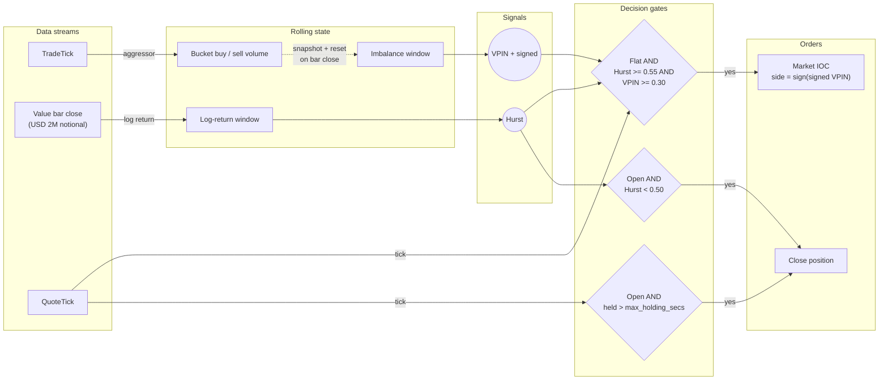
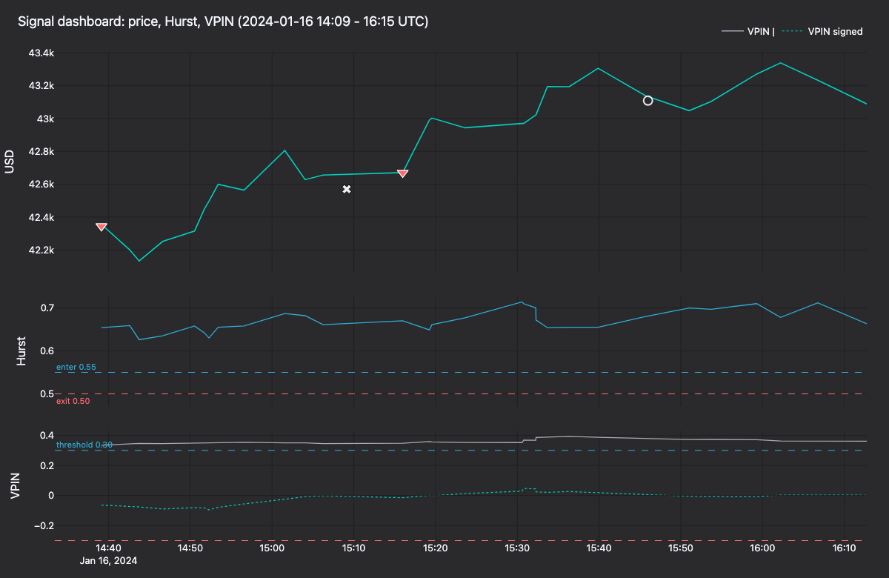
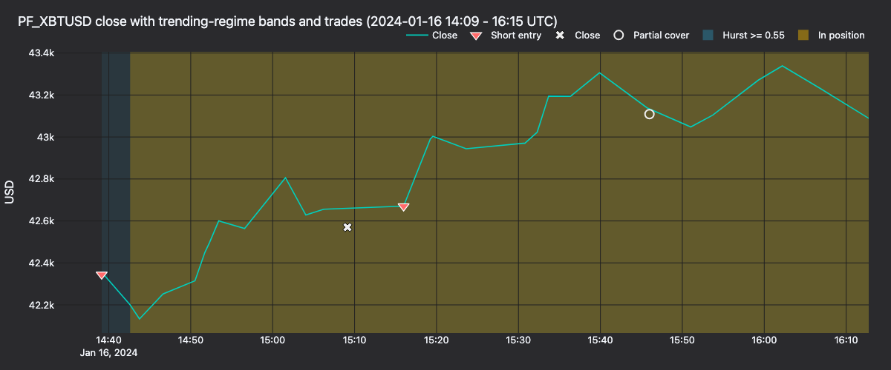

# Hurst/VPIN Directional Strategy (Kraken Futures)

:::note
This **Rust-only** tutorial uses a strategy, backtest setup, and tests from the compiled core.
:::

This tutorial backtests a directional strategy on **PF_XBTUSD**, the USD-margined Bitcoin perpetual on [Kraken
Futures](https://futures.kraken.com). The strategy combines a **Hurst-exponent regime filter** with a **VPIN**
(Volume-synchronized Probability of Informed Trading) flow signal. The Rust `BacktestEngine` replays
historical trades and quotes from [Tardis.dev](https://tardis.dev).

## Introduction

The strategy combines a slow regime filter from bars and a fast informed-flow signal from trades. Quote-driven
entry occurs only when both signals agree.

- **Hurst exponent**: Sampled on constant-notional (value)
  bars, following Lopez de Prado (*Advances in Financial Machine
  Learning*, Chapter 2). A rescaled-range (R/S) estimate greater than `0.55` indicates persistent, trending behavior.
  An estimate less than `0.50` indicates mean reversion or noise.

- **VPIN**: Each completed dollar bar is one volume bucket.
  VPIN is the average absolute imbalance between aggressive buy and aggressive sell volume over the last fifty buckets.
  The signed imbalance gives the net informed direction.

- **Quote-driven entry**: Once both signals agree, the strategy opens a
  position on the next quote tick. Entry timing stays tied to the live
  top of book rather than to bar closes.

The strategy closes the position when the Hurst estimate decreases through a lower threshold or the
holding-time cap is reached.

The strategy is shipped as
[`HurstVpinDirectional`](https://github.com/nautechsystems/nautilus_trader/tree/develop/crates/trading/src/examples/strategies/hurst_vpin_directional)
in the `nautilus_trading::examples::strategies` module. As with all
shipped example strategies, it is intentionally simple and has no alpha
advantage.

### Why Kraken Futures

Kraken Futures lists perpetuals on Bitcoin and Ether in two forms:

- **`PI_` inverse perpetuals**: quoted in USD, margined and settled in
  the underlying.
- **`PF_` linear perpetuals**: quoted in USD, margined and settled in
  USD (through multi-collateral).

The tutorial uses **`PF_XBTUSD`** so the account currency, quote
currency, and dollar-bar sampling frame are all USD.

### Why dollar bars and VPIN together

VPIN is defined on *volume* buckets rather than *time* buckets. Dollar bars (`VALUE` aggregation in
NautilusTrader) close after a fixed notional has traded, so the sampling frame adapts to market activity. Each
VPIN bucket is one dollar bar, and Hurst uses the same bars. Thus, both signals use the same clock and
sampling frame.

## Prerequisites

- A working Rust toolchain (see [rustup.rs](https://rustup.rs)).
- The NautilusTrader repository cloned and building.
- Internet access to download a free Tardis sample (no API key required
  for the first day of each month).

## Data preparation

Kraken Futures is published by Tardis under the historical slug `cryptofacilities`. The first day of each
month is free without an API key. This sample is sufficient for a single-day setup check. A full backtest
needs at least two sessions to fill the 128-bar Hurst window. Those historical ranges require a paid Tardis
API key (see the tip below).

```bash
mkdir -p /tmp/tardis_kraken

curl -L -o /tmp/tardis_kraken/PF_XBTUSD_trades.csv.gz \
  https://datasets.tardis.dev/v1/cryptofacilities/trades/2024/01/01/PF_XBTUSD.csv.gz

curl -L -o /tmp/tardis_kraken/PF_XBTUSD_quotes.csv.gz \
  https://datasets.tardis.dev/v1/cryptofacilities/quotes/2024/01/01/PF_XBTUSD.csv.gz
```

The runnable example binary reads from `/tmp/tardis_kraken/` by default. If you download into that directory,
`cargo run` works without changes to the example's path constants.

:::tip
Full historical ranges require a paid Tardis API key. Use the
[Tardis download utility](https://docs.tardis.dev/downloadable-csv-files)
for bulk downloads beyond single-day samples.
:::

The Rust Tardis loader parses `.csv.gz` directly and assigns the supplied instrument ID to each record. The
strategy therefore needs no symbology mapping:

```rust
use nautilus_model::identifiers::InstrumentId;
use nautilus_tardis::csv::load::{load_quotes, load_trades};

let instrument_id = InstrumentId::from("PF_XBTUSD.KRAKEN");
let trades = load_trades(
    "/tmp/tardis_kraken/PF_XBTUSD_trades.csv.gz",
    Some(1),               // price_precision
    Some(4),               // size_precision
    Some(instrument_id),
    None,                  // limit
)?;
let quotes = load_quotes(
    "/tmp/tardis_kraken/PF_XBTUSD_quotes.csv.gz",
    Some(1),
    Some(4),
    Some(instrument_id),
    None,
)?;
```

Pass the instrument's `price_precision` and `size_precision` explicitly. The loader otherwise infers precision
from the first few records. For a sample day without fractional prices, it can infer `0`. The matching engine
rejects a quote tick whose precision does not match the instrument's declared precision.

## Instrument definition

This tutorial loads CSV data directly, without the live Kraken adapter. It therefore defines `PF_XBTUSD`
manually as a
[`CryptoPerpetual`](https://github.com/nautechsystems/nautilus_trader/blob/develop/crates/model/src/instruments/crypto_perpetual.rs).
Linear perpetuals on Kraken Futures are quoted and margined in USD:

```rust
use nautilus_model::{
    identifiers::{InstrumentId, Symbol},
    instruments::CryptoPerpetual,
    types::{Currency, Price, Quantity},
};
use rust_decimal_macros::dec;

let instrument = CryptoPerpetual::builder()
    .instrument_id(InstrumentId::from("PF_XBTUSD.KRAKEN"))
    .raw_symbol(Symbol::from("PF_XBTUSD"))
    .base_currency(Currency::BTC())       // base
    .quote_currency(Currency::USD())      // quote
    .settlement_currency(Currency::USD()) // settlement (linear)
    .is_inverse(false)
    .price_precision(1)
    .size_precision(4)
    .price_increment(Price::from("0.5"))
    .size_increment(Quantity::from("0.0001"))
    .margin_init(dec!(0.02))
    .margin_maint(dec!(0.01))
    .ts_event(0.into())
    .ts_init(0.into())
    .build()
    .unwrap();
```

Margin and fee rates are explicit backtest assumptions. This example uses a
maker/taker fee model with 0.02% maker and 0.05% taker rates. Check the
[Kraken Futures fee schedule](https://futures.kraken.com/features/fee-schedule)
for current rates.

## Dollar-bar sampling

NautilusTrader ships all the information-driven bar aggregators from AFML Chapter 2: tick, volume, value
(dollar), plus imbalance and runs variants for each. This tutorial uses plain `VALUE` bars, which close after
a fixed notional has traded on the tape.

The bar type is expressed as a string. The `INTERNAL` suffix tells the
engine to aggregate inside NautilusTrader from the underlying trade
stream (price type `LAST`):

```rust
use nautilus_model::data::BarType;

let bar_type = BarType::from("PF_XBTUSD.KRAKEN-2000000-VALUE-LAST-INTERNAL");
```

Each bar closes after **USD 2,000,000** of traded notional. A session typically produces fewer than 150 bars
and can fall short of the 128-bar Hurst window. Thus, the default configuration needs multiple sessions for
warmup. For a single-day run, reduce the bar size to **USD 500,000** or reduce `hurst_window` and
`vpin_window` accordingly. For full multi-day backtests, use the defaults.

:::note
`VALUE` bars are a *view* onto the trade tape. The backtest engine
consumes the same stream that drives VPIN. The bars do not cause double counting.
:::

## Strategy overview

The `HurstVpinDirectional` strategy runs three concurrent pipelines that synchronize at bar close:

- Trades feed a bucket accumulator.
- Bar close triggers new signal calculations.
- Quotes drive entry and timeout checks.



- **Per trade**: The strategy accumulates aggressive buy and aggressive sell volume
  for the current dollar-bar bucket through `TradeTick::aggressor_side`.
- **Per bar** (bucket close): The strategy appends the bar's log return to the Hurst window.
  It calculates the bucket's signed and absolute imbalance, then resets the accumulators.
  It estimates rolling Hurst and VPIN again, clears `exit_cooldown`, and checks regime exit.
- **Per quote**: The Hurst and VPIN signals must agree before a flat strategy can open a market IOC order.
  Hurst must meet `hurst_enter`, VPIN must meet `vpin_threshold`, and signed imbalance must be nonzero.
  If a position is already open, it checks the holding-time cap.

Regime exit occurs in the bar pipeline when Hurst decreases to less than `hurst_exit`. Holding timeout occurs
in the quote pipeline when the position has been open longer than `max_holding_secs`.



**Figure 1.** *Signal dashboard for 2024-01-16 14:09-16:15 UTC: close, Hurst, VPIN. Markers show actual fill
price. The dotted connector shows slippage against the bar-close line.*

### Hurst estimator

The strategy uses classical rescaled-range (R/S) regression. For each lag `k` in `(4, 8, 16, 32)`, it divides
the return window into non-overlapping chunks of length `k`. It calculates each chunk's rescaled range and
records the mean R/S. The slope of `log(R/S)` against `log(k)` across the lag set gives the Hurst estimate.


**Figure 2.** *Rolling Hurst across 14 days of PF_XBTUSD (2024-01-15 to
2024-01-28) with enter 0.55 and exit 0.50 thresholds.*

### VPIN estimator

With explicit trade aggressor side available from the venue feed,
VPIN collapses to

```text
VPIN = mean_k ( |V_B_k - V_S_k| / (V_B_k + V_S_k) )
```

over the last `k` completed dollar-bar buckets. The signed variant retains the sign of `V_B - V_S` and is used
to choose direction. This is more accurate than the bulk-volume classification in the original Easley/Lopez de
Prado formulation. That classification was only necessary when aggressor side was not directly observable.


**Figure 3.** *VPIN distribution across all bars with the 0.30 entry threshold.*

### Configuration

| Parameter          | Value            | Description                                                       |
| ------------------ | ---------------- | ----------------------------------------------------------------- |
| `bar_type`         | `2M-VALUE-LAST`  | Dollar bars closing every USD 2,000,000 of notional.              |
| `trade_size`       | `0.0100`         | 0.0100 XBT per trade (matches instrument precision).              |
| `hurst_window`     | `128`            | Rolling window of dollar bar log returns.                         |
| `hurst_lags`       | `[4, 8, 16, 32]` | Lag set used in the R/S regression.                               |
| `hurst_enter`      | `0.55`           | Minimum Hurst value for a trending regime.                        |
| `hurst_exit`       | `0.50`           | Below this, open positions are flattened.                         |
| `vpin_window`      | `50`             | Completed volume buckets averaged for VPIN.                       |
| `vpin_threshold`   | `0.30`           | Minimum VPIN for flow to be considered informed.                  |
| `max_holding_secs` | `1800`           | Seconds a position may be held (default `3600`; overridden here). |

Set `hurst_window` and `vpin_window` to values in `[1, 16_384]`.

:::tip
Dollar-bar size, Hurst lags, and VPIN window are all coupled. Smaller
bars give faster reaction but noisier Hurst. Larger bars smooth both
signals but risk too few samples in a single-day backtest.
:::

## Backtest setup

Configure a `BacktestEngine` with a Kraken venue and a USD starting balance:

```rust
use nautilus_backtest::{
    config::{BacktestEngineConfig, SimulatedVenueConfig},
    engine::BacktestEngine,
};
use nautilus_execution::models::fee::{FeeModelAny, MakerTakerFeeModel};
use nautilus_model::{
    data::Data,
    enums::{AccountType, BookType, OmsType},
    identifiers::Venue,
    instruments::{Instrument, InstrumentAny},
    types::Money,
};

let mut engine = BacktestEngine::new(BacktestEngineConfig::default())?;

engine.add_venue(
    SimulatedVenueConfig::builder()
        .venue(Venue::from("KRAKEN"))
        .oms_type(OmsType::Netting)
        .account_type(AccountType::Margin)
        .book_type(BookType::L1_MBP)
        .starting_balances(vec![Money::from("100_000 USD")])
        .fee_model(
            FeeModelAny::MakerTaker(MakerTakerFeeModel::new(dec!(0.0002), dec!(0.0005))).into(),
        )
        .build()?,
)?;

engine.add_instrument(&InstrumentAny::CryptoPerpetual(instrument))?;
```

Feed the loaded trades and quotes as `Data` enum variants:

```rust
let mut data: Vec<Data> = trades.into_iter().map(Data::Trade).collect();
data.extend(quotes.into_iter().map(Data::Quote));
engine.add_data(data, None, true, true)?;
```

### Add the strategy

```rust
use nautilus_model::types::Quantity;
use nautilus_trading::examples::strategies::{
    HurstVpinDirectional, HurstVpinDirectionalConfig,
};

let config = HurstVpinDirectionalConfig::builder()
    .instrument_id(instrument_id)
    .bar_type(bar_type)
    .trade_size(Quantity::from("0.0100")) // match instrument size_precision
    .max_holding_secs(1800)
    .build();

engine.add_strategy(HurstVpinDirectional::new(config))?;
```

### Run the backtest

```rust
engine.run(None, None, None, false)?;
```

With the default 128/50 windows and USD 2,000,000 bars, a single-day sample stays in warmup for the whole run.
The engine aggregates dollar bars and drives the strategy on individual trades and quotes. Hurst and VPIN do
not emit until the windows are full. For signal updates and entries or exits on a single day, reduce the bar
size or windows as described above. Alternatively, provide two or more sessions of data.

A 14-day run (2024-01-15 to 2024-01-28) on this configuration prints 1,224 bars and produces only 2 entries, 1
partial cover, and 1 close. Entries are sparse by design: Hurst and VPIN must meet their respective thresholds
on the same quote. The remaining size after the partial IOC cover stays open through the rest of the session.
A Netting OMS leaves this residual position when an exit IOC only fills part of the position.

The wiring above is shipped as a runnable binary:

```bash
cargo run -p nautilus-kraken --features examples \
  --example kraken-hurst-vpin-backtest --release
```

By default it reads `PF_XBTUSD_trades.csv.gz` and `PF_XBTUSD_quotes.csv.gz`
from `/tmp/tardis_kraken/`. To read other files, edit the `TRADES_PATH` and
`QUOTES_PATH` constants in `crates/adapters/kraken/examples/engine_hurst_vpin_backtest.rs`.



**Figure 4.** *Close price for 2024-01-16 14:09-16:15 UTC. Teal bands mark `Hurst >= 0.55` bars. Gold bands
mark periods with an open position. Markers sit at actual fill price; dotted connector shows slip against the
bar-close line.*


**Figure 5.** *Per-bar Hurst vs. VPIN across the backtest, colored by signed
VPIN. Shaded quadrant marks the entry-eligible region.*

### Regenerate the panels

The backtest strategy logs `Hurst=… VPIN=… signed=… bar_close=…` on every bar close. It also logs standard
`OrderFilled` events on entries and exits. These logs make the panels above fully reproducible from the run's
stdout.

After building NautilusTrader from source, run these commands from the repository root:

```bash
make sync

RUST_LOG=info cargo run -p nautilus-kraken --features examples \
    --example kraken-hurst-vpin-backtest --release > /tmp/backtest.log 2>&1

BACKTEST_LOG=/tmp/backtest.log \
    uv run --project python --no-sync \
        python docs/tutorials/assets/hurst_vpin_kraken/render_panels.py
```

The renderer uses the shared `nautilus_dark` tearsheet theme and writes static PNGs through Plotly's Kaleido
exporter.

## Next steps

- **Sampling frame**: Try larger or smaller dollar-bar
  thresholds. The `VALUE_IMBALANCE` and `VALUE_RUNS` aggregators
  produce bars that close on information arrival. These are alternatives to constant-dollar sampling.
- **Thresholds**: `hurst_enter`, `hurst_exit`, and
  `vpin_threshold` all interact: a higher enter threshold makes signals
  rarer but more specific. A tighter exit shortens average holding
  time.
- **Volatility gate**: Add a realized-volatility estimator
  on the same bars to suppress entries during clearly chaotic
  sessions.
- **Live trading**: Once the backtest behaves, drive the
  same strategy through the Kraken live client factories. A runnable live
  wiring ships as `kraken-hurst-vpin-live`.

The example trades **Kraken Futures production with real funds** by default: both clients use the default
`KrakenEnvironment::Live`, and it reads `KRAKEN_FUTURES_API_KEY` and `KRAKEN_FUTURES_API_SECRET`. To paper
trade on [demo-futures.kraken.com](https://demo-futures.kraken.com) instead, first edit
`crates/adapters/kraken/examples/node_hurst_vpin_live.rs`:

  1. Pass `true` as the `demo` argument to `KrakenCredential::resolve_futures`.
  1. Set `environment: KrakenEnvironment::Demo` (from `nautilus_kraken::common::enums`) on both
     `KrakenDataClientConfig` and `KrakenExecutionClientConfig`.

The example then reads `KRAKEN_FUTURES_DEMO_API_KEY` and `KRAKEN_FUTURES_DEMO_API_SECRET`.

  ```bash
  cargo run -p nautilus-kraken --features examples \
    --example kraken-hurst-vpin-live
  ```

## Further reading

- [`HurstVpinDirectional` strategy source](https://github.com/nautechsystems/nautilus_trader/tree/develop/crates/trading/src/examples/strategies/hurst_vpin_directional)
- [Data concepts: bar types and aggregation](../concepts/data/index.md#bars-and-aggregation)
- [Tardis integration guide](../integrations/tardis.md)
- [Kraken integration guide](../integrations/kraken.md)
- [Kraken Futures documentation](https://docs.kraken.com/api/docs/futures-api)
- Lopez de Prado, M. (2018). *Advances in Financial Machine Learning*,
  Wiley. Chapter 2 (information-driven bars) and Chapter 19 (VPIN).
